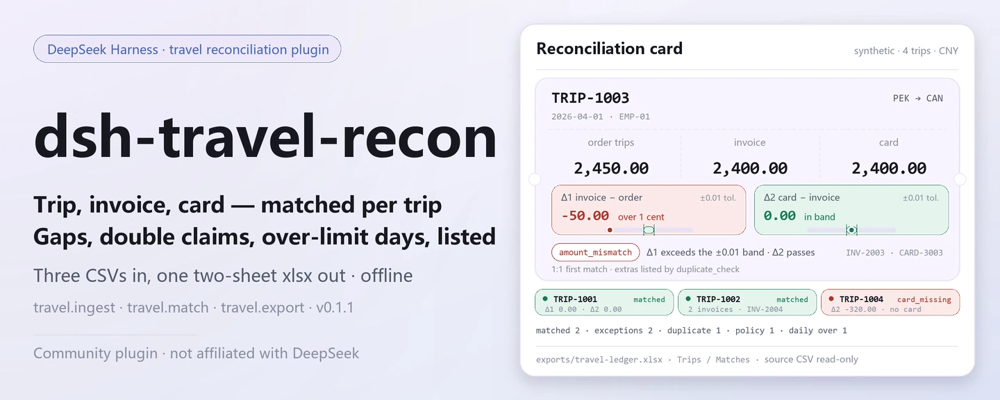
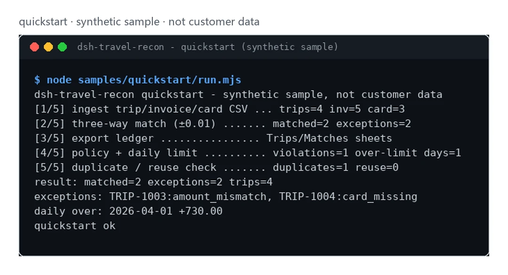

<div align="center">

<picture>
  <source media="(prefers-color-scheme: dark)" srcset="docs/assets/dsh-travel-recon-hero-en-dark.webp">
  
</picture>

# dsh-travel-recon

**Line up travel orders, invoices and card transactions in one pass — mismatches, duplicate claims and over-limit days, listed plainly.**

A local reconciliation plugin: three CSVs in, a two-sheet xlsx ledger out — no model call, no network, no upload.

[Install](#three-step-setup) · [Configuration](#configuration) · [FAQ](#faq) · [简体中文](README.md) · [English](README.en.md) · [Español](README.es.md) · [Português](README.pt.md) · [हिन्दी](README.hi.md)

[](LICENSE)
[](#compatibility)
[](https://www.npmjs.com/package/dsh-travel-recon)
[](https://github.com/PerryLink/dsh-travel-recon/actions/workflows/ci.yml)
[](#compatibility)

[](https://github.com/PerryLink/dsh-travel-recon/stargazers)
[](https://www.npmjs.com/package/dsh-travel-recon)
[](https://dshfind.com/plugins/PerryLink/dsh-travel-recon?ref=badge)
[](https://dsh.market/)

```sh
dsh plugin --profile <profile> add dsh-travel-recon
```

</div>

<sub>Community plugin, not affiliated with DeepSeek. Canonical repository: <https://github.com/PerryLink/dsh-travel-recon> (same-name repositories under other accounts are not this project). Apache-2.0.</sub>

## What it is

`dsh-travel-recon` reconciles three CSVs — travel orders, invoices and card transactions — row by row: it ingests and dedupes them, runs a ±1-cent three-way match keyed on `trip_id`, then lists duplicate claims, amount mismatches, missing invoices and daily over-limit days, and finally exports an xlsx ledger you can page through. Everything runs on your own machine: no model call, no network, no upload, and the source CSVs are never modified.

- **Good fit**: tens to hundreds of trips, invoices and card rows; you want a per-trip reconciliation, duplicate-claim flags and a local daily-limit ledger.
- **Bad fit**: scenarios that need automatic approval, payment or edits to expense forms; this package only does read-only checks and local export — it does not approve anything for you.

<picture>
  <source media="(prefers-color-scheme: dark)" srcset="docs/assets/dsh-travel-recon-flow-v5-dark.svg">
  
</picture>

## Three-step setup

1. **Install** (pick one; npm is the recommended channel, the rest are for pinning or offline):

   ```sh
   # npm (recommended, 0.1.1 published)
   dsh plugin --profile <profile> add dsh-travel-recon
   # git channel (latest main; equivalent to git+https://github.com/PerryLink/dsh-travel-recon.git)
   dsh plugin --profile <profile> add github:PerryLink/dsh-travel-recon
   # tarball channel: pnpm pack in this repo, then
   dsh plugin --profile <profile> add ./dsh-travel-recon-<version>.tgz
   # 1024 store channel
   npm i -g dsh1024 && dsh1024 plugin --profile <profile> add dsh-travel-recon
   ```

2. **No configuration**: `cordis.patch.yml` only inserts one row — `id: dsh-travel-recon` / `name: 'dsh-travel-recon'` — and the plugin has no Config fields, so the seven tools are registered once installed. The data directory defaults to `$DSH_HOME/storages/dsh-travel-recon`; set `DSH_TRAVEL_HOME` to point elsewhere.

3. **Verify it mounts**:

   ```sh
   dsh --profile <profile> --dump-config | grep dsh-travel-recon
   ```

   A line containing `dsh-travel-recon` means it is mounted. Then run the shipped synthetic sample (build first in a dev tree; the published package already ships `lib/`):

   ```sh
   node samples/quickstart/run.mjs
   ```

   The last line is `quickstart ok`.

**Uninstall**: `dsh plugin --profile <profile> remove dsh-travel-recon` (or remove the row from the profile patch).

## Core capabilities

- **Three-way match (±1 cent)** — `travel.match` joins orders, invoices and card rows on `trip_id` with a 0.01 tolerance; exceptions come back per trip as `invoice_missing`, `card_missing` or `amount_mismatch`, with both deltas.
- **Dedupe without silence** — duplicate `trip_id`s are kept and reported as issues (`E_TRAVEL_TRIP_DUPLICATE`); each id is stored once and the rest count as `skipped`. Duplicate invoices and card rows are listed separately by `travel.duplicate_check`.
- **Cross-trip double claims** — `travel.reuse_check` reports an invoice id or a card transaction id that appears under more than one trip before ingest; it needs no stored data.
- **Read-only policy checks** — `travel.policy_check` (per-trip cap + invoice presence) and `travel.daily_limit_check` (per-employee per-day cap) return violation lists only: no edits, no approval, no payment.
- **Two-sheet ledger export** — `travel.export` writes `exports/travel-ledger.xlsx` with `Trips` / `Matches` sheets; the path passes an escape guard before anything is written.
- **Local first** — no HTTP, DNS or WebSocket calls in the source and no model calls; input and output stay on the machine.

### Tool surface

Tool names are a stable API (`travel.*`); runtime descriptions are English, matching the tool output.

| Tool | Purpose | Risk |
|---|---|---|
| `travel.ingest` | Ingest travel order/invoice/card rows | R1 local write |
| `travel.match` | Three-way match order/invoice/card (writes match state) | R1 local write |
| `travel.duplicate_check` | Detect duplicate invoice/card per trip | R0 |
| `travel.policy_check` | Read-only max-amount and invoice-presence policy check | R0 |
| `travel.reuse_check` | Read-only cross-trip invoice/card reuse check | R0 |
| `travel.daily_limit_check` | Read-only per-employee daily cap check | R0 |
| `travel.export` | Export the reconciliation ledger xlsx (`Trips` / `Matches`) | R1 local write |

### Input

- Trip CSV: UTF-8 with header `trip_id,employee,origin,destination,date,amount`.
- Invoice CSV: `invoice_id,trip_id,amount`; card CSV: `txn_id,trip_id,amount`.
- Amounts take at most two decimals; keep each file at or below 5 MB. The shipped sample lives in `samples/quickstart/input/` (synthetic, far below 500 KB).
- The three CSVs are passed as **text content** tool arguments (the session reads the file and passes it in); the plugin never resolves paths on its own.

### Output

- Terminal summary: how many trips matched, how many are exceptions, policy violations and over-limit days.
- Ledger: `$DSH_HOME/storages/dsh-travel-recon/exports/travel-ledger.xlsx`, sheets `Trips` / `Matches`.
- The original files are never modified.

### Example

Paste this sentence into the session:

> Help me check this trip's orders, invoices and card transactions with the shipped sample, and list the mismatched documents and over-limit days.

Or run it yourself (a real run — the capture below comes from this command):

```sh
node samples/quickstart/run.mjs
```

```text
dsh-travel-recon quickstart - synthetic sample, not customer data
[1/5] ingest trip/invoice/card CSV ... trips=4 inv=5 card=3
[2/5] three-way match (±0.01) ....... matched=2 exceptions=2
[3/5] export ledger ................ Trips/Matches sheets
[4/5] policy + daily limit .......... violations=1 over-limit days=1
[5/5] duplicate / reuse check ....... duplicates=1 reuse=0
result: matched=2 exceptions=2 trips=4
exceptions: TRIP-1003:amount_mismatch, TRIP-1004:card_missing
daily over: 2026-04-01 +730.00
quickstart ok
```

*Observed from `samples/quickstart/run.mjs` and the gold `samples/quickstart/expected/result.json` (input hashes live in result.json; synthetic data, not a customer run).*

<picture>
  <source media="(prefers-color-scheme: dark)" srcset="docs/assets/dsh-travel-recon-quickstart-dark.webp">
  
</picture>

*Synthetic sample → gold `samples/quickstart/expected/result.json`; command and hashes in `screenshots.json`.*

## Acceptance data

`ACCEPTANCE.csv` records the public synthetic checks row by row (script `scripts/acceptance.mjs`, `evidence_sha256`, `counted` flag); re-run with `node scripts/acceptance.mjs`:

| req_id | metric | threshold | actual | pass | source | counted |
|---|---|---|---|---|---|---|
| SKU-15-A01 | itinerary parsing | 20/20 | 20 | true | public/synthetic | false |
| SKU-15-A02 | three-way match | 20/20 | 20 | true | public/synthetic | false |
| SKU-15-A03 | duplicate trips | 0 | 0 | true | public/synthetic | false |
| SKU-15-A04 | ledger sheets | 2 | 2 | true | public/synthetic | false |
| SKU-15-A05 | duplicate invoice detection | 1 | 1 | true | public/synthetic | false |
| SKU-15-A06 | cross-trip double claim | 1 | 1 | true | public/synthetic | false |
| SKU-15-A07 | daily-limit overage | 1 | 1 | true | public/synthetic | false |
| PS1-QS01 | quickstart sample matches gold | 1/1 | 1 | true | synthetic/quickstart | true |

*Metric labels are translated here; `ACCEPTANCE.csv` is canonical. SKU rows are synthetic checks (`counted=false`, no customer evidence); PS1-QS01 is a local reproduction of the shipped sample (`counted=true`). `EVIDENCE.md`: 0 real trips, 20 synthetic trips/invoices/card rows, 4 rows pass, not counted, partial.*

## Configuration

This plugin has **no Config fields**: `cordis.patch.yml` carries only `id` / `name`, so it works once installed. What you can tune is the data directory (environment variable) and the tool arguments passed on each call.

| Environment variable | Default | Meaning |
|---|---|---|
| `DSH_TRAVEL_HOME` | empty | Overrides the data root; when empty the next row applies |
| `DSH_HOME` | process cwd | Without `DSH_TRAVEL_HOME`, the data root is `$DSH_HOME/storages/dsh-travel-recon` |

Most-used call arguments (money is always an integer number of cents):

| Argument | Tool | Default | Meaning |
|---|---|---|---|
| `trips_csv` | `travel.ingest` | required | Trip CSV text |
| `invoices_csv` | `travel.ingest` / `travel.reuse_check` | required | Invoice CSV text |
| `cards_csv` | `travel.ingest` / `travel.reuse_check` | required | Card CSV text |
| `max_order_cents` | `travel.policy_check` | required | Per-trip amount cap (cents) |
| `require_invoice` | `travel.policy_check` | `false` | Require an invoice for every trip |
| `cap_cents` | `travel.daily_limit_check` | required | Per-employee per-day cap (cents) |

<details>
<summary>Full tool and output surface (7 tools)</summary>

| Tool | Arguments | Returns | Risk |
|---|---|---|---|
| `travel.ingest` | `trips_csv`, `invoices_csv`, `cards_csv` (strings, all required) | `trips` / `invoices` / `cards` / `skipped` / `duplicate_trips`, plus `issues[]` (`code`, `trip_id`, `occurrences`) | R1 local write |
| `travel.match` | none | `matched` / `exceptions` / `duplicate_trips`; each match record carries `state`, `reason` and both deltas | R1 local write (match state) |
| `travel.duplicate_check` | none | `duplicates[]` (`kind`, `trip_id`, `count`) | R0 |
| `travel.policy_check` | `max_order_cents` (number, required), `require_invoice` (boolean, optional) | `checked` / `violations[]` (`trip_id`, `reason`) | R0 |
| `travel.reuse_check` | `invoices_csv`, `cards_csv` (strings, both required) | `invoice_reuse[]` / `card_reuse[]` (`id`, `trips[]`) | R0 |
| `travel.daily_limit_check` | `cap_cents` (number, required) | `days` / `over_limit[]` (`employee`, `date`, `total_cents`, `over_by_cents`) | R0 |
| `travel.export` | none | `path` / `rows`; the two-sheet xlsx lands in `exports/` under the data directory | R1 local write |

</details>

Point the data directory elsewhere (environment only — nothing goes into the patch):

```sh
export DSH_TRAVEL_HOME="$HOME/.local/share/dsh-travel-recon"
```

## FAQ

<details>
<summary>Installation or activation fails — what now?</summary>

Check DSH `>=0.2.1-rc.3 <0.4.0` and Node `>=24.9 <25`, then retry with a fresh `DSH_HOME` to rule out stale config:

```sh
export DSH_HOME="$(mktemp -d)"
dsh plugin --profile <profile> add dsh-travel-recon
dsh --profile <profile> --dump-config | grep dsh-travel-recon
```

The full troubleshooting guide (unreadable amounts, missing columns, missing `trip_id`) is in [`TROUBLESHOOTING.md`](TROUBLESHOOTING.md).

</details>

<details>
<summary>Where does the data live? Is anything uploaded?</summary>

No network, no upload. Match state lives in the DSH storage domain (`$DSH_HOME/storages/dsh-travel-recon`) and the ledger is written to `exports/travel-ledger.xlsx` under the same directory; the source CSVs are read-only. The plugin writes nowhere else and calls no model.

</details>

<details>
<summary>Why does a trip show `card_missing`?</summary>

That trip has no card row with the same `trip_id`, or the amount differs by more than 0.01; add the card row, or confirm it was paid personally. The other reasons are `invoice_missing` (no invoice) and `amount_mismatch` (amounts differ — both deltas are returned).

</details>

<details>
<summary>Do the policy checks edit documents or approve anything?</summary>

No. `travel.policy_check` / `travel.daily_limit_check` / `travel.duplicate_check` / `travel.reuse_check` are all read-only and only return violation lists; approval and payment stay with you, and this package ships no approval or edit capability.

</details>

<details>
<summary>Can I run my real travel data through it?</summary>

You can run it locally, but this package is alpha and has only been validated on synthetic data; its output is not an audit conclusion. Desensitize real data first and review the result yourself. The repository neither accepts nor stores customer data.

</details>

## Security boundaries

- **Read-only input**: only the CSV text passed by the session is parsed; source files are never modified or deleted.
- **Controlled writes**: only the data directory (match state + `exports/*.xlsx`); the export path passes `safeExportPath`, and an escaping or invalid path fails closed (`E_TRAVEL_PATH_INVALID` / `E_TRAVEL_PATH_NOT_ALLOWED`) instead of writing outside the root.
- **No network, no model**: no HTTP, DNS or WebSocket calls in the source, and tool execution makes no model requests.
- **No approval action**: the four check tools only return lists — no edits, no approval, no payment.
- **No silent data loss**: duplicate `trip_id`s are kept and reported as issues; bad CSV headers or amounts fail with a plain-language message, an `E_XXX` code and a next-step hint instead of guessing or skipping.

## Known limitations

- **Public/synthetic only**: `EVIDENCE.md` records 0 real trips and 20 synthetic trips/invoices/card rows; the repository contains no customer data and makes no customer-run claim.
- **alpha / partial / not counted / not GA**: no production-readiness claim; the tool surface may change between versions.
- **Fixed CSV shape**: headers must use the column names above (case-insensitive) and amounts take at most two decimals; keep each file at or below 5 MB.
- **1:1 match per trip**: each trip contributes one invoice and one card row to the three-way match; extra rows for the same trip are reported by `travel.duplicate_check` and are never merged automatically.
- **It does not approve for you**: every check is read-only; there is no approval, payment, document editing or integration with expense/travel platforms.
- **Exact per-tool boundaries** are in the tool table above and in `ACCEPTANCE.csv`; unless a tool says otherwise, no model call and no network.

## Compatibility

| Surface | Status |
|---|---|
| Harness | `dsh >=0.2.1-rc.3 <0.4.0` (from `package.json` `engines.dsh`) |
| Node | `>=24.9.0 <25` |
| Platforms | All; local files only |
| Data | No network, no model call, no upload |

## Ecosystem & quality

- [dshfind plugin page](https://dshfind.com/plugins/PerryLink/dsh-travel-recon) (installs and ranking)
- [DSH Market](https://dsh.market/) (listed)
- **1024 store channel**: `npm i -g dsh1024` once, then `dsh1024 plugin --profile <profile> add dsh-travel-recon` (counts toward the [deepseek1024.com](https://deepseek1024.com) install ranking)
- [Domain index](https://perrylink.github.io/dsh-plugins/) · [Checker family](https://perrylink.github.io/zh/checkers/) · [Mainline family dsh-kit](https://github.com/PerryLink/dsh-kit) · [Scenario article](https://perrylink.github.io/dsh-plugins/articles/finops-suite.html)
- [Ecosystem knowledge base](https://perrylink.github.io/dsh-plugin-guide/): plugin development guide · plugin-selection data · maintenance criteria
- [Troubleshooting](TROUBLESHOOTING.md) · [Privacy](PRIVACY.md) · [Security policy](SECURITY.md)

Sibling packages and family indexes: [dsh-einvoice](https://github.com/PerryLink/dsh-einvoice) · [dsh-bankrec](https://github.com/PerryLink/dsh-bankrec) · [dsh-ap-three-way](https://github.com/PerryLink/dsh-ap-three-way) · [dsh-finops-suite](https://github.com/PerryLink/dsh-finops-suite)

Related checkers (separate packages with their own version; install only what you need):

| Package | Why it is relevant |
|---|---|
| [`dsh-invoice-ledger`](https://github.com/PerryLink/dsh-invoice-ledger) | Invoice anomalies for the same trip. |
| [`dsh-excel-reconcile`](https://github.com/PerryLink/dsh-excel-reconcile) | Card/ledger alignment outside the built-in order/invoice/card match. |

## Development

```sh
pnpm install --frozen-lockfile
pnpm build && pnpm lint && pnpm typecheck && pnpm test
node samples/quickstart/run.mjs          # synthetic sample: should print quickstart ok
node scripts/acceptance.mjs              # acceptance: details in ACCEPTANCE.csv
pnpm pack                                # the published tarball
```

Layout:

```text
src/core/               CSV parsing, cents conversion, three-way match, path guard (pure functions)
src/plugin/             Cordis entry, storage-domain tables, the 7 tool definitions
samples/quickstart/     synthetic input + gold result.json + runner
test/*.test.mjs         node --test (11 test files)
scripts/                acceptance, pack checks, lint, SBOM
docs/assets/            README images
cordis.patch.yml        bundle patch (inserts only this plugin's row)
```

Current version `0.1.1` (matches `package.json`); `node --test test/*.test.mjs` is green (25 cases, 0 failures). README images are generated by [`scripts/gen-readme-assets.py`](scripts/gen-readme-assets.py) (Python + Pillow) and can be re-run:

```sh
python scripts/gen-readme-assets.py
```

It writes `dsh-travel-recon-hero-{zh,en}-{light,dark}.webp` (1440×576 banners) and `dsh-travel-recon-flow-v5-{light,dark}.svg` (1100×660 structure diagrams), and frames the real quickstart capture as `dsh-travel-recon-quickstart-{light,dark}.webp`.

## Family & thanks

This project is part of the DeepSeek Harness plugin family maintained by [PerryLink](https://github.com/PerryLink) (all Apache-2.0). If it is useful, **a star helps the next person find it** — nothing is gated behind it.

- [@PerryLink](https://github.com/PerryLink) — maintainer: three-way match, read-only policy checks, the 7-tool surface, the synthetic quickstart sample and the five-language docs.

<details>
<summary>Expand the DSH domain plugin family (15 packages + 2 suites)</summary>

| Package | npm |
|---|---|
| **[dsh-einvoice](https://github.com/PerryLink/dsh-einvoice)** | [npm](https://www.npmjs.com/package/dsh-einvoice) |
| **[dsh-docx-redline](https://github.com/PerryLink/dsh-docx-redline)** | [npm](https://www.npmjs.com/package/dsh-docx-redline) |
| **[dsh-policy-ledger](https://github.com/PerryLink/dsh-policy-ledger)** | [npm](https://www.npmjs.com/package/dsh-policy-ledger) |
| **[dsh-ghg](https://github.com/PerryLink/dsh-ghg)** | [npm](https://www.npmjs.com/package/dsh-ghg) |
| **[dsh-bankrec](https://github.com/PerryLink/dsh-bankrec)** | [npm](https://www.npmjs.com/package/dsh-bankrec) |
| **[dsh-ap-three-way](https://github.com/PerryLink/dsh-ap-three-way)** | [npm](https://www.npmjs.com/package/dsh-ap-three-way) |
| **[dsh-ifc-qto](https://github.com/PerryLink/dsh-ifc-qto)** | [npm](https://www.npmjs.com/package/dsh-ifc-qto) |
| **[dsh-qms-capa](https://github.com/PerryLink/dsh-qms-capa)** | [npm](https://www.npmjs.com/package/dsh-qms-capa) |
| **[dsh-legal-intake](https://github.com/PerryLink/dsh-legal-intake)** | [npm](https://www.npmjs.com/package/dsh-legal-intake) |
| **[dsh-legal-clause](https://github.com/PerryLink/dsh-legal-clause)** | [npm](https://www.npmjs.com/package/dsh-legal-clause) |
| **[dsh-freight-audit](https://github.com/PerryLink/dsh-freight-audit)** | [npm](https://www.npmjs.com/package/dsh-freight-audit) |
| **[dsh-hs-candidate](https://github.com/PerryLink/dsh-hs-candidate)** | [npm](https://www.npmjs.com/package/dsh-hs-candidate) |
| **[dsh-travel-recon](https://github.com/PerryLink/dsh-travel-recon)** | [npm](https://www.npmjs.com/package/dsh-travel-recon) |
| **[dsh-pim-lint](https://github.com/PerryLink/dsh-pim-lint)** | [npm](https://www.npmjs.com/package/dsh-pim-lint) |
| **[dsh-eval-pack](https://github.com/PerryLink/dsh-eval-pack)** | [npm](https://www.npmjs.com/package/dsh-eval-pack) |
| **[dsh-finops-suite](https://github.com/PerryLink/dsh-finops-suite)** | [npm](https://www.npmjs.com/package/dsh-finops-suite) |
| **[dsh-contract-suite](https://github.com/PerryLink/dsh-contract-suite)** | [npm](https://www.npmjs.com/package/dsh-contract-suite) |

</details>

<details>
<summary>Expand the mainline family — 87 current install specs</summary>

| Package | npm |
|---|---|
| **[dsh-aqua-input-check](https://github.com/PerryLink/dsh-aqua-input-check)** | [npm](https://www.npmjs.com/package/dsh-aqua-input-check) |
| **[dsh-archive-check](https://github.com/PerryLink/dsh-archive-check)** | [npm](https://www.npmjs.com/package/dsh-archive-check) |
| **[dsh-bid-ca-precheck](https://github.com/PerryLink/dsh-bid-ca-precheck)** | [npm](https://www.npmjs.com/package/dsh-bid-ca-precheck) |
| **[dsh-bid-qual-check](https://github.com/PerryLink/dsh-bid-qual-check)** | [npm](https://www.npmjs.com/package/dsh-bid-qual-check) |
| **[dsh-contract-stance](https://github.com/PerryLink/dsh-contract-stance)** | [npm](https://www.npmjs.com/package/dsh-contract-stance) |
| **[dsh-customs-doc-check](https://github.com/PerryLink/dsh-customs-doc-check)** | [npm](https://www.npmjs.com/package/dsh-customs-doc-check) |
| **[dsh-demurrage-ledger](https://github.com/PerryLink/dsh-demurrage-ledger)** | [npm](https://www.npmjs.com/package/dsh-demurrage-ledger) |
| **[dsh-drill-script-check](https://github.com/PerryLink/dsh-drill-script-check)** | [npm](https://www.npmjs.com/package/dsh-drill-script-check) |
| **[dsh-eia-guide-check](https://github.com/PerryLink/dsh-eia-guide-check)** | [npm](https://www.npmjs.com/package/dsh-eia-guide-check) |
| **[dsh-emergency-plan](https://github.com/PerryLink/dsh-emergency-plan)** | [npm](https://www.npmjs.com/package/dsh-emergency-plan) |
| **[dsh-essay-rubric-check](https://github.com/PerryLink/dsh-essay-rubric-check)** | [npm](https://www.npmjs.com/package/dsh-essay-rubric-check) |
| **[dsh-evidence-check](https://github.com/PerryLink/dsh-evidence-check)** | [npm](https://www.npmjs.com/package/dsh-evidence-check) |
| **[dsh-export-ctl-check](https://github.com/PerryLink/dsh-export-ctl-check)** | [npm](https://www.npmjs.com/package/dsh-export-ctl-check) |
| **[dsh-fmea-table-check](https://github.com/PerryLink/dsh-fmea-table-check)** | [npm](https://www.npmjs.com/package/dsh-fmea-table-check) |
| **[dsh-forecast-penalty](https://github.com/PerryLink/dsh-forecast-penalty)** | [npm](https://www.npmjs.com/package/dsh-forecast-penalty) |
| **[dsh-gongwen-flow-check](https://github.com/PerryLink/dsh-gongwen-flow-check)** | [npm](https://www.npmjs.com/package/dsh-gongwen-flow-check) |
| **[dsh-gongwen-word-check](https://github.com/PerryLink/dsh-gongwen-word-check)** | [npm](https://www.npmjs.com/package/dsh-gongwen-word-check) |
| **[dsh-guard-plan-qc](https://github.com/PerryLink/dsh-guard-plan-qc)** | [npm](https://www.npmjs.com/package/dsh-guard-plan-qc) |
| **[dsh-hazchem-check](https://github.com/PerryLink/dsh-hazchem-check)** | [npm](https://www.npmjs.com/package/dsh-hazchem-check) |
| **[dsh-hazplan-check](https://github.com/PerryLink/dsh-hazplan-check)** | [npm](https://www.npmjs.com/package/dsh-hazplan-check) |
| **[dsh-hidden-risk-map](https://github.com/PerryLink/dsh-hidden-risk-map)** | [npm](https://www.npmjs.com/package/dsh-hidden-risk-map) |
| **[dsh-hs-classify](https://github.com/PerryLink/dsh-hs-classify)** | [npm](https://www.npmjs.com/package/dsh-hs-classify) |
| **[dsh-icd-rule-check](https://github.com/PerryLink/dsh-icd-rule-check)** | [npm](https://www.npmjs.com/package/dsh-icd-rule-check) |
| **[dsh-lawcite-adapter](https://github.com/PerryLink/dsh-lawcite-adapter)** | [npm](https://www.npmjs.com/package/dsh-lawcite-adapter) |
| **[dsh-lc-doc-check](https://github.com/PerryLink/dsh-lc-doc-check)** | [npm](https://www.npmjs.com/package/dsh-lc-doc-check) |
| **[dsh-learning-gap-check](https://github.com/PerryLink/dsh-learning-gap-check)** | [npm](https://www.npmjs.com/package/dsh-learning-gap-check) |
| **[dsh-medrec-qc](https://github.com/PerryLink/dsh-medrec-qc)** | [npm](https://www.npmjs.com/package/dsh-medrec-qc) |
| **[dsh-nsfc-form-check](https://github.com/PerryLink/dsh-nsfc-form-check)** | [npm](https://www.npmjs.com/package/dsh-nsfc-form-check) |
| **[dsh-nurse-record-check](https://github.com/PerryLink/dsh-nurse-record-check)** | [npm](https://www.npmjs.com/package/dsh-nurse-record-check) |
| **[dsh-origin-rvc-check](https://github.com/PerryLink/dsh-origin-rvc-check)** | [npm](https://www.npmjs.com/package/dsh-origin-rvc-check) |
| **[dsh-ota-review-check](https://github.com/PerryLink/dsh-ota-review-check)** | [npm](https://www.npmjs.com/package/dsh-ota-review-check) |
| **[dsh-paper-doc-adapter](https://github.com/PerryLink/dsh-paper-doc-adapter)** | [npm](https://www.npmjs.com/package/dsh-paper-doc-adapter) |
| **[dsh-permit-report-check](https://github.com/PerryLink/dsh-permit-report-check)** | [npm](https://www.npmjs.com/package/dsh-permit-report-check) |
| **[dsh-pipeline-check](https://github.com/PerryLink/dsh-pipeline-check)** | [npm](https://www.npmjs.com/package/dsh-pipeline-check) |
| **[dsh-pleading-draft](https://github.com/PerryLink/dsh-pleading-draft)** | [npm](https://www.npmjs.com/package/dsh-pleading-draft) |
| **[dsh-policy-brief-draft](https://github.com/PerryLink/dsh-policy-brief-draft)** | [npm](https://www.npmjs.com/package/dsh-policy-brief-draft) |
| **[dsh-power-loss-split](https://github.com/PerryLink/dsh-power-loss-split)** | [npm](https://www.npmjs.com/package/dsh-power-loss-split) |
| **[dsh-power-ticket-check](https://github.com/PerryLink/dsh-power-ticket-check)** | [npm](https://www.npmjs.com/package/dsh-power-ticket-check) |
| **[dsh-ppap-check](https://github.com/PerryLink/dsh-ppap-check)** | [npm](https://www.npmjs.com/package/dsh-ppap-check) |
| **[dsh-protest-deadline](https://github.com/PerryLink/dsh-protest-deadline)** | [npm](https://www.npmjs.com/package/dsh-protest-deadline) |
| **[dsh-railway-window](https://github.com/PerryLink/dsh-railway-window)** | [npm](https://www.npmjs.com/package/dsh-railway-window) |
| **[dsh-repair-order-qc](https://github.com/PerryLink/dsh-repair-order-qc)** | [npm](https://www.npmjs.com/package/dsh-repair-order-qc) |
| **[dsh-review-reply-check](https://github.com/PerryLink/dsh-review-reply-check)** | [npm](https://www.npmjs.com/package/dsh-review-reply-check) |
| **[dsh-rulefile-check](https://github.com/PerryLink/dsh-rulefile-check)** | [npm](https://www.npmjs.com/package/dsh-rulefile-check) |
| **[dsh-safety-brief-check](https://github.com/PerryLink/dsh-safety-brief-check)** | [npm](https://www.npmjs.com/package/dsh-safety-brief-check) |
| **[dsh-site-log-check](https://github.com/PerryLink/dsh-site-log-check)** | [npm](https://www.npmjs.com/package/dsh-site-log-check) |
| **[dsh-soe-decision-check](https://github.com/PerryLink/dsh-soe-decision-check)** | [npm](https://www.npmjs.com/package/dsh-soe-decision-check) |
| **[dsh-soilwater-check](https://github.com/PerryLink/dsh-soilwater-check)** | [npm](https://www.npmjs.com/package/dsh-soilwater-check) |
| **[dsh-sop-sync-check](https://github.com/PerryLink/dsh-sop-sync-check)** | [npm](https://www.npmjs.com/package/dsh-sop-sync-check) |
| **[dsh-spc-gbt-adapter](https://github.com/PerryLink/dsh-spc-gbt-adapter)** | [npm](https://www.npmjs.com/package/dsh-spc-gbt-adapter) |
| **[dsh-tender-extract](https://github.com/PerryLink/dsh-tender-extract)** | [npm](https://www.npmjs.com/package/dsh-tender-extract) |
| **[dsh-tender-matrix](https://github.com/PerryLink/dsh-tender-matrix)** | [npm](https://www.npmjs.com/package/dsh-tender-matrix) |
| **[dsh-warranty-calc](https://github.com/PerryLink/dsh-warranty-calc)** | [npm](https://www.npmjs.com/package/dsh-warranty-calc) |
| **[dsh-auto-review](https://github.com/PerryLink/dsh-auto-review)** | [npm](https://www.npmjs.com/package/dsh-auto-review) |
| **[dsh-autotier](https://github.com/PerryLink/dsh-autotier)** | [npm](https://www.npmjs.com/package/dsh-autotier) |
| **[dsh-budget](https://github.com/PerryLink/dsh-budget)** | [npm](https://www.npmjs.com/package/dsh-budget) |
| **[dsh-cert-mcp](https://github.com/PerryLink/dsh-cert-mcp)** | [npm](https://www.npmjs.com/package/dsh-cert-mcp) |
| **[dsh-checkpoint-rewind](https://github.com/PerryLink/dsh-checkpoint-rewind)** | [npm](https://www.npmjs.com/package/dsh-checkpoint-rewind) |
| **[dsh-claude-move](https://github.com/PerryLink/dsh-claude-move)** | [npm](https://www.npmjs.com/package/dsh-claude-move) |
| **[dsh-click](https://github.com/PerryLink/dsh-click)** | [npm](https://www.npmjs.com/package/dsh-click) |
| **[dsh-composer-history](https://github.com/PerryLink/dsh-composer-history)** | [npm](https://www.npmjs.com/package/dsh-composer-history) |
| **[dsh-data-quality](https://github.com/PerryLink/dsh-data-quality)** | [npm](https://www.npmjs.com/package/dsh-data-quality) |
| **[dsh-defend](https://github.com/PerryLink/dsh-defend)** | [npm](https://www.npmjs.com/package/dsh-defend) |
| **[dsh-doublecheck](https://github.com/PerryLink/dsh-doublecheck)** | [npm](https://www.npmjs.com/package/dsh-doublecheck) |
| **[dsh-draw](https://github.com/PerryLink/dsh-draw)** | [npm](https://www.npmjs.com/package/dsh-draw) |
| **[dsh-fast](https://github.com/PerryLink/dsh-fast)** | [npm](https://www.npmjs.com/package/dsh-fast) |
| **[dsh-fund-research](https://github.com/PerryLink/dsh-fund-research)** | [npm](https://www.npmjs.com/package/dsh-fund-research) |
| **[dsh-industry-research](https://github.com/PerryLink/dsh-industry-research)** | [npm](https://www.npmjs.com/package/dsh-industry-research) |
| **[dsh-laya](https://github.com/PerryLink/dsh-laya)** | [npm](https://www.npmjs.com/package/dsh-laya) |
| **[dsh-library](https://github.com/PerryLink/dsh-library)** | [npm](https://www.npmjs.com/package/dsh-library) |
| **[dsh-local-ai](https://github.com/PerryLink/dsh-local-ai)** | [npm](https://www.npmjs.com/package/dsh-local-ai) |
| **[dsh-lsp-actions](https://github.com/PerryLink/dsh-lsp-actions)** | [npm](https://www.npmjs.com/package/dsh-lsp-actions) |
| **[dsh-mask](https://github.com/PerryLink/dsh-mask)** | [npm](https://www.npmjs.com/package/dsh-mask) |
| **[dsh-mcp-panel](https://github.com/PerryLink/dsh-mcp-panel)** | [npm](https://www.npmjs.com/package/dsh-mcp-panel) |
| **[dsh-memento](https://github.com/PerryLink/dsh-memento)** | [npm](https://www.npmjs.com/package/dsh-memento) |
| **[dsh-observe](https://github.com/PerryLink/dsh-observe)** | [npm](https://www.npmjs.com/package/dsh-observe) |
| **[dsh-output-styles](https://github.com/PerryLink/dsh-output-styles)** | [npm](https://www.npmjs.com/package/dsh-output-styles) |
| **[dsh-permission-rules](https://github.com/PerryLink/dsh-permission-rules)** | [npm](https://www.npmjs.com/package/dsh-permission-rules) |
| **[dsh-plugin-guide](https://github.com/PerryLink/dsh-plugin-guide)** | [npm](https://www.npmjs.com/package/dsh-plugin-guide) |
| **[dsh-plugin-upgrade](https://github.com/PerryLink/dsh-plugin-upgrade)** | [npm](https://www.npmjs.com/package/dsh-plugin-upgrade) |
| **[dsh-reach](https://github.com/PerryLink/dsh-reach)** | [npm](https://www.npmjs.com/package/dsh-reach) |
| **[dsh-research-report](https://github.com/PerryLink/dsh-research-report)** | [npm](https://www.npmjs.com/package/dsh-research-report) |
| **[dsh-score](https://github.com/PerryLink/dsh-score)** | [npm](https://www.npmjs.com/package/dsh-score) |
| **[dsh-session-sync](https://github.com/PerryLink/dsh-session-sync)** | [npm](https://www.npmjs.com/package/dsh-session-sync) |
| **[dsh-talk](https://github.com/PerryLink/dsh-talk)** | [npm](https://www.npmjs.com/package/dsh-talk) |
| **[dsh-test-drive](https://github.com/PerryLink/dsh-test-drive)** | [npm](https://www.npmjs.com/package/dsh-test-drive) |
| **[dsh-translate](https://github.com/PerryLink/dsh-translate)** | [npm](https://www.npmjs.com/package/dsh-translate) |

</details>

## License

[LICENSE](LICENSE) (Apache License 2.0) © 2026 dsh-travel-recon contributors. See also `NOTICE` and `THIRD-PARTY-NOTICES`.

<p align="center"><sub>Apache-2.0 · Community plugin, not affiliated with DeepSeek.</sub></p>
