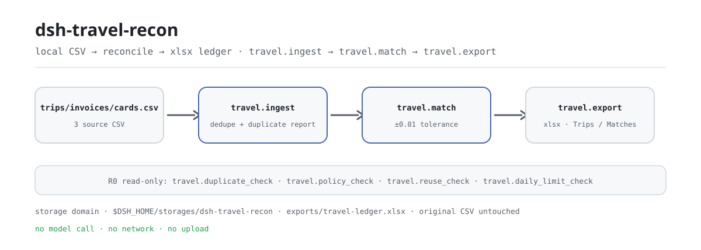
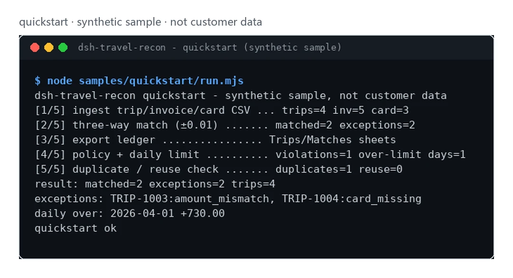

<div align="center">

<picture>
  <source media="(prefers-color-scheme: dark)" srcset="docs/assets/dsh-travel-recon-flow-dark.svg">
  
</picture>

# dsh-travel-recon

**Cuadra órdenes de viaje, facturas y movimientos de tarjeta en una sola pasada: discrepancias, duplicados y días fuera de límite, todo listado.**

Un plugin local de conciliación: tres CSV de entrada, un libro xlsx de dos hojas de salida; sin llamada al modelo, sin red, sin subidas.

[Instalar](#instalación-en-tres-pasos) · [Configuración](#configuración) · [FAQ](#faq) · [简体中文](README.md) · [English](README.en.md) · [Español](README.es.md) · [Português](README.pt.md) · [हिन्दी](README.hi.md)

[](LICENSE)
[](#compatibilidad)
[](https://www.npmjs.com/package/dsh-travel-recon)
[](https://github.com/PerryLink/dsh-travel-recon/actions/workflows/ci.yml)
[](#compatibilidad)

[](https://github.com/PerryLink/dsh-travel-recon/stargazers)
[](https://www.npmjs.com/package/dsh-travel-recon)
[](https://dshfind.com/plugins/PerryLink/dsh-travel-recon?ref=badge)
[](https://dsh.market/)

```sh
dsh plugin --profile <profile> add dsh-travel-recon
```

</div>

<sub>Plugin de la comunidad, sin relación con DeepSeek. Repositorio oficial único: <https://github.com/PerryLink/dsh-travel-recon> (los repositorios con el mismo nombre en otras cuentas no son este proyecto). Apache-2.0.</sub>

## Qué es

`dsh-travel-recon` concilia tres CSV —órdenes de viaje, facturas y movimientos de tarjeta— fila por fila: los importa y deduplica, ejecuta un cruce de tres vías con tolerancia de ±1 céntimo sobre `trip_id`, y luego lista los duplicados, las diferencias de importe, las facturas ausentes y los días fuera de límite diario; por último exporta un libro xlsx que puedes revisar hoja por hoja. Todo se ejecuta en tu propia máquina: sin llamada al modelo, sin red, sin subidas, y los CSV originales nunca se modifican.

- **Encaja bien**: decenas o cientos de viajes, facturas y movimientos; quieres una conciliación por viaje, avisos de duplicados y un libro local de límites diarios.
- **No encaja**: escenarios que necesitan aprobación automática, pago o modificación de hojas de gastos; este paquete solo hace comprobaciones de solo lectura y exportación local, no aprueba nada por ti.

## Instalación en tres pasos

1. **Instalar** (elige un canal; npm es el recomendado y el resto sirve para fijar versión o trabajar sin conexión):

   ```sh
   # npm (recomendado, 0.1.1 publicado)
   dsh plugin --profile <profile> add dsh-travel-recon
   # canal git (último main; equivale a git+https://github.com/PerryLink/dsh-travel-recon.git)
   dsh plugin --profile <profile> add github:PerryLink/dsh-travel-recon
   # canal tarball: pnpm pack en este repositorio y luego
   dsh plugin --profile <profile> add ./dsh-travel-recon-<version>.tgz
   # canal tienda 1024
   npm i -g dsh1024 && dsh1024 plugin --profile <profile> add dsh-travel-recon
   ```

2. **Sin configuración**: `cordis.patch.yml` solo inserta una fila — `id: dsh-travel-recon` / `name: 'dsh-travel-recon'` — y el plugin no tiene campos Config, así que registra sus siete herramientas al instalarse. El directorio de datos por defecto es `$DSH_HOME/storages/dsh-travel-recon`; define `DSH_TRAVEL_HOME` para apuntar a otro sitio.

3. **Comprobar que está montado**:

   ```sh
   dsh --profile <profile> --dump-config | grep dsh-travel-recon
   ```

   Si aparece una línea con `dsh-travel-recon`, está montado. Después ejecuta el ejemplo sintético incluido (en un árbol de desarrollo compila antes con `pnpm build`; el paquete publicado ya trae `lib/`):

   ```sh
   node samples/quickstart/run.mjs
   ```

   La última línea es `quickstart ok`.

**Desinstalar**: `dsh plugin --profile <profile> remove dsh-travel-recon` (o elimina la fila del patch del perfil).

## Capacidades clave

- **Cruce de tres vías (±1 céntimo)** — `travel.match` une órdenes, facturas y tarjetas por `trip_id` con tolerancia de 0.01; las excepciones vuelven por viaje como `invoice_missing`, `card_missing` o `amount_mismatch`, con ambas diferencias.
- **Deduplicación sin silencios** — los `trip_id` repetidos se conservan y se reportan como issues (`E_TRAVEL_TRIP_DUPLICATE`); cada id se guarda una vez y el resto cuenta como `skipped`. Las facturas y los movimientos duplicados los lista `travel.duplicate_check`.
- **Doble reclamación entre viajes** — `travel.reuse_check` informa de una factura o un movimiento de tarjeta que aparece en más de un viaje antes de importar; no necesita datos guardados.
- **Comprobaciones de solo lectura** — `travel.policy_check` (tope por viaje + presencia de factura) y `travel.daily_limit_check` (tope diario por empleado) solo devuelven listas de infracciones: sin ediciones, sin aprobación, sin pagos.
- **Exportación de libro de dos hojas** — `travel.export` escribe `exports/travel-ledger.xlsx` con las hojas `Trips` / `Matches`; la ruta pasa una validación anti-fuga antes de escribir.
- **Local primero** — no hay llamadas HTTP, DNS ni WebSocket en el código, ni llamadas al modelo; entrada y salida se quedan en la máquina.

### Superficie de herramientas

Los nombres de herramienta son una API estable (`travel.*`); las descripciones en tiempo de ejecución están en inglés, igual que la salida.

| Herramienta | Propósito | Riesgo |
|---|---|---|
| `travel.ingest` | Importa filas de órdenes/facturas/tarjetas | R1 escritura local |
| `travel.match` | Cruce de tres vías orden/factura/tarjeta (escribe el estado) | R1 escritura local |
| `travel.duplicate_check` | Detecta factura/tarjeta duplicada por viaje | R0 |
| `travel.policy_check` | Comprobación de solo lectura de tope y factura presente | R0 |
| `travel.reuse_check` | Comprobación de solo lectura de reutilización entre viajes | R0 |
| `travel.daily_limit_check` | Comprobación de solo lectura del tope diario por empleado | R0 |
| `travel.export` | Exporta el libro xlsx de conciliación (`Trips` / `Matches`) | R1 escritura local |

### Entrada

- CSV de viajes: UTF-8 con cabecera `trip_id,employee,origin,destination,date,amount`.
- CSV de facturas: `invoice_id,trip_id,amount`; CSV de tarjetas: `txn_id,trip_id,amount`.
- Los importes admiten como máximo dos decimales; mantén cada archivo en 5 MB o menos. El ejemplo incluido está en `samples/quickstart/input/` (sintético, muy por debajo de 500 KB).
- Los tres CSV se pasan como **texto** en los argumentos de la herramienta (la sesión lee el archivo y lo pasa); el plugin nunca resuelve rutas por su cuenta.

### Salida

- Resumen en terminal: cuántos viajes cuadran, cuántas excepciones, infracciones de política y días fuera de límite.
- Libro: `$DSH_HOME/storages/dsh-travel-recon/exports/travel-ledger.xlsx`, hojas `Trips` / `Matches`.
- Los archivos originales nunca se modifican.

### Ejemplo

Pega esta frase en la sesión:

> Ayúdame a revisar los pedidos, facturas y movimientos de tarjeta de este viaje con el ejemplo incluido y enumera los documentos que no cuadran y los días fuera de límite.

O ejecútalo tú mismo (ejecución real: la captura de abajo sale de este comando):

```sh
node samples/quickstart/run.mjs
```

```text
dsh-travel-recon quickstart - synthetic sample, not customer data
[1/5] ingest trip/invoice/card CSV ... trips=4 inv=5 card=3
[2/5] three-way match (±0.01) ....... matched=2 exceptions=2
[3/5] export ledger ................ Trips/Matches sheets
[4/5] policy + daily limit .......... violations=1 over-limit days=1
[5/5] duplicate / reuse check ....... duplicates=1 reuse=0
result: matched=2 exceptions=2 trips=4
exceptions: TRIP-1003:amount_mismatch, TRIP-1004:card_missing
daily over: 2026-04-01 +730.00
quickstart ok
```

*Observado en `samples/quickstart/run.mjs` y en el patrón `samples/quickstart/expected/result.json` (los hashes de entrada están en result.json; datos sintéticos, no una ejecución de cliente).*

<picture>
  <source media="(prefers-color-scheme: dark)" srcset="docs/assets/dsh-travel-recon-quickstart-dark.webp">
  
</picture>

*Ejemplo sintético → patrón `samples/quickstart/expected/result.json`; comando y hashes en `screenshots.json`.*

## Datos de aceptación

`ACCEPTANCE.csv` registra las comprobaciones sintéticas públicas fila por fila (script `scripts/acceptance.mjs`, `evidence_sha256`, marca `counted`); se repite con `node scripts/acceptance.mjs`:

| req_id | metric | threshold | actual | pass | source | counted |
|---|---|---|---|---|---|---|
| SKU-15-A01 | parseo de viajes | 20/20 | 20 | true | public/synthetic | false |
| SKU-15-A02 | cruce de tres vías | 20/20 | 20 | true | public/synthetic | false |
| SKU-15-A03 | viajes duplicados | 0 | 0 | true | public/synthetic | false |
| SKU-15-A04 | hojas del libro | 2 | 2 | true | public/synthetic | false |
| SKU-15-A05 | detección de factura duplicada | 1 | 1 | true | public/synthetic | false |
| SKU-15-A06 | doble reclamación entre viajes | 1 | 1 | true | public/synthetic | false |
| SKU-15-A07 | exceso del límite diario | 1 | 1 | true | public/synthetic | false |
| PS1-QS01 | el ejemplo quickstart coincide con el patrón | 1/1 | 1 | true | synthetic/quickstart | true |

*Las etiquetas están traducidas aquí; `ACCEPTANCE.csv` es la fuente canónica. Las filas SKU son comprobaciones sintéticas (`counted=false`, sin evidencia de cliente); PS1-QS01 reproduce localmente el ejemplo incluido (`counted=true`). `EVIDENCE.md`: 0 viajes reales, 20 viajes/facturas/tarjetas sintéticos, 4 filas pasan, no contabilizado, parcial.*

## Configuración

Este plugin **no tiene campos Config**: `cordis.patch.yml` solo lleva `id` / `name`, así que funciona al instalarse. Lo ajustable es el directorio de datos (variable de entorno) y los argumentos de cada llamada.

| Variable de entorno | Por defecto | Significado |
|---|---|---|
| `DSH_TRAVEL_HOME` | vacío | Sustituye la raíz de datos; si está vacío se aplica la fila siguiente |
| `DSH_HOME` | cwd del proceso | Sin `DSH_TRAVEL_HOME`, la raíz es `$DSH_HOME/storages/dsh-travel-recon` |

Argumentos de llamada más usados (el dinero siempre es un entero de céntimos):

| Argumento | Herramienta | Por defecto | Significado |
|---|---|---|---|
| `trips_csv` | `travel.ingest` | obligatorio | Texto CSV de viajes |
| `invoices_csv` | `travel.ingest` / `travel.reuse_check` | obligatorio | Texto CSV de facturas |
| `cards_csv` | `travel.ingest` / `travel.reuse_check` | obligatorio | Texto CSV de tarjetas |
| `max_order_cents` | `travel.policy_check` | obligatorio | Tope por viaje (céntimos) |
| `require_invoice` | `travel.policy_check` | `false` | Exigir factura en cada viaje |
| `cap_cents` | `travel.daily_limit_check` | obligatorio | Tope diario por empleado (céntimos) |

<details>
<summary>Superficie completa de herramientas y salidas (7 herramientas)</summary>

| Herramienta | Argumentos | Devuelve | Riesgo |
|---|---|---|---|
| `travel.ingest` | `trips_csv`, `invoices_csv`, `cards_csv` (texto, obligatorios) | `trips` / `invoices` / `cards` / `skipped` / `duplicate_trips`, más `issues[]` (`code`, `trip_id`, `occurrences`) | R1 escritura local |
| `travel.match` | ninguno | `matched` / `exceptions` / `duplicate_trips`; cada registro lleva `state`, `reason` y las dos diferencias | R1 escritura local (estado) |
| `travel.duplicate_check` | ninguno | `duplicates[]` (`kind`, `trip_id`, `count`) | R0 |
| `travel.policy_check` | `max_order_cents` (número, obligatorio), `require_invoice` (booleano, opcional) | `checked` / `violations[]` (`trip_id`, `reason`) | R0 |
| `travel.reuse_check` | `invoices_csv`, `cards_csv` (texto, obligatorios) | `invoice_reuse[]` / `card_reuse[]` (`id`, `trips[]`) | R0 |
| `travel.daily_limit_check` | `cap_cents` (número, obligatorio) | `days` / `over_limit[]` (`employee`, `date`, `total_cents`, `over_by_cents`) | R0 |
| `travel.export` | ninguno | `path` / `rows`; el xlsx de dos hojas va a `exports/` dentro del directorio de datos | R1 escritura local |

</details>

Apuntar el directorio de datos a otro sitio (solo entorno, nada va al patch):

```sh
export DSH_TRAVEL_HOME="$HOME/.local/share/dsh-travel-recon"
```

## FAQ

<details>
<summary>¿Falla la instalación o la activación?</summary>

Comprueba DSH `>=0.2.1-rc.3 <0.4.0` y Node `>=24.9 <25`, y reintenta con un `DSH_HOME` nuevo para descartar configuración vieja:

```sh
export DSH_HOME="$(mktemp -d)"
dsh plugin --profile <profile> add dsh-travel-recon
dsh --profile <profile> --dump-config | grep dsh-travel-recon
```

La guía completa (importes ilegibles, columnas ausentes, `trip_id` ausente) está en [`TROUBLESHOOTING.md`](TROUBLESHOOTING.md).

</details>

<details>
<summary>¿Dónde viven los datos? ¿Se sube algo?</summary>

Sin red y sin subidas. El estado de conciliación vive en el storage domain de DSH (`$DSH_HOME/storages/dsh-travel-recon`) y el libro se escribe en `exports/travel-ledger.xlsx` dentro del mismo directorio; los CSV de origen son de solo lectura. El plugin no escribe en ningún otro sitio ni llama a un modelo.

</details>

<details>
<summary>¿Por qué un viaje muestra `card_missing`?</summary>

Ese viaje no tiene ningún movimiento de tarjeta con el mismo `trip_id`, o el importe difiere en más de 0.01; añade el movimiento o confirma que se pagó aparte. Los otros motivos son `invoice_missing` (sin factura) y `amount_mismatch` (importes distintos; se devuelven ambas diferencias).

</details>

<details>
<summary>¿Las comprobaciones de política editan documentos o aprueban algo?</summary>

No. `travel.policy_check` / `travel.daily_limit_check` / `travel.duplicate_check` / `travel.reuse_check` son de solo lectura y solo devuelven listas de infracciones; la aprobación y el pago siguen siendo tuyos, y el paquete no incluye capacidad de aprobación ni de edición.

</details>

<details>
<summary>¿Puedo usarlo con mis datos reales de viaje?</summary>

Puedes ejecutarlo en local, pero el paquete es alpha y solo se ha validado con datos sintéticos; su salida no es una conclusión de auditoría. Anonimiza los datos reales antes y revisa el resultado tú mismo. El repositorio no acepta ni almacena datos de clientes.

</details>

## Límites de seguridad

- **Entrada de solo lectura**: solo se analiza el texto CSV que pasa la sesión; los archivos de origen nunca se modifican ni se borran.
- **Escrituras controladas**: solo el directorio de datos (estado + `exports/*.xlsx`); la ruta de exportación pasa por `safeExportPath` y una ruta fuera de límites o inválida falla en cerrado (`E_TRAVEL_PATH_INVALID` / `E_TRAVEL_PATH_NOT_ALLOWED`) en lugar de escribir fuera de la raíz.
- **Sin red ni modelo**: no hay llamadas HTTP, DNS ni WebSocket en el código, y la ejecución de herramientas no hace peticiones al modelo.
- **Sin acciones de aprobación**: las cuatro herramientas de comprobación solo devuelven listas: sin ediciones, sin aprobación, sin pagos.
- **Sin pérdida silenciosa**: los `trip_id` duplicados se conservan y se reportan como issues; una cabecera o un importe incorrecto falla con un mensaje claro, un código `E_XXX` y una pista de siguiente paso en lugar de adivinar u omitir.

## Limitaciones conocidas

- **Solo público/sintético**: `EVIDENCE.md` registra 0 viajes reales y 20 viajes/facturas/tarjetas sintéticos; el repositorio no contiene datos de clientes ni hace afirmaciones de ejecución con clientes.
- **alpha / parcial / no contabilizado / no GA**: sin afirmación de disponibilidad para producción; la superficie de herramientas puede cambiar entre versiones.
- **Forma CSV fija**: las cabeceras deben usar los nombres de arriba (sin distinguir mayúsculas) y los importes admiten como máximo dos decimales; mantén cada archivo en 5 MB o menos.
- **Cruce 1:1 por viaje**: cada viaje aporta una factura y un movimiento de tarjeta al cruce de tres vías; las filas extra del mismo viaje las reporta `travel.duplicate_check` y nunca se fusionan solas.
- **No aprueba por ti**: todas las comprobaciones son de solo lectura; no hay aprobación, pago, edición de documentos ni integración con plataformas de gastos o viajes.
- **Los límites exactos por herramienta** están en la tabla de arriba y en `ACCEPTANCE.csv`; salvo que una herramienta diga lo contrario, sin llamada al modelo y sin red.

## Compatibilidad

| Superficie | Estado |
|---|---|
| Harness | `dsh >=0.2.1-rc.3 <0.4.0` (de `engines.dsh` en `package.json`) |
| Node | `>=24.9.0 <25` |
| Plataformas | Todas; solo archivos locales |
| Datos | Sin red, sin llamada al modelo, sin subidas |

## Ecosistema y calidad

- [Página del plugin en dshfind](https://dshfind.com/plugins/PerryLink/dsh-travel-recon) (instalaciones y ranking)
- [DSH Market](https://dsh.market/) (listado)
- **Canal tienda 1024**: `npm i -g dsh1024` una vez y luego `dsh1024 plugin --profile <profile> add dsh-travel-recon` (cuenta para el ranking de [deepseek1024.com](https://deepseek1024.com))
- [Índice de dominio](https://perrylink.github.io/dsh-plugins/) · [Familia de checkers](https://perrylink.github.io/zh/checkers/) · [Familia principal dsh-kit](https://github.com/PerryLink/dsh-kit) · [Artículo de escenario](https://perrylink.github.io/dsh-plugins/articles/finops-suite.html)
- [Base de conocimiento del ecosistema](https://perrylink.github.io/dsh-plugin-guide/): guía de desarrollo · datos de selección · criterios de mantenimiento
- [Solución de problemas](TROUBLESHOOTING.md) · [Privacidad](PRIVACY.md) · [Política de seguridad](SECURITY.md)

Paquetes hermanos e índices de familia: [dsh-einvoice](https://github.com/PerryLink/dsh-einvoice) · [dsh-bankrec](https://github.com/PerryLink/dsh-bankrec) · [dsh-ap-three-way](https://github.com/PerryLink/dsh-ap-three-way) · [dsh-finops-suite](https://github.com/PerryLink/dsh-finops-suite)

Checkers relacionados (paquetes separados con su propia versión; instala solo los que necesites):

| Paquete | Por qué es relevante |
|---|---|
| [`dsh-invoice-ledger`](https://github.com/PerryLink/dsh-invoice-ledger) | Anomalías de facturas del mismo viaje. |
| [`dsh-excel-reconcile`](https://github.com/PerryLink/dsh-excel-reconcile) | Alineación tarjeta/libro fuera del cruce integrado. |

## Desarrollo

```sh
pnpm install --frozen-lockfile
pnpm build && pnpm lint && pnpm typecheck && pnpm test
node samples/quickstart/run.mjs          # ejemplo sintético: debe imprimir quickstart ok
node scripts/acceptance.mjs              # aceptación: detalle en ACCEPTANCE.csv
pnpm pack                                # tarball publicado
```

Estructura:

```text
src/core/               parseo CSV, conversión a céntimos, cruce de tres vías, guarda de rutas (funciones puras)
src/plugin/             entrada Cordis, tablas del storage domain, las 7 herramientas
samples/quickstart/     entrada sintética + result.json patrón + runner
test/*.test.mjs         node --test (11 archivos de test)
scripts/                aceptación, comprobaciones de empaquetado, lint, SBOM
docs/assets/            imágenes del README
cordis.patch.yml        patch del bundle (inserta solo la fila de este plugin)
```

Versión actual `0.1.1` (coincide con `package.json`); `node --test test/*.test.mjs` pasa en verde (25 casos, 0 fallos). Las imágenes del README las genera [`scripts/gen-readme-assets.py`](scripts/gen-readme-assets.py) (Python + Pillow) y se puede repetir:

```sh
python scripts/gen-readme-assets.py
```

Reescribe `docs/assets/dsh-travel-recon-flow-{light,dark}.svg` y enmarca la captura real del quickstart como `dsh-travel-recon-quickstart-{light,dark}.webp`.

## Familia y agradecimientos

Este proyecto forma parte de la familia de plugins de DeepSeek Harness mantenida por [PerryLink](https://github.com/PerryLink) (todos Apache-2.0). Si te resulta útil, **una estrella ayuda a que la siguiente persona lo encuentre** — no desbloquea nada.

- [@PerryLink](https://github.com/PerryLink) — mantenedor: cruce de tres vías, comprobaciones de solo lectura, la superficie de 7 herramientas, el ejemplo quickstart sintético y la documentación en cinco idiomas.

<details>
<summary>Desplegar la familia de plugins de dominio DSH (15 paquetes + 2 suites)</summary>

| Paquete | npm |
|---|---|
| **[dsh-einvoice](https://github.com/PerryLink/dsh-einvoice)** | [npm](https://www.npmjs.com/package/dsh-einvoice) |
| **[dsh-docx-redline](https://github.com/PerryLink/dsh-docx-redline)** | [npm](https://www.npmjs.com/package/dsh-docx-redline) |
| **[dsh-policy-ledger](https://github.com/PerryLink/dsh-policy-ledger)** | [npm](https://www.npmjs.com/package/dsh-policy-ledger) |
| **[dsh-ghg](https://github.com/PerryLink/dsh-ghg)** | [npm](https://www.npmjs.com/package/dsh-ghg) |
| **[dsh-bankrec](https://github.com/PerryLink/dsh-bankrec)** | [npm](https://www.npmjs.com/package/dsh-bankrec) |
| **[dsh-ap-three-way](https://github.com/PerryLink/dsh-ap-three-way)** | [npm](https://www.npmjs.com/package/dsh-ap-three-way) |
| **[dsh-ifc-qto](https://github.com/PerryLink/dsh-ifc-qto)** | [npm](https://www.npmjs.com/package/dsh-ifc-qto) |
| **[dsh-qms-capa](https://github.com/PerryLink/dsh-qms-capa)** | [npm](https://www.npmjs.com/package/dsh-qms-capa) |
| **[dsh-legal-intake](https://github.com/PerryLink/dsh-legal-intake)** | [npm](https://www.npmjs.com/package/dsh-legal-intake) |
| **[dsh-legal-clause](https://github.com/PerryLink/dsh-legal-clause)** | [npm](https://www.npmjs.com/package/dsh-legal-clause) |
| **[dsh-freight-audit](https://github.com/PerryLink/dsh-freight-audit)** | [npm](https://www.npmjs.com/package/dsh-freight-audit) |
| **[dsh-hs-candidate](https://github.com/PerryLink/dsh-hs-candidate)** | [npm](https://www.npmjs.com/package/dsh-hs-candidate) |
| **[dsh-travel-recon](https://github.com/PerryLink/dsh-travel-recon)** | [npm](https://www.npmjs.com/package/dsh-travel-recon) |
| **[dsh-pim-lint](https://github.com/PerryLink/dsh-pim-lint)** | [npm](https://www.npmjs.com/package/dsh-pim-lint) |
| **[dsh-eval-pack](https://github.com/PerryLink/dsh-eval-pack)** | [npm](https://www.npmjs.com/package/dsh-eval-pack) |
| **[dsh-finops-suite](https://github.com/PerryLink/dsh-finops-suite)** | [npm](https://www.npmjs.com/package/dsh-finops-suite) |
| **[dsh-contract-suite](https://github.com/PerryLink/dsh-contract-suite)** | [npm](https://www.npmjs.com/package/dsh-contract-suite) |

</details>

<details>
<summary>Desplegar la familia principal — 87 especificaciones de instalación actuales</summary>

| Paquete | npm |
|---|---|
| **[dsh-aqua-input-check](https://github.com/PerryLink/dsh-aqua-input-check)** | [npm](https://www.npmjs.com/package/dsh-aqua-input-check) |
| **[dsh-archive-check](https://github.com/PerryLink/dsh-archive-check)** | [npm](https://www.npmjs.com/package/dsh-archive-check) |
| **[dsh-bid-ca-precheck](https://github.com/PerryLink/dsh-bid-ca-precheck)** | [npm](https://www.npmjs.com/package/dsh-bid-ca-precheck) |
| **[dsh-bid-qual-check](https://github.com/PerryLink/dsh-bid-qual-check)** | [npm](https://www.npmjs.com/package/dsh-bid-qual-check) |
| **[dsh-contract-stance](https://github.com/PerryLink/dsh-contract-stance)** | [npm](https://www.npmjs.com/package/dsh-contract-stance) |
| **[dsh-customs-doc-check](https://github.com/PerryLink/dsh-customs-doc-check)** | [npm](https://www.npmjs.com/package/dsh-customs-doc-check) |
| **[dsh-demurrage-ledger](https://github.com/PerryLink/dsh-demurrage-ledger)** | [npm](https://www.npmjs.com/package/dsh-demurrage-ledger) |
| **[dsh-drill-script-check](https://github.com/PerryLink/dsh-drill-script-check)** | [npm](https://www.npmjs.com/package/dsh-drill-script-check) |
| **[dsh-eia-guide-check](https://github.com/PerryLink/dsh-eia-guide-check)** | [npm](https://www.npmjs.com/package/dsh-eia-guide-check) |
| **[dsh-emergency-plan](https://github.com/PerryLink/dsh-emergency-plan)** | [npm](https://www.npmjs.com/package/dsh-emergency-plan) |
| **[dsh-essay-rubric-check](https://github.com/PerryLink/dsh-essay-rubric-check)** | [npm](https://www.npmjs.com/package/dsh-essay-rubric-check) |
| **[dsh-evidence-check](https://github.com/PerryLink/dsh-evidence-check)** | [npm](https://www.npmjs.com/package/dsh-evidence-check) |
| **[dsh-export-ctl-check](https://github.com/PerryLink/dsh-export-ctl-check)** | [npm](https://www.npmjs.com/package/dsh-export-ctl-check) |
| **[dsh-fmea-table-check](https://github.com/PerryLink/dsh-fmea-table-check)** | [npm](https://www.npmjs.com/package/dsh-fmea-table-check) |
| **[dsh-forecast-penalty](https://github.com/PerryLink/dsh-forecast-penalty)** | [npm](https://www.npmjs.com/package/dsh-forecast-penalty) |
| **[dsh-gongwen-flow-check](https://github.com/PerryLink/dsh-gongwen-flow-check)** | [npm](https://www.npmjs.com/package/dsh-gongwen-flow-check) |
| **[dsh-gongwen-word-check](https://github.com/PerryLink/dsh-gongwen-word-check)** | [npm](https://www.npmjs.com/package/dsh-gongwen-word-check) |
| **[dsh-guard-plan-qc](https://github.com/PerryLink/dsh-guard-plan-qc)** | [npm](https://www.npmjs.com/package/dsh-guard-plan-qc) |
| **[dsh-hazchem-check](https://github.com/PerryLink/dsh-hazchem-check)** | [npm](https://www.npmjs.com/package/dsh-hazchem-check) |
| **[dsh-hazplan-check](https://github.com/PerryLink/dsh-hazplan-check)** | [npm](https://www.npmjs.com/package/dsh-hazplan-check) |
| **[dsh-hidden-risk-map](https://github.com/PerryLink/dsh-hidden-risk-map)** | [npm](https://www.npmjs.com/package/dsh-hidden-risk-map) |
| **[dsh-hs-classify](https://github.com/PerryLink/dsh-hs-classify)** | [npm](https://www.npmjs.com/package/dsh-hs-classify) |
| **[dsh-icd-rule-check](https://github.com/PerryLink/dsh-icd-rule-check)** | [npm](https://www.npmjs.com/package/dsh-icd-rule-check) |
| **[dsh-lawcite-adapter](https://github.com/PerryLink/dsh-lawcite-adapter)** | [npm](https://www.npmjs.com/package/dsh-lawcite-adapter) |
| **[dsh-lc-doc-check](https://github.com/PerryLink/dsh-lc-doc-check)** | [npm](https://www.npmjs.com/package/dsh-lc-doc-check) |
| **[dsh-learning-gap-check](https://github.com/PerryLink/dsh-learning-gap-check)** | [npm](https://www.npmjs.com/package/dsh-learning-gap-check) |
| **[dsh-medrec-qc](https://github.com/PerryLink/dsh-medrec-qc)** | [npm](https://www.npmjs.com/package/dsh-medrec-qc) |
| **[dsh-nsfc-form-check](https://github.com/PerryLink/dsh-nsfc-form-check)** | [npm](https://www.npmjs.com/package/dsh-nsfc-form-check) |
| **[dsh-nurse-record-check](https://github.com/PerryLink/dsh-nurse-record-check)** | [npm](https://www.npmjs.com/package/dsh-nurse-record-check) |
| **[dsh-origin-rvc-check](https://github.com/PerryLink/dsh-origin-rvc-check)** | [npm](https://www.npmjs.com/package/dsh-origin-rvc-check) |
| **[dsh-ota-review-check](https://github.com/PerryLink/dsh-ota-review-check)** | [npm](https://www.npmjs.com/package/dsh-ota-review-check) |
| **[dsh-paper-doc-adapter](https://github.com/PerryLink/dsh-paper-doc-adapter)** | [npm](https://www.npmjs.com/package/dsh-paper-doc-adapter) |
| **[dsh-permit-report-check](https://github.com/PerryLink/dsh-permit-report-check)** | [npm](https://www.npmjs.com/package/dsh-permit-report-check) |
| **[dsh-pipeline-check](https://github.com/PerryLink/dsh-pipeline-check)** | [npm](https://www.npmjs.com/package/dsh-pipeline-check) |
| **[dsh-pleading-draft](https://github.com/PerryLink/dsh-pleading-draft)** | [npm](https://www.npmjs.com/package/dsh-pleading-draft) |
| **[dsh-policy-brief-draft](https://github.com/PerryLink/dsh-policy-brief-draft)** | [npm](https://www.npmjs.com/package/dsh-policy-brief-draft) |
| **[dsh-power-loss-split](https://github.com/PerryLink/dsh-power-loss-split)** | [npm](https://www.npmjs.com/package/dsh-power-loss-split) |
| **[dsh-power-ticket-check](https://github.com/PerryLink/dsh-power-ticket-check)** | [npm](https://www.npmjs.com/package/dsh-power-ticket-check) |
| **[dsh-ppap-check](https://github.com/PerryLink/dsh-ppap-check)** | [npm](https://www.npmjs.com/package/dsh-ppap-check) |
| **[dsh-protest-deadline](https://github.com/PerryLink/dsh-protest-deadline)** | [npm](https://www.npmjs.com/package/dsh-protest-deadline) |
| **[dsh-railway-window](https://github.com/PerryLink/dsh-railway-window)** | [npm](https://www.npmjs.com/package/dsh-railway-window) |
| **[dsh-repair-order-qc](https://github.com/PerryLink/dsh-repair-order-qc)** | [npm](https://www.npmjs.com/package/dsh-repair-order-qc) |
| **[dsh-review-reply-check](https://github.com/PerryLink/dsh-review-reply-check)** | [npm](https://www.npmjs.com/package/dsh-review-reply-check) |
| **[dsh-rulefile-check](https://github.com/PerryLink/dsh-rulefile-check)** | [npm](https://www.npmjs.com/package/dsh-rulefile-check) |
| **[dsh-safety-brief-check](https://github.com/PerryLink/dsh-safety-brief-check)** | [npm](https://www.npmjs.com/package/dsh-safety-brief-check) |
| **[dsh-site-log-check](https://github.com/PerryLink/dsh-site-log-check)** | [npm](https://www.npmjs.com/package/dsh-site-log-check) |
| **[dsh-soe-decision-check](https://github.com/PerryLink/dsh-soe-decision-check)** | [npm](https://www.npmjs.com/package/dsh-soe-decision-check) |
| **[dsh-soilwater-check](https://github.com/PerryLink/dsh-soilwater-check)** | [npm](https://www.npmjs.com/package/dsh-soilwater-check) |
| **[dsh-sop-sync-check](https://github.com/PerryLink/dsh-sop-sync-check)** | [npm](https://www.npmjs.com/package/dsh-sop-sync-check) |
| **[dsh-spc-gbt-adapter](https://github.com/PerryLink/dsh-spc-gbt-adapter)** | [npm](https://www.npmjs.com/package/dsh-spc-gbt-adapter) |
| **[dsh-tender-extract](https://github.com/PerryLink/dsh-tender-extract)** | [npm](https://www.npmjs.com/package/dsh-tender-extract) |
| **[dsh-tender-matrix](https://github.com/PerryLink/dsh-tender-matrix)** | [npm](https://www.npmjs.com/package/dsh-tender-matrix) |
| **[dsh-warranty-calc](https://github.com/PerryLink/dsh-warranty-calc)** | [npm](https://www.npmjs.com/package/dsh-warranty-calc) |
| **[dsh-auto-review](https://github.com/PerryLink/dsh-auto-review)** | [npm](https://www.npmjs.com/package/dsh-auto-review) |
| **[dsh-autotier](https://github.com/PerryLink/dsh-autotier)** | [npm](https://www.npmjs.com/package/dsh-autotier) |
| **[dsh-budget](https://github.com/PerryLink/dsh-budget)** | [npm](https://www.npmjs.com/package/dsh-budget) |
| **[dsh-cert-mcp](https://github.com/PerryLink/dsh-cert-mcp)** | [npm](https://www.npmjs.com/package/dsh-cert-mcp) |
| **[dsh-checkpoint-rewind](https://github.com/PerryLink/dsh-checkpoint-rewind)** | [npm](https://www.npmjs.com/package/dsh-checkpoint-rewind) |
| **[dsh-claude-move](https://github.com/PerryLink/dsh-claude-move)** | [npm](https://www.npmjs.com/package/dsh-claude-move) |
| **[dsh-click](https://github.com/PerryLink/dsh-click)** | [npm](https://www.npmjs.com/package/dsh-click) |
| **[dsh-composer-history](https://github.com/PerryLink/dsh-composer-history)** | [npm](https://www.npmjs.com/package/dsh-composer-history) |
| **[dsh-data-quality](https://github.com/PerryLink/dsh-data-quality)** | [npm](https://www.npmjs.com/package/dsh-data-quality) |
| **[dsh-defend](https://github.com/PerryLink/dsh-defend)** | [npm](https://www.npmjs.com/package/dsh-defend) |
| **[dsh-doublecheck](https://github.com/PerryLink/dsh-doublecheck)** | [npm](https://www.npmjs.com/package/dsh-doublecheck) |
| **[dsh-draw](https://github.com/PerryLink/dsh-draw)** | [npm](https://www.npmjs.com/package/dsh-draw) |
| **[dsh-fast](https://github.com/PerryLink/dsh-fast)** | [npm](https://www.npmjs.com/package/dsh-fast) |
| **[dsh-fund-research](https://github.com/PerryLink/dsh-fund-research)** | [npm](https://www.npmjs.com/package/dsh-fund-research) |
| **[dsh-industry-research](https://github.com/PerryLink/dsh-industry-research)** | [npm](https://www.npmjs.com/package/dsh-industry-research) |
| **[dsh-laya](https://github.com/PerryLink/dsh-laya)** | [npm](https://www.npmjs.com/package/dsh-laya) |
| **[dsh-library](https://github.com/PerryLink/dsh-library)** | [npm](https://www.npmjs.com/package/dsh-library) |
| **[dsh-local-ai](https://github.com/PerryLink/dsh-local-ai)** | [npm](https://www.npmjs.com/package/dsh-local-ai) |
| **[dsh-lsp-actions](https://github.com/PerryLink/dsh-lsp-actions)** | [npm](https://www.npmjs.com/package/dsh-lsp-actions) |
| **[dsh-mask](https://github.com/PerryLink/dsh-mask)** | [npm](https://www.npmjs.com/package/dsh-mask) |
| **[dsh-mcp-panel](https://github.com/PerryLink/dsh-mcp-panel)** | [npm](https://www.npmjs.com/package/dsh-mcp-panel) |
| **[dsh-memento](https://github.com/PerryLink/dsh-memento)** | [npm](https://www.npmjs.com/package/dsh-memento) |
| **[dsh-observe](https://github.com/PerryLink/dsh-observe)** | [npm](https://www.npmjs.com/package/dsh-observe) |
| **[dsh-output-styles](https://github.com/PerryLink/dsh-output-styles)** | [npm](https://www.npmjs.com/package/dsh-output-styles) |
| **[dsh-permission-rules](https://github.com/PerryLink/dsh-permission-rules)** | [npm](https://www.npmjs.com/package/dsh-permission-rules) |
| **[dsh-plugin-guide](https://github.com/PerryLink/dsh-plugin-guide)** | [npm](https://www.npmjs.com/package/dsh-plugin-guide) |
| **[dsh-plugin-upgrade](https://github.com/PerryLink/dsh-plugin-upgrade)** | [npm](https://www.npmjs.com/package/dsh-plugin-upgrade) |
| **[dsh-reach](https://github.com/PerryLink/dsh-reach)** | [npm](https://www.npmjs.com/package/dsh-reach) |
| **[dsh-research-report](https://github.com/PerryLink/dsh-research-report)** | [npm](https://www.npmjs.com/package/dsh-research-report) |
| **[dsh-score](https://github.com/PerryLink/dsh-score)** | [npm](https://www.npmjs.com/package/dsh-score) |
| **[dsh-session-sync](https://github.com/PerryLink/dsh-session-sync)** | [npm](https://www.npmjs.com/package/dsh-session-sync) |
| **[dsh-talk](https://github.com/PerryLink/dsh-talk)** | [npm](https://www.npmjs.com/package/dsh-talk) |
| **[dsh-test-drive](https://github.com/PerryLink/dsh-test-drive)** | [npm](https://www.npmjs.com/package/dsh-test-drive) |
| **[dsh-translate](https://github.com/PerryLink/dsh-translate)** | [npm](https://www.npmjs.com/package/dsh-translate) |

</details>

## Licencia

[LICENSE](LICENSE) (Apache License 2.0) © 2026 dsh-travel-recon contributors. Ver también `NOTICE` y `THIRD-PARTY-NOTICES`.

<p align="center"><sub>Apache-2.0 · Plugin de la comunidad, sin relación con DeepSeek.</sub></p>
