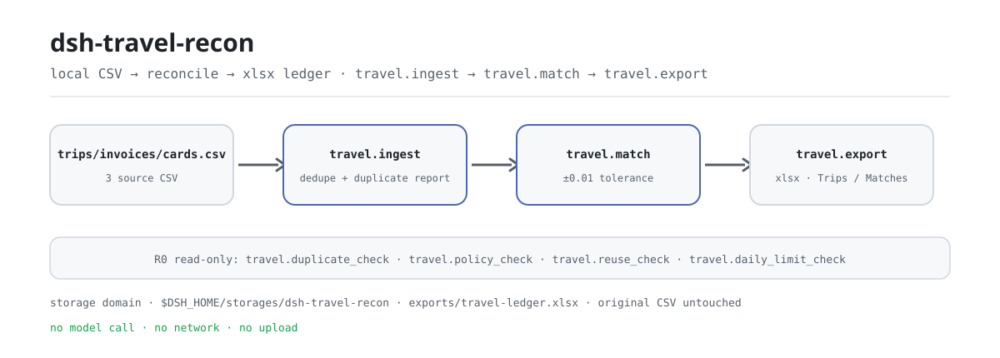
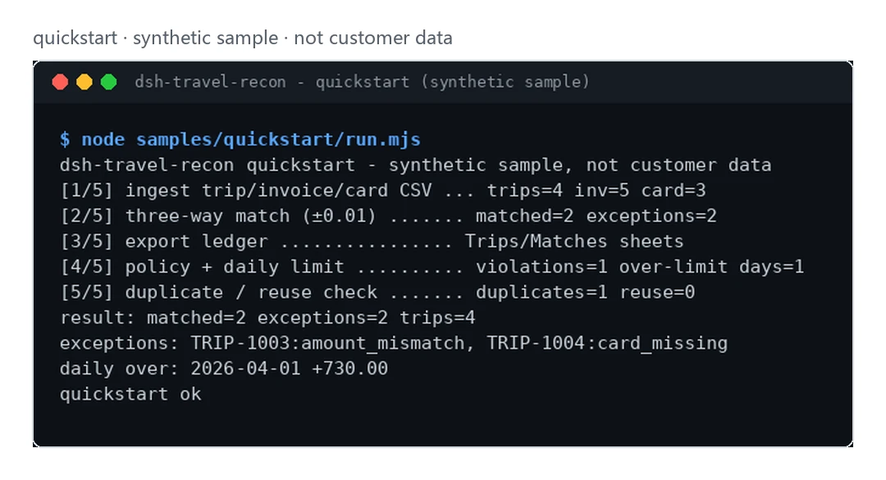

<div align="center">

<picture>
  <source media="(prefers-color-scheme: dark)" srcset="docs/assets/dsh-travel-recon-flow-dark.svg">
  
</picture>

# dsh-travel-recon

**यात्रा ऑर्डर, इनवॉइस और कार्ड लेन-देन एक ही बार में मिलाएँ — बेमेल दस्तावेज़, दोहरे दावे और सीमा से अधिक दिन सीधे सूचीबद्ध।**

एक लोकल मिलान प्लगइन: तीन CSV अंदर, दो शीट वाली xlsx बही बाहर; कोई मॉडल कॉल नहीं, कोई नेटवर्क नहीं, कोई अपलोड नहीं।

[इंस्टॉल](#तीन-चरणों-में-शुरुआत) · [कॉन्फ़िगरेशन](#कॉन्फ़िगरेशन) · [FAQ](#faq) · [简体中文](README.md) · [English](README.en.md) · [Español](README.es.md) · [Português](README.pt.md) · [हिन्दी](README.hi.md)

[](LICENSE)
[](#संगतता)
[](https://www.npmjs.com/package/dsh-travel-recon)
[](https://github.com/PerryLink/dsh-travel-recon/actions/workflows/ci.yml)
[](#संगतता)

[](https://github.com/PerryLink/dsh-travel-recon/stargazers)
[](https://www.npmjs.com/package/dsh-travel-recon)
[](https://dshfind.com/plugins/PerryLink/dsh-travel-recon?ref=badge)
[](https://dsh.market/)

```sh
dsh plugin --profile <profile> add dsh-travel-recon
```

</div>

<sub>सामुदायिक प्लगइन, DeepSeek से संबद्ध नहीं। एकमात्र आधिकारिक रेपो: <https://github.com/PerryLink/dsh-travel-recon> (अन्य खातों के इसी नाम वाले रेपो इस प्रोजेक्ट के नहीं हैं)। Apache-2.0।</sub>

## यह क्या है

`dsh-travel-recon` तीन CSV — यात्रा ऑर्डर, इनवॉइस और कार्ड लेन-देन — को पंक्ति-दर-पंक्ति मिलाता है: पहले आयात और डुप्लीकेट हटाना, फिर `trip_id` पर ±1 पैसे की सहनशीलता के साथ तीन-तरफ़ा मिलान, फिर दोहरे दावे, राशि का अंतर, अनुपस्थित इनवॉइस और दैनिक सीमा से अधिक दिनों की अलग सूची, और अंत में सीधे देखने योग्य xlsx बही का निर्यात। सब कुछ आपकी ही मशीन पर चलता है: कोई मॉडल कॉल नहीं, कोई नेटवर्क नहीं, कोई अपलोड नहीं, और मूल CSV कभी नहीं बदलती।

- **किसके लिए ठीक है**: दसियों से सैकड़ों यात्राएँ, इनवॉइस और कार्ड पंक्तियाँ; आपको प्रति-यात्रा मिलान, दोहरे दावे के संकेत और लोकल दैनिक-सीमा बही चाहिए।
- **किसके लिए नहीं**: स्वचालित स्वीकृति, भुगतान या व्यय फ़ॉर्म में बदलाव चाहने वाले परिदृश्य; यह पैकेज केवल केवल-पढ़ने वाली जाँच और लोकल निर्यात करता है — आपके लिए कुछ स्वीकृत नहीं करता।

## तीन चरणों में शुरुआत

1. **इंस्टॉल करें** (कोई एक चैनल चुनें; npm अनुशंसित है, बाकी वर्ज़न पिन या ऑफ़लाइन के लिए):

   ```sh
   # npm (अनुशंसित, 0.1.1 प्रकाशित)
   dsh plugin --profile <profile> add dsh-travel-recon
   # git चैनल (नवीनतम main; बराबर है git+https://github.com/PerryLink/dsh-travel-recon.git)
   dsh plugin --profile <profile> add github:PerryLink/dsh-travel-recon
   # tarball चैनल: इस रेपो में pnpm pack के बाद
   dsh plugin --profile <profile> add ./dsh-travel-recon-<version>.tgz
   # 1024 स्टोर चैनल
   npm i -g dsh1024 && dsh1024 plugin --profile <profile> add dsh-travel-recon
   ```

2. **कोई कॉन्फ़िगरेशन नहीं**: `cordis.patch.yml` केवल एक पंक्ति जोड़ता है — `id: dsh-travel-recon` / `name: 'dsh-travel-recon'` — और प्लगइन में कोई Config फ़ील्ड नहीं है, इसलिए इंस्टॉल होते ही सात टूल पंजीकृत हो जाते हैं। डेटा डायरेक्टरी डिफ़ॉल्ट रूप से `$DSH_HOME/storages/dsh-travel-recon` है; कहीं और रखना हो तो `DSH_TRAVEL_HOME` सेट करें।

3. **जाँचें कि माउंट हुआ**:

   ```sh
   dsh --profile <profile> --dump-config | grep dsh-travel-recon
   ```

   आउटपुट में `dsh-travel-recon` वाली पंक्ति दिखे तो माउंट हो गया। फिर साथ आया सिंथेटिक नमूना चलाएँ (डेवलपमेंट ट्री में पहले `pnpm build`; प्रकाशित पैकेज में `lib/` पहले से है):

   ```sh
   node samples/quickstart/run.mjs
   ```

   अंतिम पंक्ति `quickstart ok` होती है।

**अनइंस्टॉल**: `dsh plugin --profile <profile> remove dsh-travel-recon` (या प्रोफ़ाइल patch से वह पंक्ति हटा दें)।

## मुख्य क्षमताएँ

- **तीन-तरफ़ा मिलान (±1 पैसा)** — `travel.match` ऑर्डर, इनवॉइस और कार्ड को `trip_id` पर 0.01 की सहनशीलता से जोड़ता है; अपवाद प्रति यात्रा `invoice_missing`, `card_missing` या `amount_mismatch` के रूप में दोनों अंतर के साथ लौटते हैं।
- **बिना चुप्पी के डुप्लीकेट हटाना** — दोहराए गए `trip_id` रखे जाते हैं और issue के रूप में सूचित होते हैं (`E_TRAVEL_TRIP_DUPLICATE`); हर id एक बार संग्रहीत होता है और बाकी `skipped` में गिने जाते हैं। दोहरे इनवॉइस और कार्ड लेन-देन `travel.duplicate_check` अलग से सूचीबद्ध करता है।
- **यात्राओं के बीच दोहरा दावा** — `travel.reuse_check` आयात से पहले बताता है कि कोई इनवॉइस नंबर या कार्ड लेन-देन एक से अधिक यात्राओं में आ रहा है; इसके लिए पहले से संग्रहीत डेटा ज़रूरी नहीं।
- **केवल-पढ़ने वाली नीति जाँच** — `travel.policy_check` (प्रति यात्रा सीमा + इनवॉइस की उपस्थिति) और `travel.daily_limit_check` (प्रति कर्मचारी दैनिक सीमा) केवल उल्लंघन की सूची लौटाते हैं: कोई बदलाव नहीं, कोई स्वीकृति नहीं, कोई भुगतान नहीं।
- **दो शीट वाली बही का निर्यात** — `travel.export` `exports/travel-ledger.xlsx` लिखता है, शीट `Trips` / `Matches`; लिखने से पहले पथ सीमा-जाँच से गुज़रता है।
- **लोकल पहले** — सोर्स में कोई HTTP, DNS या WebSocket कॉल नहीं और कोई मॉडल कॉल नहीं; इनपुट और आउटपुट मशीन पर ही रहते हैं।

### टूल सतह

टूल नाम स्थिर API हैं (`travel.*`); रनटाइम विवरण अंग्रेज़ी में हैं, आउटपुट की तरह।

| टूल | उद्देश्य | जोखिम |
|---|---|---|
| `travel.ingest` | यात्रा ऑर्डर/इनवॉइस/कार्ड पंक्तियाँ आयात करें | R1 लोकल लेखन |
| `travel.match` | ऑर्डर/इनवॉइस/कार्ड का तीन-तरफ़ा मिलान (स्थिति लिखता है) | R1 लोकल लेखन |
| `travel.duplicate_check` | प्रति यात्रा दोहरे इनवॉइस/कार्ड का पता लगाएँ | R0 |
| `travel.policy_check` | केवल-पढ़ने वाली राशि सीमा और इनवॉइस उपस्थिति जाँच | R0 |
| `travel.reuse_check` | केवल-पढ़ने वाली अंतर-यात्रा पुन:उपयोग जाँच | R0 |
| `travel.daily_limit_check` | केवल-पढ़ने वाली प्रति-कर्मचारी दैनिक सीमा जाँच | R0 |
| `travel.export` | मिलान बही xlsx का निर्यात (`Trips` / `Matches`) | R1 लोकल लेखन |

### इनपुट

- यात्रा CSV: UTF-8, हेडर `trip_id,employee,origin,destination,date,amount`.
- इनवॉइस CSV: `invoice_id,trip_id,amount`; कार्ड CSV: `txn_id,trip_id,amount`.
- राशि में अधिकतम दो दशमलव; प्रति फ़ाइल 5 MB तक रखें। साथ आया नमूना `samples/quickstart/input/` में है (सिंथेटिक, 500 KB से बहुत कम)।
- तीनों CSV **टेक्स्ट** के रूप में टूल आर्ग्युमेंट में जाती हैं (सेशन फ़ाइल पढ़कर पास करता है); प्लगइन स्वयं कोई पथ नहीं खोजता।

### आउटपुट

- टर्मिनल सारांश: कितनी यात्राएँ मिलीं, कितने अपवाद, नीति उल्लंघन और सीमा से अधिक दिन।
- बही: `$DSH_HOME/storages/dsh-travel-recon/exports/travel-ledger.xlsx`, शीट `Trips` / `Matches`.
- मूल फ़ाइलें कभी नहीं बदलतीं।

### उदाहरण

यह वाक्य सेशन में पेस्ट करें:

> साथ आए नमूने से इस यात्रा के ऑर्डर, इनवॉइस और कार्ड लेन-देन जाँचने में मदद करें, और बेमेल दस्तावेज़ तथा सीमा से अधिक दिनों की सूची दें।

या स्वयं चलाएँ (वास्तविक रन: नीचे का कैप्चर इसी कमांड से है):

```sh
node samples/quickstart/run.mjs
```

```text
dsh-travel-recon quickstart - synthetic sample, not customer data
[1/5] ingest trip/invoice/card CSV ... trips=4 inv=5 card=3
[2/5] three-way match (±0.01) ....... matched=2 exceptions=2
[3/5] export ledger ................ Trips/Matches sheets
[4/5] policy + daily limit .......... violations=1 over-limit days=1
[5/5] duplicate / reuse check ....... duplicates=1 reuse=0
result: matched=2 exceptions=2 trips=4
exceptions: TRIP-1003:amount_mismatch, TRIP-1004:card_missing
daily over: 2026-04-01 +730.00
quickstart ok
```

*Observed from `samples/quickstart/run.mjs` और गोल्ड `samples/quickstart/expected/result.json` (इनपुट हैश result.json में; सिंथेटिक डेटा, ग्राहक रन नहीं)।*

<picture>
  <source media="(prefers-color-scheme: dark)" srcset="docs/assets/dsh-travel-recon-quickstart-dark.webp">
  
</picture>

*सिंथेटिक नमूना → गोल्ड `samples/quickstart/expected/result.json`; कमांड और हैश `screenshots.json` में।*

## स्वीकृति डेटा

`ACCEPTANCE.csv` सार्वजनिक सिंथेटिक जाँचों को पंक्ति-दर-पंक्ति दर्ज करता है (स्क्रिप्ट `scripts/acceptance.mjs`, `evidence_sha256`, `counted` चिह्न); `node scripts/acceptance.mjs` से दोहराएँ:

| req_id | metric | threshold | actual | pass | source | counted |
|---|---|---|---|---|---|---|
| SKU-15-A01 | यात्रा पार्सिंग | 20/20 | 20 | true | public/synthetic | false |
| SKU-15-A02 | तीन-तरफ़ा मिलान | 20/20 | 20 | true | public/synthetic | false |
| SKU-15-A03 | दोहरी यात्राएँ | 0 | 0 | true | public/synthetic | false |
| SKU-15-A04 | बही की शीट | 2 | 2 | true | public/synthetic | false |
| SKU-15-A05 | दोहरे इनवॉइस की पहचान | 1 | 1 | true | public/synthetic | false |
| SKU-15-A06 | अंतर-यात्रा दोहरा दावा | 1 | 1 | true | public/synthetic | false |
| SKU-15-A07 | दैनिक सीमा उल्लंघन | 1 | 1 | true | public/synthetic | false |
| PS1-QS01 | quickstart नमूना गोल्ड से मेल | 1/1 | 1 | true | synthetic/quickstart | true |

*यहाँ लेबल अनूदित हैं; `ACCEPTANCE.csv` प्रामाणिक स्रोत है। SKU पंक्तियाँ सिंथेटिक जाँचें हैं (`counted=false`, कोई ग्राहक साक्ष्य नहीं); PS1-QS01 साथ आए नमूने का लोकल पुनरुत्पादन है (`counted=true`)। `EVIDENCE.md`: 0 वास्तविक यात्राएँ, 20 सिंथेटिक यात्राएँ/इनवॉइस/कार्ड, 4 पंक्तियाँ पास, गिनी नहीं गईं, आंशिक।*

## कॉन्फ़िगरेशन

इस प्लगइन में **कोई Config फ़ील्ड नहीं** है: `cordis.patch.yml` में केवल `id` / `name` हैं, इसलिए इंस्टॉल होते ही काम करता है। समायोज्य हैं डेटा डायरेक्टरी (एनवायरनमेंट वेरिएबल) और हर कॉल में दिए जाने वाले टूल आर्ग्युमेंट।

| एनवायरनमेंट वेरिएबल | डिफ़ॉल्ट | अर्थ |
|---|---|---|
| `DSH_TRAVEL_HOME` | खाली | डेटा रूट बदलता है; खाली हो तो अगली पंक्ति लागू |
| `DSH_HOME` | प्रोसेस cwd | `DSH_TRAVEL_HOME` के बिना रूट `$DSH_HOME/storages/dsh-travel-recon` |

सबसे अधिक उपयोग होने वाले आर्ग्युमेंट (राशि हमेशा पैसों में पूर्णांक):

| आर्ग्युमेंट | टूल | डिफ़ॉल्ट | अर्थ |
|---|---|---|---|
| `trips_csv` | `travel.ingest` | आवश्यक | यात्रा CSV टेक्स्ट |
| `invoices_csv` | `travel.ingest` / `travel.reuse_check` | आवश्यक | इनवॉइस CSV टेक्स्ट |
| `cards_csv` | `travel.ingest` / `travel.reuse_check` | आवश्यक | कार्ड CSV टेक्स्ट |
| `max_order_cents` | `travel.policy_check` | आवश्यक | प्रति यात्रा राशि सीमा (पैसे) |
| `require_invoice` | `travel.policy_check` | `false` | हर यात्रा के लिए इनवॉइस अनिवार्य करें |
| `cap_cents` | `travel.daily_limit_check` | आवश्यक | प्रति कर्मचारी दैनिक सीमा (पैसे) |

<details>
<summary>पूरी टूल और आउटपुट सतह (7 टूल)</summary>

| टूल | आर्ग्युमेंट | लौटाता है | जोखिम |
|---|---|---|---|
| `travel.ingest` | `trips_csv`, `invoices_csv`, `cards_csv` (टेक्स्ट, तीनों आवश्यक) | `trips` / `invoices` / `cards` / `skipped` / `duplicate_trips`, और `issues[]` (`code`, `trip_id`, `occurrences`) | R1 लोकल लेखन |
| `travel.match` | कोई नहीं | `matched` / `exceptions` / `duplicate_trips`; हर रिकॉर्ड में `state`, `reason` और दोनों अंतर | R1 लोकल लेखन (स्थिति) |
| `travel.duplicate_check` | कोई नहीं | `duplicates[]` (`kind`, `trip_id`, `count`) | R0 |
| `travel.policy_check` | `max_order_cents` (संख्या, आवश्यक), `require_invoice` (बूलियन, वैकल्पिक) | `checked` / `violations[]` (`trip_id`, `reason`) | R0 |
| `travel.reuse_check` | `invoices_csv`, `cards_csv` (टेक्स्ट, दोनों आवश्यक) | `invoice_reuse[]` / `card_reuse[]` (`id`, `trips[]`) | R0 |
| `travel.daily_limit_check` | `cap_cents` (संख्या, आवश्यक) | `days` / `over_limit[]` (`employee`, `date`, `total_cents`, `over_by_cents`) | R0 |
| `travel.export` | कोई नहीं | `path` / `rows`; दो शीट वाली xlsx डेटा डायरेक्टरी के `exports/` में | R1 लोकल लेखन |

</details>

डेटा डायरेक्टरी कहीं और रखें (केवल एनवायरनमेंट, patch में कुछ नहीं जाता):

```sh
export DSH_TRAVEL_HOME="$HOME/.local/share/dsh-travel-recon"
```

## FAQ

<details>
<summary>इंस्टॉल या सक्रियण विफल हो रहा है?</summary>

पहले DSH `>=0.2.1-rc.3 <0.4.0` और Node `>=24.9 <25` जाँचें, फिर पुरानी कॉन्फ़िग हटाने के लिए नए `DSH_HOME` के साथ दोबारा कोशिश करें:

```sh
export DSH_HOME="$(mktemp -d)"
dsh plugin --profile <profile> add dsh-travel-recon
dsh --profile <profile> --dump-config | grep dsh-travel-recon
```

पूरा ट्रबलशूटिंग गाइड (राशि पढ़ी न जाना, कॉलम अनुपस्थित, `trip_id` अनुपस्थित) [`TROUBLESHOOTING.md`](TROUBLESHOOTING.md) में है।

</details>

<details>
<summary>डेटा कहाँ रहता है? कुछ अपलोड होता है?</summary>

कोई नेटवर्क नहीं, कोई अपलोड नहीं। मिलान की स्थिति DSH storage domain (`$DSH_HOME/storages/dsh-travel-recon`) में रहती है और बही उसी डायरेक्टरी के `exports/travel-ledger.xlsx` में लिखी जाती है; स्रोत CSV केवल पढ़ी जाती हैं। प्लगइन कहीं और नहीं लिखता और किसी मॉडल को कॉल नहीं करता।

</details>

<details>
<summary>किसी यात्रा में `card_missing` क्यों दिखता है?</summary>

उस यात्रा के लिए उसी `trip_id` वाला कोई कार्ड लेन-देन नहीं है, या राशि 0.01 से अधिक अलग है; लेन-देन जोड़ें या पुष्टि करें कि भुगतान अलग से हुआ। अन्य कारण `invoice_missing` (इनवॉइस नहीं) और `amount_mismatch` (राशि अलग, दोनों अंतर लौटते हैं) हैं।

</details>

<details>
<summary>नीति जाँच दस्तावेज़ बदलती है या कुछ स्वीकृत करती है?</summary>

नहीं। `travel.policy_check` / `travel.daily_limit_check` / `travel.duplicate_check` / `travel.reuse_check` सभी केवल-पढ़ने वाली हैं और केवल उल्लंघन की सूची लौटाती हैं; स्वीकृति और भुगतान आपके पास रहते हैं, और इस पैकेज में स्वीकृति या बदलाव की क्षमता नहीं है।

</details>

<details>
<summary>क्या मैं अपना वास्तविक यात्रा डेटा चला सकता हूँ?</summary>

लोकल चला सकते हैं, लेकिन यह पैकेज alpha है और केवल सिंथेटिक डेटा पर जाँचा गया है; इसका आउटपुट ऑडिट निष्कर्ष नहीं है। वास्तविक डेटा पहले अनाम करें और परिणाम स्वयं जाँचें। रेपो ग्राहक डेटा न लेता है न संग्रहीत करता है।

</details>

## सुरक्षा सीमाएँ

- **केवल-पढ़ने वाला इनपुट**: केवल सेशन द्वारा भेजा गया CSV टेक्स्ट पढ़ा जाता है; स्रोत फ़ाइलें कभी नहीं बदलतीं या हटतीं।
- **नियंत्रित लेखन**: केवल डेटा डायरेक्टरी (स्थिति + `exports/*.xlsx`); निर्यात पथ `safeExportPath` से गुज़रता है, और सीमा से बाहर या अमान्य पथ लिखने के बजाय सीधे विफल होता है (`E_TRAVEL_PATH_INVALID` / `E_TRAVEL_PATH_NOT_ALLOWED`)।
- **कोई नेटवर्क नहीं, कोई मॉडल नहीं**: सोर्स में HTTP, DNS या WebSocket कॉल नहीं, और टूल निष्पादन कोई मॉडल अनुरोध नहीं करता।
- **कोई स्वीकृति क्रिया नहीं**: चारों जाँच टूल केवल सूची लौटाते हैं — कोई बदलाव नहीं, कोई स्वीकृति नहीं, कोई भुगतान नहीं।
- **कोई चुपचाप डेटा हानि नहीं**: दोहरे `trip_id` रखे और issue के रूप में सूचित होते हैं; गलत CSV हेडर या राशि अनुमान लगाने या छोड़ने के बजाय स्पष्ट संदेश, `E_XXX` कोड और अगले कदम के संकेत के साथ विफल होती है।

## ज्ञात सीमाएँ

- **केवल सार्वजनिक/सिंथेटिक**: `EVIDENCE.md` में 0 वास्तविक यात्राएँ और 20 सिंथेटिक यात्राएँ/इनवॉइस/कार्ड हैं; रेपो में ग्राहक डेटा नहीं है और ग्राहक-रन का दावा नहीं किया जाता।
- **alpha / आंशिक / गिनी नहीं गई / GA नहीं**: उत्पादन-तैयारी का दावा नहीं; टूल सतह वर्ज़न के बीच बदल सकती है।
- **CSV आकार निश्चित**: हेडर ऊपर दिए नामों के होने चाहिए (केस-असंवेदनशील) और राशि में अधिकतम दो दशमलव; प्रति फ़ाइल 5 MB तक रखें।
- **प्रति यात्रा 1:1 मिलान**: हर यात्रा तीन-तरफ़ा मिलान में एक इनवॉइस और एक कार्ड पंक्ति देती है; उसी यात्रा की अतिरिक्त पंक्तियाँ `travel.duplicate_check` बताता है और कभी स्वतः नहीं मिलाई जातीं।
- **आपके लिए स्वीकृति नहीं**: हर जाँच केवल-पढ़ने वाली है; कोई स्वीकृति, भुगतान, दस्तावेज़ संपादन या व्यय/यात्रा प्लेटफ़ॉर्म एकीकरण नहीं।
- **प्रति टूल सटीक सीमाएँ** ऊपर की टूल तालिका और `ACCEPTANCE.csv` में हैं; जब तक कोई टूल स्पष्ट न कहे, कोई मॉडल कॉल नहीं और कोई नेटवर्क नहीं।

## संगतता

| सतह | स्थिति |
|---|---|
| Harness | `dsh >=0.2.1-rc.3 <0.4.0` (`package.json` के `engines.dsh` से) |
| Node | `>=24.9.0 <25` |
| प्लेटफ़ॉर्म | सभी; केवल लोकल फ़ाइलें |
| डेटा | कोई नेटवर्क नहीं, कोई मॉडल कॉल नहीं, कोई अपलोड नहीं |

## इकोसिस्टम और गुणवत्ता

- [dshfind प्लगइन पेज](https://dshfind.com/plugins/PerryLink/dsh-travel-recon) (इंस्टॉल और रैंकिंग)
- [DSH Market](https://dsh.market/) (सूचीबद्ध)
- **1024 स्टोर चैनल**: एक बार `npm i -g dsh1024`, फिर `dsh1024 plugin --profile <profile> add dsh-travel-recon` ([deepseek1024.com](https://deepseek1024.com) की इंस्टॉल रैंकिंग में गिना जाता है)
- [डोमेन इंडेक्स](https://perrylink.github.io/dsh-plugins/) · [Checker परिवार](https://perrylink.github.io/zh/checkers/) · [मुख्य परिवार dsh-kit](https://github.com/PerryLink/dsh-kit) · [परिदृश्य लेख](https://perrylink.github.io/dsh-plugins/articles/finops-suite.html)
- [इकोसिस्टम ज्ञानकोश](https://perrylink.github.io/dsh-plugin-guide/): प्लगइन विकास गाइड · चयन डेटा · रखरखाव मानदंड
- [ट्रबलशूटिंग](TROUBLESHOOTING.md) · [गोपनीयता](PRIVACY.md) · [सुरक्षा नीति](SECURITY.md)

सहोदर पैकेज और परिवार सूचकांक: [dsh-einvoice](https://github.com/PerryLink/dsh-einvoice) · [dsh-bankrec](https://github.com/PerryLink/dsh-bankrec) · [dsh-ap-three-way](https://github.com/PerryLink/dsh-ap-three-way) · [dsh-finops-suite](https://github.com/PerryLink/dsh-finops-suite)

संबंधित checker (अलग पैकेज, अपना वर्ज़न; ज़रूरत के अनुसार ही इंस्टॉल करें):

| पैकेज | क्यों प्रासंगिक है |
|---|---|
| [`dsh-invoice-ledger`](https://github.com/PerryLink/dsh-invoice-ledger) | उसी यात्रा के इनवॉइस की विसंगतियाँ। |
| [`dsh-excel-reconcile`](https://github.com/PerryLink/dsh-excel-reconcile) | अंतर्निहित तीन-तरफ़ा मिलान के बाहर कार्ड/बही का मिलान। |

## डेवलपमेंट

```sh
pnpm install --frozen-lockfile
pnpm build && pnpm lint && pnpm typecheck && pnpm test
node samples/quickstart/run.mjs          # सिंथेटिक नमूना: quickstart ok प्रिंट होना चाहिए
node scripts/acceptance.mjs              # स्वीकृति: विवरण ACCEPTANCE.csv में
pnpm pack                                # प्रकाशित tarball
```

संरचना:

```text
src/core/               CSV पार्सिंग, पैसे में रूपांतरण, तीन-तरफ़ा मिलान, पथ गार्ड (शुद्ध फ़ंक्शन)
src/plugin/             Cordis प्रवेश, storage domain तालिकाएँ, 7 टूल परिभाषाएँ
samples/quickstart/     सिंथेटिक इनपुट + गोल्ड result.json + रनर
test/*.test.mjs         node --test (11 टेस्ट फ़ाइलें)
scripts/                स्वीकृति, पैक जाँच, lint, SBOM
docs/assets/            README चित्र
cordis.patch.yml        bundle patch (केवल इस प्लगइन की पंक्ति जोड़ता है)
```

वर्तमान वर्ज़न `0.1.1` (`package.json` के अनुरूप); `node --test test/*.test.mjs` हरा है (25 केस, 0 विफल)। README चित्र [`scripts/gen-readme-assets.py`](scripts/gen-readme-assets.py) (Python + Pillow) से बनते हैं और दोबारा चलाए जा सकते हैं:

```sh
python scripts/gen-readme-assets.py
```

यह `docs/assets/dsh-travel-recon-flow-{light,dark}.svg` फिर से लिखता है और वास्तविक quickstart कैप्चर को `dsh-travel-recon-quickstart-{light,dark}.webp` के रूप में फ़्रेम करता है।

## परिवार और आभार

यह प्रोजेक्ट [PerryLink](https://github.com/PerryLink) द्वारा रखे जाने वाले DeepSeek Harness प्लगइन परिवार का हिस्सा है (सभी Apache-2.0)। अगर यह उपयोगी हो, तो **एक स्टार अगले इंसान को इसे खोजने में मदद करता है** — इसके पीछे कुछ भी बंद नहीं है।

- [@PerryLink](https://github.com/PerryLink) — अनुरक्षक: तीन-तरफ़ा मिलान, केवल-पढ़ने वाली नीति जाँच, 7-टूल सतह, सिंथेटिक quickstart नमूना और पाँच-भाषा दस्तावेज़।

<details>
<summary>DSH डोमेन प्लगइन परिवार खोलें (15 पैकेज + 2 सूट)</summary>

| पैकेज | npm |
|---|---|
| **[dsh-einvoice](https://github.com/PerryLink/dsh-einvoice)** | [npm](https://www.npmjs.com/package/dsh-einvoice) |
| **[dsh-docx-redline](https://github.com/PerryLink/dsh-docx-redline)** | [npm](https://www.npmjs.com/package/dsh-docx-redline) |
| **[dsh-policy-ledger](https://github.com/PerryLink/dsh-policy-ledger)** | [npm](https://www.npmjs.com/package/dsh-policy-ledger) |
| **[dsh-ghg](https://github.com/PerryLink/dsh-ghg)** | [npm](https://www.npmjs.com/package/dsh-ghg) |
| **[dsh-bankrec](https://github.com/PerryLink/dsh-bankrec)** | [npm](https://www.npmjs.com/package/dsh-bankrec) |
| **[dsh-ap-three-way](https://github.com/PerryLink/dsh-ap-three-way)** | [npm](https://www.npmjs.com/package/dsh-ap-three-way) |
| **[dsh-ifc-qto](https://github.com/PerryLink/dsh-ifc-qto)** | [npm](https://www.npmjs.com/package/dsh-ifc-qto) |
| **[dsh-qms-capa](https://github.com/PerryLink/dsh-qms-capa)** | [npm](https://www.npmjs.com/package/dsh-qms-capa) |
| **[dsh-legal-intake](https://github.com/PerryLink/dsh-legal-intake)** | [npm](https://www.npmjs.com/package/dsh-legal-intake) |
| **[dsh-legal-clause](https://github.com/PerryLink/dsh-legal-clause)** | [npm](https://www.npmjs.com/package/dsh-legal-clause) |
| **[dsh-freight-audit](https://github.com/PerryLink/dsh-freight-audit)** | [npm](https://www.npmjs.com/package/dsh-freight-audit) |
| **[dsh-hs-candidate](https://github.com/PerryLink/dsh-hs-candidate)** | [npm](https://www.npmjs.com/package/dsh-hs-candidate) |
| **[dsh-travel-recon](https://github.com/PerryLink/dsh-travel-recon)** | [npm](https://www.npmjs.com/package/dsh-travel-recon) |
| **[dsh-pim-lint](https://github.com/PerryLink/dsh-pim-lint)** | [npm](https://www.npmjs.com/package/dsh-pim-lint) |
| **[dsh-eval-pack](https://github.com/PerryLink/dsh-eval-pack)** | [npm](https://www.npmjs.com/package/dsh-eval-pack) |
| **[dsh-finops-suite](https://github.com/PerryLink/dsh-finops-suite)** | [npm](https://www.npmjs.com/package/dsh-finops-suite) |
| **[dsh-contract-suite](https://github.com/PerryLink/dsh-contract-suite)** | [npm](https://www.npmjs.com/package/dsh-contract-suite) |

</details>

<details>
<summary>मुख्य परिवार खोलें — 87 वर्तमान इंस्टॉल स्पेक</summary>

| पैकेज | npm |
|---|---|
| **[dsh-aqua-input-check](https://github.com/PerryLink/dsh-aqua-input-check)** | [npm](https://www.npmjs.com/package/dsh-aqua-input-check) |
| **[dsh-archive-check](https://github.com/PerryLink/dsh-archive-check)** | [npm](https://www.npmjs.com/package/dsh-archive-check) |
| **[dsh-bid-ca-precheck](https://github.com/PerryLink/dsh-bid-ca-precheck)** | [npm](https://www.npmjs.com/package/dsh-bid-ca-precheck) |
| **[dsh-bid-qual-check](https://github.com/PerryLink/dsh-bid-qual-check)** | [npm](https://www.npmjs.com/package/dsh-bid-qual-check) |
| **[dsh-contract-stance](https://github.com/PerryLink/dsh-contract-stance)** | [npm](https://www.npmjs.com/package/dsh-contract-stance) |
| **[dsh-customs-doc-check](https://github.com/PerryLink/dsh-customs-doc-check)** | [npm](https://www.npmjs.com/package/dsh-customs-doc-check) |
| **[dsh-demurrage-ledger](https://github.com/PerryLink/dsh-demurrage-ledger)** | [npm](https://www.npmjs.com/package/dsh-demurrage-ledger) |
| **[dsh-drill-script-check](https://github.com/PerryLink/dsh-drill-script-check)** | [npm](https://www.npmjs.com/package/dsh-drill-script-check) |
| **[dsh-eia-guide-check](https://github.com/PerryLink/dsh-eia-guide-check)** | [npm](https://www.npmjs.com/package/dsh-eia-guide-check) |
| **[dsh-emergency-plan](https://github.com/PerryLink/dsh-emergency-plan)** | [npm](https://www.npmjs.com/package/dsh-emergency-plan) |
| **[dsh-essay-rubric-check](https://github.com/PerryLink/dsh-essay-rubric-check)** | [npm](https://www.npmjs.com/package/dsh-essay-rubric-check) |
| **[dsh-evidence-check](https://github.com/PerryLink/dsh-evidence-check)** | [npm](https://www.npmjs.com/package/dsh-evidence-check) |
| **[dsh-export-ctl-check](https://github.com/PerryLink/dsh-export-ctl-check)** | [npm](https://www.npmjs.com/package/dsh-export-ctl-check) |
| **[dsh-fmea-table-check](https://github.com/PerryLink/dsh-fmea-table-check)** | [npm](https://www.npmjs.com/package/dsh-fmea-table-check) |
| **[dsh-forecast-penalty](https://github.com/PerryLink/dsh-forecast-penalty)** | [npm](https://www.npmjs.com/package/dsh-forecast-penalty) |
| **[dsh-gongwen-flow-check](https://github.com/PerryLink/dsh-gongwen-flow-check)** | [npm](https://www.npmjs.com/package/dsh-gongwen-flow-check) |
| **[dsh-gongwen-word-check](https://github.com/PerryLink/dsh-gongwen-word-check)** | [npm](https://www.npmjs.com/package/dsh-gongwen-word-check) |
| **[dsh-guard-plan-qc](https://github.com/PerryLink/dsh-guard-plan-qc)** | [npm](https://www.npmjs.com/package/dsh-guard-plan-qc) |
| **[dsh-hazchem-check](https://github.com/PerryLink/dsh-hazchem-check)** | [npm](https://www.npmjs.com/package/dsh-hazchem-check) |
| **[dsh-hazplan-check](https://github.com/PerryLink/dsh-hazplan-check)** | [npm](https://www.npmjs.com/package/dsh-hazplan-check) |
| **[dsh-hidden-risk-map](https://github.com/PerryLink/dsh-hidden-risk-map)** | [npm](https://www.npmjs.com/package/dsh-hidden-risk-map) |
| **[dsh-hs-classify](https://github.com/PerryLink/dsh-hs-classify)** | [npm](https://www.npmjs.com/package/dsh-hs-classify) |
| **[dsh-icd-rule-check](https://github.com/PerryLink/dsh-icd-rule-check)** | [npm](https://www.npmjs.com/package/dsh-icd-rule-check) |
| **[dsh-lawcite-adapter](https://github.com/PerryLink/dsh-lawcite-adapter)** | [npm](https://www.npmjs.com/package/dsh-lawcite-adapter) |
| **[dsh-lc-doc-check](https://github.com/PerryLink/dsh-lc-doc-check)** | [npm](https://www.npmjs.com/package/dsh-lc-doc-check) |
| **[dsh-learning-gap-check](https://github.com/PerryLink/dsh-learning-gap-check)** | [npm](https://www.npmjs.com/package/dsh-learning-gap-check) |
| **[dsh-medrec-qc](https://github.com/PerryLink/dsh-medrec-qc)** | [npm](https://www.npmjs.com/package/dsh-medrec-qc) |
| **[dsh-nsfc-form-check](https://github.com/PerryLink/dsh-nsfc-form-check)** | [npm](https://www.npmjs.com/package/dsh-nsfc-form-check) |
| **[dsh-nurse-record-check](https://github.com/PerryLink/dsh-nurse-record-check)** | [npm](https://www.npmjs.com/package/dsh-nurse-record-check) |
| **[dsh-origin-rvc-check](https://github.com/PerryLink/dsh-origin-rvc-check)** | [npm](https://www.npmjs.com/package/dsh-origin-rvc-check) |
| **[dsh-ota-review-check](https://github.com/PerryLink/dsh-ota-review-check)** | [npm](https://www.npmjs.com/package/dsh-ota-review-check) |
| **[dsh-paper-doc-adapter](https://github.com/PerryLink/dsh-paper-doc-adapter)** | [npm](https://www.npmjs.com/package/dsh-paper-doc-adapter) |
| **[dsh-permit-report-check](https://github.com/PerryLink/dsh-permit-report-check)** | [npm](https://www.npmjs.com/package/dsh-permit-report-check) |
| **[dsh-pipeline-check](https://github.com/PerryLink/dsh-pipeline-check)** | [npm](https://www.npmjs.com/package/dsh-pipeline-check) |
| **[dsh-pleading-draft](https://github.com/PerryLink/dsh-pleading-draft)** | [npm](https://www.npmjs.com/package/dsh-pleading-draft) |
| **[dsh-policy-brief-draft](https://github.com/PerryLink/dsh-policy-brief-draft)** | [npm](https://www.npmjs.com/package/dsh-policy-brief-draft) |
| **[dsh-power-loss-split](https://github.com/PerryLink/dsh-power-loss-split)** | [npm](https://www.npmjs.com/package/dsh-power-loss-split) |
| **[dsh-power-ticket-check](https://github.com/PerryLink/dsh-power-ticket-check)** | [npm](https://www.npmjs.com/package/dsh-power-ticket-check) |
| **[dsh-ppap-check](https://github.com/PerryLink/dsh-ppap-check)** | [npm](https://www.npmjs.com/package/dsh-ppap-check) |
| **[dsh-protest-deadline](https://github.com/PerryLink/dsh-protest-deadline)** | [npm](https://www.npmjs.com/package/dsh-protest-deadline) |
| **[dsh-railway-window](https://github.com/PerryLink/dsh-railway-window)** | [npm](https://www.npmjs.com/package/dsh-railway-window) |
| **[dsh-repair-order-qc](https://github.com/PerryLink/dsh-repair-order-qc)** | [npm](https://www.npmjs.com/package/dsh-repair-order-qc) |
| **[dsh-review-reply-check](https://github.com/PerryLink/dsh-review-reply-check)** | [npm](https://www.npmjs.com/package/dsh-review-reply-check) |
| **[dsh-rulefile-check](https://github.com/PerryLink/dsh-rulefile-check)** | [npm](https://www.npmjs.com/package/dsh-rulefile-check) |
| **[dsh-safety-brief-check](https://github.com/PerryLink/dsh-safety-brief-check)** | [npm](https://www.npmjs.com/package/dsh-safety-brief-check) |
| **[dsh-site-log-check](https://github.com/PerryLink/dsh-site-log-check)** | [npm](https://www.npmjs.com/package/dsh-site-log-check) |
| **[dsh-soe-decision-check](https://github.com/PerryLink/dsh-soe-decision-check)** | [npm](https://www.npmjs.com/package/dsh-soe-decision-check) |
| **[dsh-soilwater-check](https://github.com/PerryLink/dsh-soilwater-check)** | [npm](https://www.npmjs.com/package/dsh-soilwater-check) |
| **[dsh-sop-sync-check](https://github.com/PerryLink/dsh-sop-sync-check)** | [npm](https://www.npmjs.com/package/dsh-sop-sync-check) |
| **[dsh-spc-gbt-adapter](https://github.com/PerryLink/dsh-spc-gbt-adapter)** | [npm](https://www.npmjs.com/package/dsh-spc-gbt-adapter) |
| **[dsh-tender-extract](https://github.com/PerryLink/dsh-tender-extract)** | [npm](https://www.npmjs.com/package/dsh-tender-extract) |
| **[dsh-tender-matrix](https://github.com/PerryLink/dsh-tender-matrix)** | [npm](https://www.npmjs.com/package/dsh-tender-matrix) |
| **[dsh-warranty-calc](https://github.com/PerryLink/dsh-warranty-calc)** | [npm](https://www.npmjs.com/package/dsh-warranty-calc) |
| **[dsh-auto-review](https://github.com/PerryLink/dsh-auto-review)** | [npm](https://www.npmjs.com/package/dsh-auto-review) |
| **[dsh-autotier](https://github.com/PerryLink/dsh-autotier)** | [npm](https://www.npmjs.com/package/dsh-autotier) |
| **[dsh-budget](https://github.com/PerryLink/dsh-budget)** | [npm](https://www.npmjs.com/package/dsh-budget) |
| **[dsh-cert-mcp](https://github.com/PerryLink/dsh-cert-mcp)** | [npm](https://www.npmjs.com/package/dsh-cert-mcp) |
| **[dsh-checkpoint-rewind](https://github.com/PerryLink/dsh-checkpoint-rewind)** | [npm](https://www.npmjs.com/package/dsh-checkpoint-rewind) |
| **[dsh-claude-move](https://github.com/PerryLink/dsh-claude-move)** | [npm](https://www.npmjs.com/package/dsh-claude-move) |
| **[dsh-click](https://github.com/PerryLink/dsh-click)** | [npm](https://www.npmjs.com/package/dsh-click) |
| **[dsh-composer-history](https://github.com/PerryLink/dsh-composer-history)** | [npm](https://www.npmjs.com/package/dsh-composer-history) |
| **[dsh-data-quality](https://github.com/PerryLink/dsh-data-quality)** | [npm](https://www.npmjs.com/package/dsh-data-quality) |
| **[dsh-defend](https://github.com/PerryLink/dsh-defend)** | [npm](https://www.npmjs.com/package/dsh-defend) |
| **[dsh-doublecheck](https://github.com/PerryLink/dsh-doublecheck)** | [npm](https://www.npmjs.com/package/dsh-doublecheck) |
| **[dsh-draw](https://github.com/PerryLink/dsh-draw)** | [npm](https://www.npmjs.com/package/dsh-draw) |
| **[dsh-fast](https://github.com/PerryLink/dsh-fast)** | [npm](https://www.npmjs.com/package/dsh-fast) |
| **[dsh-fund-research](https://github.com/PerryLink/dsh-fund-research)** | [npm](https://www.npmjs.com/package/dsh-fund-research) |
| **[dsh-industry-research](https://github.com/PerryLink/dsh-industry-research)** | [npm](https://www.npmjs.com/package/dsh-industry-research) |
| **[dsh-laya](https://github.com/PerryLink/dsh-laya)** | [npm](https://www.npmjs.com/package/dsh-laya) |
| **[dsh-library](https://github.com/PerryLink/dsh-library)** | [npm](https://www.npmjs.com/package/dsh-library) |
| **[dsh-local-ai](https://github.com/PerryLink/dsh-local-ai)** | [npm](https://www.npmjs.com/package/dsh-local-ai) |
| **[dsh-lsp-actions](https://github.com/PerryLink/dsh-lsp-actions)** | [npm](https://www.npmjs.com/package/dsh-lsp-actions) |
| **[dsh-mask](https://github.com/PerryLink/dsh-mask)** | [npm](https://www.npmjs.com/package/dsh-mask) |
| **[dsh-mcp-panel](https://github.com/PerryLink/dsh-mcp-panel)** | [npm](https://www.npmjs.com/package/dsh-mcp-panel) |
| **[dsh-memento](https://github.com/PerryLink/dsh-memento)** | [npm](https://www.npmjs.com/package/dsh-memento) |
| **[dsh-observe](https://github.com/PerryLink/dsh-observe)** | [npm](https://www.npmjs.com/package/dsh-observe) |
| **[dsh-output-styles](https://github.com/PerryLink/dsh-output-styles)** | [npm](https://www.npmjs.com/package/dsh-output-styles) |
| **[dsh-permission-rules](https://github.com/PerryLink/dsh-permission-rules)** | [npm](https://www.npmjs.com/package/dsh-permission-rules) |
| **[dsh-plugin-guide](https://github.com/PerryLink/dsh-plugin-guide)** | [npm](https://www.npmjs.com/package/dsh-plugin-guide) |
| **[dsh-plugin-upgrade](https://github.com/PerryLink/dsh-plugin-upgrade)** | [npm](https://www.npmjs.com/package/dsh-plugin-upgrade) |
| **[dsh-reach](https://github.com/PerryLink/dsh-reach)** | [npm](https://www.npmjs.com/package/dsh-reach) |
| **[dsh-research-report](https://github.com/PerryLink/dsh-research-report)** | [npm](https://www.npmjs.com/package/dsh-research-report) |
| **[dsh-score](https://github.com/PerryLink/dsh-score)** | [npm](https://www.npmjs.com/package/dsh-score) |
| **[dsh-session-sync](https://github.com/PerryLink/dsh-session-sync)** | [npm](https://www.npmjs.com/package/dsh-session-sync) |
| **[dsh-talk](https://github.com/PerryLink/dsh-talk)** | [npm](https://www.npmjs.com/package/dsh-talk) |
| **[dsh-test-drive](https://github.com/PerryLink/dsh-test-drive)** | [npm](https://www.npmjs.com/package/dsh-test-drive) |
| **[dsh-translate](https://github.com/PerryLink/dsh-translate)** | [npm](https://www.npmjs.com/package/dsh-translate) |

</details>

## लाइसेंस

[LICENSE](LICENSE) (Apache License 2.0) © 2026 dsh-travel-recon contributors. `NOTICE` और `THIRD-PARTY-NOTICES` भी देखें।

<p align="center"><sub>Apache-2.0 · सामुदायिक प्लगइन, DeepSeek से संबद्ध नहीं।</sub></p>
