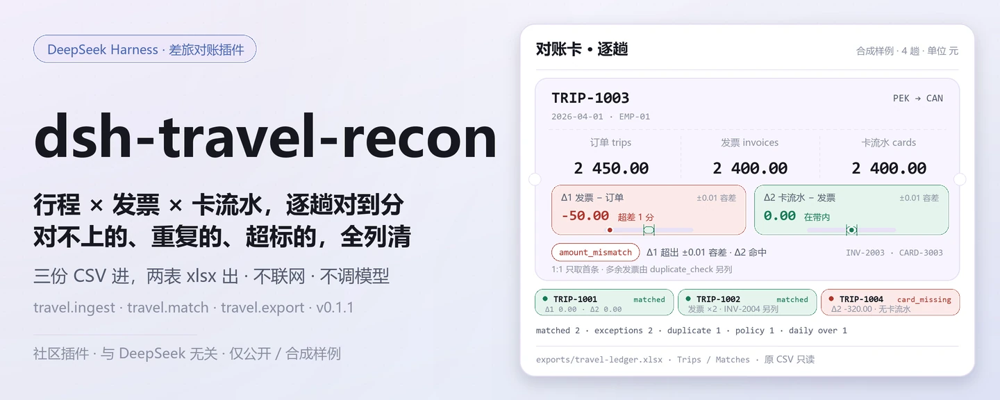
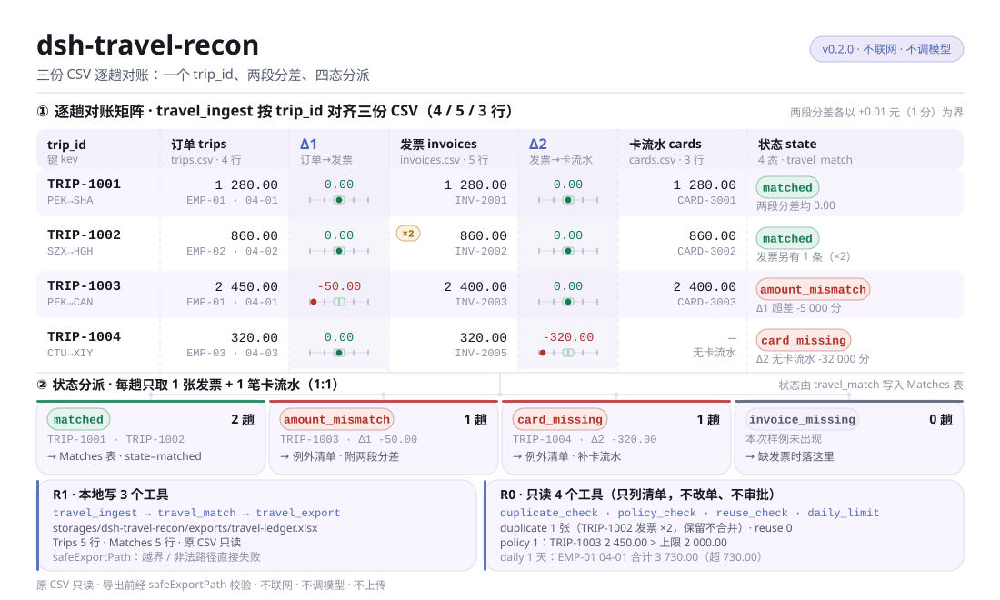
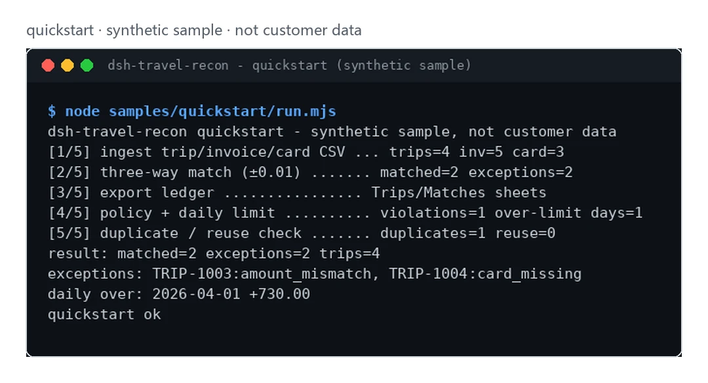

<div align="center">

<picture>
  <source media="(prefers-color-scheme: dark)" srcset="docs/assets/dsh-travel-recon-hero-zh-dark.webp">
  
</picture>

# dsh-travel-recon

**把差旅行程、发票和卡流水一次对上——对不上的单据、重复报销和超标天数直接列清。**

本地对账插件：三份 CSV 进，一份两表 xlsx 台账出；不调模型、不联网、不上传。

[安装](#三步上手) · [配置](#配置) · [FAQ](#faq) · [简体中文](README.md) · [English](README.en.md) · [Español](README.es.md) · [Português](README.pt.md) · [हिन्दी](README.hi.md)

[](LICENSE)
[](#兼容性)
[](https://www.npmjs.com/package/dsh-travel-recon)
[](https://github.com/PerryLink/dsh-travel-recon/actions/workflows/ci.yml)
[](#兼容性)

[](https://github.com/PerryLink/dsh-travel-recon/stargazers)
[](https://www.npmjs.com/package/dsh-travel-recon)
[](https://dshfind.com/plugins/PerryLink/dsh-travel-recon?ref=badge)
[](https://dsh.market/)

```sh
dsh plugin --profile <profile> add dsh-travel-recon
```

</div>

<sub>社区插件，与 DeepSeek 官方无关。唯一官方仓库：<https://github.com/PerryLink/dsh-travel-recon>（其他账号下的同名仓库均非本项目）。Apache-2.0。</sub>

## 它是什么

`dsh-travel-recon` 把差旅行程、发票、卡流水三份 CSV 逐单核对：先导入去重，再按 `trip_id` 做 ±1 分钱的三单匹配，然后把重复报销、金额对不上、缺发票、每日超限的部分单独列成清单，最后导出一份可以直接翻的 xlsx 台账。全程在你自己的机器上跑——不调模型、不联网、不上传，原 CSV 不会被改动。

- **适合**：几十到几百条差旅行程、发票和卡流水；需要一份逐单对账、重复报销提示和每日限额超标的本地台账。
- **不适合**：需要自动审批、打款或修改报销单的场景；本包只做只读检查与本地导出，不替你批准。

<picture>
  <source media="(prefers-color-scheme: dark)" srcset="docs/assets/dsh-travel-recon-flow-v5-dark.svg">
  
</picture>

## 三步上手

1. **安装**（四选一；npm 是推荐通道，其余用于固定版本或离线）：

   ```sh
   # npm（推荐，已发布 0.1.1）
   dsh plugin --profile <profile> add dsh-travel-recon
   # git 通道（最新 main；等价于 git+https://github.com/PerryLink/dsh-travel-recon.git）
   dsh plugin --profile <profile> add github:PerryLink/dsh-travel-recon
   # tarball 通道：本仓库 pnpm pack 后
   dsh plugin --profile <profile> add ./dsh-travel-recon-<version>.tgz
   # 1024 商店通道
   npm i -g dsh1024 && dsh1024 plugin --profile <profile> add dsh-travel-recon
   ```

2. **不用配置**：`cordis.patch.yml` 只 insert 一行 `id: dsh-travel-recon` / `name: 'dsh-travel-recon'`，插件没有 Config 字段，装好即注册 7 个工具。数据目录默认 `$DSH_HOME/storages/dsh-travel-recon`，可用环境变量 `DSH_TRAVEL_HOME` 指到别处。

3. **验证已生效**：

   ```sh
   dsh --profile <profile> --dump-config | grep dsh-travel-recon
   ```

   输出里出现 `dsh-travel-recon` 这一行即挂载成功。再跑一遍自带合成样例（开发树需先 `pnpm build`，发布包已带 `lib/`）：

   ```sh
   node samples/quickstart/run.mjs
   ```

   最后一行是 `quickstart ok`。

**卸载**：`dsh plugin --profile <profile> remove dsh-travel-recon`（或从 profile patch 删掉该行）。

## 核心能力

- **三单匹配（±1 分钱）** — `travel.match` 按 `trip_id` 把行程、发票、卡流水对上，容差 0.01 元；例外分 `invoice_missing` / `card_missing` / `amount_mismatch` 三种原因，逐单返回分差。
- **去重不静默** — 重复的 `trip_id` 保留并作为 issue 报告（`E_TRAVEL_TRIP_DUPLICATE`），同一 id 只入库一次、其余计入 `skipped`；重复发票与重复卡流水由 `travel.duplicate_check` 单独列出。
- **跨行程重复报销** — `travel.reuse_check` 在导入前就能报出同一张发票号或同一笔卡流水覆盖多个行程的双报销模式，不需要已存数据。
- **只读政策检查** — `travel.policy_check`（单笔上限 + 是否必须有发票）与 `travel.daily_limit_check`（每人每日合计上限）都只返回违规清单：不改单据、不审批、不打款。
- **两表台账导出** — `travel.export` 写 `exports/travel-ledger.xlsx`，工作表 `Trips` / `Matches`；路径经越界校验后才写。
- **本地优先** — 源码里没有 HTTP / DNS / WebSocket 调用，也不调模型；输入输出都留在本地。

### 工具面

工具名是稳定 API（`travel.*`），运行时描述为英文；下表是中文用途。

| 工具 | 用途 | 风险 |
|---|---|---|
| `travel.ingest` | 导入差旅行程/发票/卡流水三份 CSV | R1 本地写 |
| `travel.match` | 对订单/发票/卡流水执行三单匹配（写入匹配状态） | R1 本地写 |
| `travel.duplicate_check` | 按行程检测重复的发票/卡流水 | R0 |
| `travel.policy_check` | 只读的金额上限与发票存在性策略检查 | R0 |
| `travel.reuse_check` | 只读的跨行程发票/卡流水重复使用检查 | R0 |
| `travel.daily_limit_check` | 只读的每位员工每日限额检查 | R0 |
| `travel.export` | 导出对账台账 xlsx（`Trips` / `Matches`） | R1 本地写 |

### 输入

- 行程 CSV：UTF-8，表头 `trip_id,employee,origin,destination,date,amount`。
- 发票 CSV：`invoice_id,trip_id,amount`；卡流水 CSV：`txn_id,trip_id,amount`。
- 金额最多两位小数；建议单个文件 ≤5 MB。自带样例在 `samples/quickstart/input/`（合成数据，远小于 500 KB）。
- 三份 CSV 以**文本内容**作为工具参数传入（由会话读取文件后传入），插件不自己按路径找文件。

### 输出

- 终端摘要：对上几单、例外几单、政策违规数与每日超限天数。
- 台账：`$DSH_HOME/storages/dsh-travel-recon/exports/travel-ledger.xlsx`，工作表 `Trips` / `Matches`。
- 原文件不会被修改。

### 示例

直接复制这句话给会话：

> 帮我用自带样例核对这趟差旅的订单、发票和卡流水，列出对不上的单据和超标的天数。

也可以自己跑（真实运行，截图即来自这条命令）：

```sh
node samples/quickstart/run.mjs
```

```text
dsh-travel-recon quickstart - synthetic sample, not customer data
[1/5] ingest trip/invoice/card CSV ... trips=4 inv=5 card=3
[2/5] three-way match (±0.01) ....... matched=2 exceptions=2
[3/5] export ledger ................ Trips/Matches sheets
[4/5] policy + daily limit .......... violations=1 over-limit days=1
[5/5] duplicate / reuse check ....... duplicates=1 reuse=0
result: matched=2 exceptions=2 trips=4
exceptions: TRIP-1003:amount_mismatch, TRIP-1004:card_missing
daily over: 2026-04-01 +730.00
quickstart ok
```

*Observed from `samples/quickstart/run.mjs` 与金标 `samples/quickstart/expected/result.json`（输入哈希记录在 result.json 内；合成数据，非客户运行）。*

<picture>
  <source media="(prefers-color-scheme: dark)" srcset="docs/assets/dsh-travel-recon-quickstart-dark.webp">
  
</picture>

*合成样例 → 金标 `samples/quickstart/expected/result.json`；命令与哈希见 `screenshots.json`。*

## 验收数据

`ACCEPTANCE.csv` 记录了公开合成检查的逐行证据（脚本 `scripts/acceptance.mjs`、`evidence_sha256`、`counted` 标记），可用 `node scripts/acceptance.mjs` 复跑：

| req_id | metric | threshold | actual | pass | source | counted |
|---|---|---|---|---|---|---|
| SKU-15-A01 | 行程解析 | 20/20 | 20 | true | public/synthetic | false |
| SKU-15-A02 | 三方匹配 | 20/20 | 20 | true | public/synthetic | false |
| SKU-15-A03 | 重复行程 | 0 | 0 | true | public/synthetic | false |
| SKU-15-A04 | 台账 sheet | 2 | 2 | true | public/synthetic | false |
| SKU-15-A05 | 重复发票检测 | 1 | 1 | true | public/synthetic | false |
| SKU-15-A06 | 跨行程重复报销 | 1 | 1 | true | public/synthetic | false |
| SKU-15-A07 | 每日限额超标 | 1 | 1 | true | public/synthetic | false |
| PS1-QS01 | quickstart 样例与金标一致 | 1/1 | 1 | true | synthetic/quickstart | true |

*SKU 行是合成数据检查（`counted=false`，不构成客户证据）；PS1-QS01 是随包样例的本地复现（`counted=true`）。`EVIDENCE.md` 的结论：0 趟真实行程，20 趟合成行程/发票/卡流水，4 行通过，不计入，partial。*

## 配置

本插件**没有 Config 字段**：`cordis.patch.yml` 只有 `id` / `name` 两行，装好即用。可调的是数据目录（环境变量）和每次调用传入的工具参数。

| 环境变量 | 默认 | 含义 |
|---|---|---|
| `DSH_TRAVEL_HOME` | 空 | 覆盖数据根目录；空则用下一条 |
| `DSH_HOME` | 进程 cwd | 未设 `DSH_TRAVEL_HOME` 时，数据根目录取 `$DSH_HOME/storages/dsh-travel-recon` |

最常用的调用参数（金额一律以「分」为单位的整数传入）：

| 参数 | 所属工具 | 默认 | 含义 |
|---|---|---|---|
| `trips_csv` | `travel.ingest` | 必填 | 行程 CSV 文本 |
| `invoices_csv` | `travel.ingest` / `travel.reuse_check` | 必填 | 发票 CSV 文本 |
| `cards_csv` | `travel.ingest` / `travel.reuse_check` | 必填 | 卡流水 CSV 文本 |
| `max_order_cents` | `travel.policy_check` | 必填 | 单笔金额上限（分） |
| `require_invoice` | `travel.policy_check` | `false` | 是否要求每个行程都有发票 |
| `cap_cents` | `travel.daily_limit_check` | 必填 | 每人每日合计上限（分） |

<details>
<summary>完整工具与输出（7 个工具）</summary>

| 工具 | 参数 | 返回 | 风险 |
|---|---|---|---|
| `travel.ingest` | `trips_csv`、`invoices_csv`、`cards_csv`（字符串，均必填） | `trips` / `invoices` / `cards` / `skipped` / `duplicate_trips`，以及 `issues[]`（`code`、`trip_id`、`occurrences`） | R1 本地写 |
| `travel.match` | 无 | `matched` / `exceptions` / `duplicate_trips`；每条匹配记录带 `state`、`reason` 与两个分差 | R1 本地写（写匹配状态） |
| `travel.duplicate_check` | 无 | `duplicates[]`（`kind`、`trip_id`、`count`） | R0 |
| `travel.policy_check` | `max_order_cents`（数字，必填）、`require_invoice`（布尔，可选） | `checked` / `violations[]`（`trip_id`、`reason`） | R0 |
| `travel.reuse_check` | `invoices_csv`、`cards_csv`（字符串，均必填） | `invoice_reuse[]` / `card_reuse[]`（`id`、`trips[]`） | R0 |
| `travel.daily_limit_check` | `cap_cents`（数字，必填） | `days` / `over_limit[]`（`employee`、`date`、`total_cents`、`over_by_cents`） | R0 |
| `travel.export` | 无 | `path` / `rows`；两表 xlsx 写在数据目录的 `exports/` 下 | R1 本地写 |

</details>

把数据目录指到别处（只改环境变量，不写进 patch）：

```sh
export DSH_TRAVEL_HOME="$HOME/.local/share/dsh-travel-recon"
```

## FAQ

<details>
<summary>装不上或激活失败怎么办？</summary>

先确认 DSH `>=0.2.1-rc.3 <0.4.0`、Node `>=24.9 <25`，再用全新的 `DSH_HOME` 排除旧配置干扰：

```sh
export DSH_HOME="$(mktemp -d)"
dsh plugin --profile <profile> add dsh-travel-recon
dsh --profile <profile> --dump-config | grep dsh-travel-recon
```

完整排错步骤（金额读不懂、缺列、缺 `trip_id` 三类报错）见 [`TROUBLESHOOTING.md`](TROUBLESHOOTING.md)。

</details>

<details>
<summary>数据存在哪？会上传吗？</summary>

不联网、不上传。匹配状态存在 DSH 的 storage domain（`$DSH_HOME/storages/dsh-travel-recon`），台账写到同一目录下的 `exports/travel-ledger.xlsx`；原 CSV 只读不写。除这些本地路径外，插件不写任何别处，也不调用模型。

</details>

<details>
<summary>为什么有的行程显示 `card_missing`？</summary>

该行程在卡流水里没有对应 `trip_id` 的记录，或金额差超过 0.01 元；先补卡流水，或人工确认是否个人垫付。同类例外还有 `invoice_missing`（缺发票）与 `amount_mismatch`（金额对不上，返回两个分差）。

</details>

<details>
<summary>政策检查会改单据或自动审批吗？</summary>

不会。`travel.policy_check` / `travel.daily_limit_check` / `travel.duplicate_check` / `travel.reuse_check` 都是只读，只返回违规清单；是否批准、是否打款由你决定，本包不提供审批或改单能力。

</details>

<details>
<summary>能处理我的真实差旅数据吗？</summary>

可以本地运行，但本包是 alpha、只用合成数据验证过，输出不构成审计结论；使用真实数据前请先脱敏，并自行复核结果。仓库不接收、不存储客户数据。

</details>

## 安全边界

- **只读输入**：只解析会话传入的 CSV 文本；原文件不会被修改或删除。
- **受控写入**：只写数据目录（匹配状态 + `exports/*.xlsx`）；导出路径经 `safeExportPath` 校验，越界或非法路径直接失败（`E_TRAVEL_PATH_INVALID` / `E_TRAVEL_PATH_NOT_ALLOWED`），不会写到根目录外。
- **无网络、无模型**：源码中没有 HTTP / DNS / WebSocket 调用，工具执行不发起模型请求。
- **无审批动作**：四个检查工具只返回清单，不改单据、不批准、不打款。
- **不静默丢数据**：重复 `trip_id` 保留并作为 issue 报告；CSV 表头或金额格式错误直接报 `<一句人话>（E_XXX）｜下一步：<动作>`，不猜、不跳过。

## 已知限制

- **仅公开/合成样例**：`EVIDENCE.md` 记录 0 趟真实行程、20 趟合成行程/发票/卡流水；仓库不含客户数据，也不作客户运行声明。
- **alpha / partial / not counted / 非 GA**：不作生产可用声明；接口与工具面可能随版本变化。
- **CSV 格式固定**：三份文件表头必须按上文列名（大小写不敏感），金额最多两位小数；建议单个文件 ≤5 MB。
- **匹配是逐行程 1:1**：每个行程只取一条发票与一条卡流水参与三单匹配，同一行程的多条记录由 `travel.duplicate_check` 报告，不会自动合并。
- **不替你批准**：所有检查只读；本包没有审批、打款、改单或对接报销/差旅平台的能力。
- **每个工具的精确边界**见上方工具表与 `ACCEPTANCE.csv`；除非工具明确说明，否则不调用模型、不联网。

## 兼容性

| 维度 | 状态 |
|---|---|
| Harness | `dsh >=0.2.1-rc.3 <0.4.0`（抄自 `package.json` 的 `engines.dsh`） |
| Node | `>=24.9.0 <25` |
| 平台 | 全平台；只读写本地文件 |
| 数据 | 不联网、不调模型、不上传 |

## 生态与质量

- [dshfind 插件页](https://dshfind.com/plugins/PerryLink/dsh-travel-recon)（安装量与排名）
- [DSH Market](https://dsh.market/)（已上架）
- **1024 商店渠道**：先 `npm i -g dsh1024`，再 `dsh1024 plugin --profile <profile> add dsh-travel-recon`（计入 [deepseek1024.com](https://deepseek1024.com) 安装排行）
- [领域索引](https://perrylink.github.io/dsh-plugins/) · [Checker 家族](https://perrylink.github.io/zh/checkers/) · [主线家族 dsh-kit](https://github.com/PerryLink/dsh-kit) · [场景文章](https://perrylink.github.io/dsh-plugins/articles/finops-suite.html)
- [生态实测知识库](https://perrylink.github.io/dsh-plugin-guide/)：插件开发指南 · 选型实测数据 · 维护取舍判据
- [故障排查](TROUBLESHOOTING.md) · [隐私说明](PRIVACY.md) · [安全策略](SECURITY.md)

兄弟包与家族索引：[dsh-einvoice](https://github.com/PerryLink/dsh-einvoice) · [dsh-bankrec](https://github.com/PerryLink/dsh-bankrec) · [dsh-ap-three-way](https://github.com/PerryLink/dsh-ap-three-way) · [dsh-finops-suite](https://github.com/PerryLink/dsh-finops-suite)

相关核查器（各自独立发包、独立版本，按需安装）：

| 包 | 为什么相关 |
|---|---|
| [`dsh-invoice-ledger`](https://github.com/PerryLink/dsh-invoice-ledger) | 同一趟行程的发票异常。 |
| [`dsh-excel-reconcile`](https://github.com/PerryLink/dsh-excel-reconcile) | 内建三单匹配之外的卡/台账对齐。 |

## 开发

```sh
pnpm install --frozen-lockfile
pnpm build && pnpm lint && pnpm typecheck && pnpm test
node samples/quickstart/run.mjs          # 合成样例：应输出 quickstart ok
node scripts/acceptance.mjs              # 验收：明细见 ACCEPTANCE.csv
pnpm pack                                # 发布 tarball
```

目录布局：

```text
src/core/               CSV 解析、金额换算、三单匹配、路径守卫（纯函数）
src/plugin/             Cordis 入口、storage domain 表、7 个工具定义
samples/quickstart/     合成输入 + 金标 result.json + runner
test/*.test.mjs         node --test（11 个测试文件）
scripts/                验收、打包检查、lint、SBOM
docs/assets/            README 配图
cordis.patch.yml        bundle patch（只 insert 本插件一行）
```

当前版本 `0.1.1`（与 `package.json` 一致）；测试 `node --test test/*.test.mjs` 全绿（25 个用例，0 失败）。README 配图由 [`scripts/gen-readme-assets.py`](scripts/gen-readme-assets.py) 程序化生成（Python + Pillow），可重复执行：

```sh
python scripts/gen-readme-assets.py
```

它生成 `dsh-travel-recon-hero-{zh,en}-{light,dark}.webp`（1440×576 横幅）与 `dsh-travel-recon-flow-v5-{light,dark}.svg`（1100×660 结构图），并把真实的 quickstart 截图框成 `dsh-travel-recon-quickstart-{light,dark}.webp`。

## 家族与致谢

本项目是 [PerryLink](https://github.com/PerryLink) 维护的 DeepSeek Harness 插件家族成员（全部 Apache-2.0）。如果它帮到了你，**点个 star**——不解锁任何功能，但会让下一个人更容易找到它。

- [@PerryLink](https://github.com/PerryLink) —— 维护者：三单匹配、只读政策检查、7 个工具面、合成 quickstart 样例与五语文档。

<details>
<summary>展开 DSH 领域插件家族（15 个包 + 2 个 suite）</summary>

| Package | npm |
|---|---|
| **[dsh-einvoice](https://github.com/PerryLink/dsh-einvoice)** | [npm](https://www.npmjs.com/package/dsh-einvoice) |
| **[dsh-docx-redline](https://github.com/PerryLink/dsh-docx-redline)** | [npm](https://www.npmjs.com/package/dsh-docx-redline) |
| **[dsh-policy-ledger](https://github.com/PerryLink/dsh-policy-ledger)** | [npm](https://www.npmjs.com/package/dsh-policy-ledger) |
| **[dsh-ghg](https://github.com/PerryLink/dsh-ghg)** | [npm](https://www.npmjs.com/package/dsh-ghg) |
| **[dsh-bankrec](https://github.com/PerryLink/dsh-bankrec)** | [npm](https://www.npmjs.com/package/dsh-bankrec) |
| **[dsh-ap-three-way](https://github.com/PerryLink/dsh-ap-three-way)** | [npm](https://www.npmjs.com/package/dsh-ap-three-way) |
| **[dsh-ifc-qto](https://github.com/PerryLink/dsh-ifc-qto)** | [npm](https://www.npmjs.com/package/dsh-ifc-qto) |
| **[dsh-qms-capa](https://github.com/PerryLink/dsh-qms-capa)** | [npm](https://www.npmjs.com/package/dsh-qms-capa) |
| **[dsh-legal-intake](https://github.com/PerryLink/dsh-legal-intake)** | [npm](https://www.npmjs.com/package/dsh-legal-intake) |
| **[dsh-legal-clause](https://github.com/PerryLink/dsh-legal-clause)** | [npm](https://www.npmjs.com/package/dsh-legal-clause) |
| **[dsh-freight-audit](https://github.com/PerryLink/dsh-freight-audit)** | [npm](https://www.npmjs.com/package/dsh-freight-audit) |
| **[dsh-hs-candidate](https://github.com/PerryLink/dsh-hs-candidate)** | [npm](https://www.npmjs.com/package/dsh-hs-candidate) |
| **[dsh-travel-recon](https://github.com/PerryLink/dsh-travel-recon)** | [npm](https://www.npmjs.com/package/dsh-travel-recon) |
| **[dsh-pim-lint](https://github.com/PerryLink/dsh-pim-lint)** | [npm](https://www.npmjs.com/package/dsh-pim-lint) |
| **[dsh-eval-pack](https://github.com/PerryLink/dsh-eval-pack)** | [npm](https://www.npmjs.com/package/dsh-eval-pack) |
| **[dsh-finops-suite](https://github.com/PerryLink/dsh-finops-suite)** | [npm](https://www.npmjs.com/package/dsh-finops-suite) |
| **[dsh-contract-suite](https://github.com/PerryLink/dsh-contract-suite)** | [npm](https://www.npmjs.com/package/dsh-contract-suite) |

</details>

<details>
<summary>展开主线家族 — 87 个当前安装 spec</summary>

| Package | npm |
|---|---|
| **[dsh-aqua-input-check](https://github.com/PerryLink/dsh-aqua-input-check)** | [npm](https://www.npmjs.com/package/dsh-aqua-input-check) |
| **[dsh-archive-check](https://github.com/PerryLink/dsh-archive-check)** | [npm](https://www.npmjs.com/package/dsh-archive-check) |
| **[dsh-bid-ca-precheck](https://github.com/PerryLink/dsh-bid-ca-precheck)** | [npm](https://www.npmjs.com/package/dsh-bid-ca-precheck) |
| **[dsh-bid-qual-check](https://github.com/PerryLink/dsh-bid-qual-check)** | [npm](https://www.npmjs.com/package/dsh-bid-qual-check) |
| **[dsh-contract-stance](https://github.com/PerryLink/dsh-contract-stance)** | [npm](https://www.npmjs.com/package/dsh-contract-stance) |
| **[dsh-customs-doc-check](https://github.com/PerryLink/dsh-customs-doc-check)** | [npm](https://www.npmjs.com/package/dsh-customs-doc-check) |
| **[dsh-demurrage-ledger](https://github.com/PerryLink/dsh-demurrage-ledger)** | [npm](https://www.npmjs.com/package/dsh-demurrage-ledger) |
| **[dsh-drill-script-check](https://github.com/PerryLink/dsh-drill-script-check)** | [npm](https://www.npmjs.com/package/dsh-drill-script-check) |
| **[dsh-eia-guide-check](https://github.com/PerryLink/dsh-eia-guide-check)** | [npm](https://www.npmjs.com/package/dsh-eia-guide-check) |
| **[dsh-emergency-plan](https://github.com/PerryLink/dsh-emergency-plan)** | [npm](https://www.npmjs.com/package/dsh-emergency-plan) |
| **[dsh-essay-rubric-check](https://github.com/PerryLink/dsh-essay-rubric-check)** | [npm](https://www.npmjs.com/package/dsh-essay-rubric-check) |
| **[dsh-evidence-check](https://github.com/PerryLink/dsh-evidence-check)** | [npm](https://www.npmjs.com/package/dsh-evidence-check) |
| **[dsh-export-ctl-check](https://github.com/PerryLink/dsh-export-ctl-check)** | [npm](https://www.npmjs.com/package/dsh-export-ctl-check) |
| **[dsh-fmea-table-check](https://github.com/PerryLink/dsh-fmea-table-check)** | [npm](https://www.npmjs.com/package/dsh-fmea-table-check) |
| **[dsh-forecast-penalty](https://github.com/PerryLink/dsh-forecast-penalty)** | [npm](https://www.npmjs.com/package/dsh-forecast-penalty) |
| **[dsh-gongwen-flow-check](https://github.com/PerryLink/dsh-gongwen-flow-check)** | [npm](https://www.npmjs.com/package/dsh-gongwen-flow-check) |
| **[dsh-gongwen-word-check](https://github.com/PerryLink/dsh-gongwen-word-check)** | [npm](https://www.npmjs.com/package/dsh-gongwen-word-check) |
| **[dsh-guard-plan-qc](https://github.com/PerryLink/dsh-guard-plan-qc)** | [npm](https://www.npmjs.com/package/dsh-guard-plan-qc) |
| **[dsh-hazchem-check](https://github.com/PerryLink/dsh-hazchem-check)** | [npm](https://www.npmjs.com/package/dsh-hazchem-check) |
| **[dsh-hazplan-check](https://github.com/PerryLink/dsh-hazplan-check)** | [npm](https://www.npmjs.com/package/dsh-hazplan-check) |
| **[dsh-hidden-risk-map](https://github.com/PerryLink/dsh-hidden-risk-map)** | [npm](https://www.npmjs.com/package/dsh-hidden-risk-map) |
| **[dsh-hs-classify](https://github.com/PerryLink/dsh-hs-classify)** | [npm](https://www.npmjs.com/package/dsh-hs-classify) |
| **[dsh-icd-rule-check](https://github.com/PerryLink/dsh-icd-rule-check)** | [npm](https://www.npmjs.com/package/dsh-icd-rule-check) |
| **[dsh-lawcite-adapter](https://github.com/PerryLink/dsh-lawcite-adapter)** | [npm](https://www.npmjs.com/package/dsh-lawcite-adapter) |
| **[dsh-lc-doc-check](https://github.com/PerryLink/dsh-lc-doc-check)** | [npm](https://www.npmjs.com/package/dsh-lc-doc-check) |
| **[dsh-learning-gap-check](https://github.com/PerryLink/dsh-learning-gap-check)** | [npm](https://www.npmjs.com/package/dsh-learning-gap-check) |
| **[dsh-medrec-qc](https://github.com/PerryLink/dsh-medrec-qc)** | [npm](https://www.npmjs.com/package/dsh-medrec-qc) |
| **[dsh-nsfc-form-check](https://github.com/PerryLink/dsh-nsfc-form-check)** | [npm](https://www.npmjs.com/package/dsh-nsfc-form-check) |
| **[dsh-nurse-record-check](https://github.com/PerryLink/dsh-nurse-record-check)** | [npm](https://www.npmjs.com/package/dsh-nurse-record-check) |
| **[dsh-origin-rvc-check](https://github.com/PerryLink/dsh-origin-rvc-check)** | [npm](https://www.npmjs.com/package/dsh-origin-rvc-check) |
| **[dsh-ota-review-check](https://github.com/PerryLink/dsh-ota-review-check)** | [npm](https://www.npmjs.com/package/dsh-ota-review-check) |
| **[dsh-paper-doc-adapter](https://github.com/PerryLink/dsh-paper-doc-adapter)** | [npm](https://www.npmjs.com/package/dsh-paper-doc-adapter) |
| **[dsh-permit-report-check](https://github.com/PerryLink/dsh-permit-report-check)** | [npm](https://www.npmjs.com/package/dsh-permit-report-check) |
| **[dsh-pipeline-check](https://github.com/PerryLink/dsh-pipeline-check)** | [npm](https://www.npmjs.com/package/dsh-pipeline-check) |
| **[dsh-pleading-draft](https://github.com/PerryLink/dsh-pleading-draft)** | [npm](https://www.npmjs.com/package/dsh-pleading-draft) |
| **[dsh-policy-brief-draft](https://github.com/PerryLink/dsh-policy-brief-draft)** | [npm](https://www.npmjs.com/package/dsh-policy-brief-draft) |
| **[dsh-power-loss-split](https://github.com/PerryLink/dsh-power-loss-split)** | [npm](https://www.npmjs.com/package/dsh-power-loss-split) |
| **[dsh-power-ticket-check](https://github.com/PerryLink/dsh-power-ticket-check)** | [npm](https://www.npmjs.com/package/dsh-power-ticket-check) |
| **[dsh-ppap-check](https://github.com/PerryLink/dsh-ppap-check)** | [npm](https://www.npmjs.com/package/dsh-ppap-check) |
| **[dsh-protest-deadline](https://github.com/PerryLink/dsh-protest-deadline)** | [npm](https://www.npmjs.com/package/dsh-protest-deadline) |
| **[dsh-railway-window](https://github.com/PerryLink/dsh-railway-window)** | [npm](https://www.npmjs.com/package/dsh-railway-window) |
| **[dsh-repair-order-qc](https://github.com/PerryLink/dsh-repair-order-qc)** | [npm](https://www.npmjs.com/package/dsh-repair-order-qc) |
| **[dsh-review-reply-check](https://github.com/PerryLink/dsh-review-reply-check)** | [npm](https://www.npmjs.com/package/dsh-review-reply-check) |
| **[dsh-rulefile-check](https://github.com/PerryLink/dsh-rulefile-check)** | [npm](https://www.npmjs.com/package/dsh-rulefile-check) |
| **[dsh-safety-brief-check](https://github.com/PerryLink/dsh-safety-brief-check)** | [npm](https://www.npmjs.com/package/dsh-safety-brief-check) |
| **[dsh-site-log-check](https://github.com/PerryLink/dsh-site-log-check)** | [npm](https://www.npmjs.com/package/dsh-site-log-check) |
| **[dsh-soe-decision-check](https://github.com/PerryLink/dsh-soe-decision-check)** | [npm](https://www.npmjs.com/package/dsh-soe-decision-check) |
| **[dsh-soilwater-check](https://github.com/PerryLink/dsh-soilwater-check)** | [npm](https://www.npmjs.com/package/dsh-soilwater-check) |
| **[dsh-sop-sync-check](https://github.com/PerryLink/dsh-sop-sync-check)** | [npm](https://www.npmjs.com/package/dsh-sop-sync-check) |
| **[dsh-spc-gbt-adapter](https://github.com/PerryLink/dsh-spc-gbt-adapter)** | [npm](https://www.npmjs.com/package/dsh-spc-gbt-adapter) |
| **[dsh-tender-extract](https://github.com/PerryLink/dsh-tender-extract)** | [npm](https://www.npmjs.com/package/dsh-tender-extract) |
| **[dsh-tender-matrix](https://github.com/PerryLink/dsh-tender-matrix)** | [npm](https://www.npmjs.com/package/dsh-tender-matrix) |
| **[dsh-warranty-calc](https://github.com/PerryLink/dsh-warranty-calc)** | [npm](https://www.npmjs.com/package/dsh-warranty-calc) |
| **[dsh-auto-review](https://github.com/PerryLink/dsh-auto-review)** | [npm](https://www.npmjs.com/package/dsh-auto-review) |
| **[dsh-autotier](https://github.com/PerryLink/dsh-autotier)** | [npm](https://www.npmjs.com/package/dsh-autotier) |
| **[dsh-budget](https://github.com/PerryLink/dsh-budget)** | [npm](https://www.npmjs.com/package/dsh-budget) |
| **[dsh-cert-mcp](https://github.com/PerryLink/dsh-cert-mcp)** | [npm](https://www.npmjs.com/package/dsh-cert-mcp) |
| **[dsh-checkpoint-rewind](https://github.com/PerryLink/dsh-checkpoint-rewind)** | [npm](https://www.npmjs.com/package/dsh-checkpoint-rewind) |
| **[dsh-claude-move](https://github.com/PerryLink/dsh-claude-move)** | [npm](https://www.npmjs.com/package/dsh-claude-move) |
| **[dsh-click](https://github.com/PerryLink/dsh-click)** | [npm](https://www.npmjs.com/package/dsh-click) |
| **[dsh-composer-history](https://github.com/PerryLink/dsh-composer-history)** | [npm](https://www.npmjs.com/package/dsh-composer-history) |
| **[dsh-data-quality](https://github.com/PerryLink/dsh-data-quality)** | [npm](https://www.npmjs.com/package/dsh-data-quality) |
| **[dsh-defend](https://github.com/PerryLink/dsh-defend)** | [npm](https://www.npmjs.com/package/dsh-defend) |
| **[dsh-doublecheck](https://github.com/PerryLink/dsh-doublecheck)** | [npm](https://www.npmjs.com/package/dsh-doublecheck) |
| **[dsh-draw](https://github.com/PerryLink/dsh-draw)** | [npm](https://www.npmjs.com/package/dsh-draw) |
| **[dsh-fast](https://github.com/PerryLink/dsh-fast)** | [npm](https://www.npmjs.com/package/dsh-fast) |
| **[dsh-fund-research](https://github.com/PerryLink/dsh-fund-research)** | [npm](https://www.npmjs.com/package/dsh-fund-research) |
| **[dsh-industry-research](https://github.com/PerryLink/dsh-industry-research)** | [npm](https://www.npmjs.com/package/dsh-industry-research) |
| **[dsh-laya](https://github.com/PerryLink/dsh-laya)** | [npm](https://www.npmjs.com/package/dsh-laya) |
| **[dsh-library](https://github.com/PerryLink/dsh-library)** | [npm](https://www.npmjs.com/package/dsh-library) |
| **[dsh-local-ai](https://github.com/PerryLink/dsh-local-ai)** | [npm](https://www.npmjs.com/package/dsh-local-ai) |
| **[dsh-lsp-actions](https://github.com/PerryLink/dsh-lsp-actions)** | [npm](https://www.npmjs.com/package/dsh-lsp-actions) |
| **[dsh-mask](https://github.com/PerryLink/dsh-mask)** | [npm](https://www.npmjs.com/package/dsh-mask) |
| **[dsh-mcp-panel](https://github.com/PerryLink/dsh-mcp-panel)** | [npm](https://www.npmjs.com/package/dsh-mcp-panel) |
| **[dsh-memento](https://github.com/PerryLink/dsh-memento)** | [npm](https://www.npmjs.com/package/dsh-memento) |
| **[dsh-observe](https://github.com/PerryLink/dsh-observe)** | [npm](https://www.npmjs.com/package/dsh-observe) |
| **[dsh-output-styles](https://github.com/PerryLink/dsh-output-styles)** | [npm](https://www.npmjs.com/package/dsh-output-styles) |
| **[dsh-permission-rules](https://github.com/PerryLink/dsh-permission-rules)** | [npm](https://www.npmjs.com/package/dsh-permission-rules) |
| **[dsh-plugin-guide](https://github.com/PerryLink/dsh-plugin-guide)** | [npm](https://www.npmjs.com/package/dsh-plugin-guide) |
| **[dsh-plugin-upgrade](https://github.com/PerryLink/dsh-plugin-upgrade)** | [npm](https://www.npmjs.com/package/dsh-plugin-upgrade) |
| **[dsh-reach](https://github.com/PerryLink/dsh-reach)** | [npm](https://www.npmjs.com/package/dsh-reach) |
| **[dsh-research-report](https://github.com/PerryLink/dsh-research-report)** | [npm](https://www.npmjs.com/package/dsh-research-report) |
| **[dsh-score](https://github.com/PerryLink/dsh-score)** | [npm](https://www.npmjs.com/package/dsh-score) |
| **[dsh-session-sync](https://github.com/PerryLink/dsh-session-sync)** | [npm](https://www.npmjs.com/package/dsh-session-sync) |
| **[dsh-talk](https://github.com/PerryLink/dsh-talk)** | [npm](https://www.npmjs.com/package/dsh-talk) |
| **[dsh-test-drive](https://github.com/PerryLink/dsh-test-drive)** | [npm](https://www.npmjs.com/package/dsh-test-drive) |
| **[dsh-translate](https://github.com/PerryLink/dsh-translate)** | [npm](https://www.npmjs.com/package/dsh-translate) |

</details>

## License

[LICENSE](LICENSE)（Apache License 2.0）© 2026 dsh-travel-recon contributors。另见 `NOTICE` 与 `THIRD-PARTY-NOTICES`。

<p align="center"><sub>Apache-2.0 · 社区插件，与 DeepSeek 无关。</sub></p>
