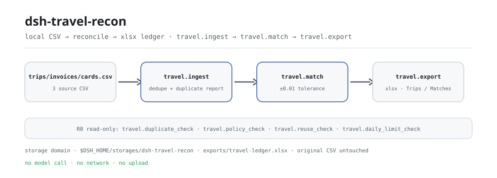
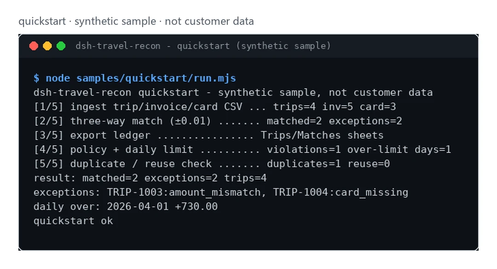

<div align="center">

<picture>
  <source media="(prefers-color-scheme: dark)" srcset="docs/assets/dsh-travel-recon-flow-dark.svg">
  
</picture>

# dsh-travel-recon

**Concilie ordens de viagem, faturas e lançamentos de cartão numa só passada: divergências, duplicidades e dias acima do limite, tudo listado.**

Um plugin local de conciliação: três CSV entram, um livro xlsx de duas folhas sai; sem chamada ao modelo, sem rede, sem upload.

[Instalar](#instalação-em-três-passos) · [Configuração](#configuração) · [FAQ](#faq) · [简体中文](README.md) · [English](README.en.md) · [Español](README.es.md) · [Português](README.pt.md) · [हिन्दी](README.hi.md)

[](LICENSE)
[](#compatibilidade)
[](https://www.npmjs.com/package/dsh-travel-recon)
[](https://github.com/PerryLink/dsh-travel-recon/actions/workflows/ci.yml)
[](#compatibilidade)

[](https://github.com/PerryLink/dsh-travel-recon/stargazers)
[](https://www.npmjs.com/package/dsh-travel-recon)
[](https://dshfind.com/plugins/PerryLink/dsh-travel-recon?ref=badge)
[](https://dsh.market/)

```sh
dsh plugin --profile <profile> add dsh-travel-recon
```

</div>

<sub>Plugin da comunidade, sem vínculo com a DeepSeek. Repositório oficial único: <https://github.com/PerryLink/dsh-travel-recon> (repositórios com o mesmo nome em outras contas não são este projeto). Apache-2.0.</sub>

## O que é

`dsh-travel-recon` concilia três CSV — ordens de viagem, faturas e lançamentos de cartão — linha a linha: importa e deduplica, faz o cruzamento de três vias com tolerância de ±1 centavo sobre `trip_id` e depois lista duplicidades, diferenças de valor, faturas ausentes e dias acima do limite diário; por fim exporta um livro xlsx pronto para consulta. Tudo roda na sua própria máquina: sem chamada ao modelo, sem rede, sem upload, e os CSV originais nunca são alterados.

- **Encaixa bem**: dezenas a centenas de viagens, faturas e lançamentos; você quer conciliação por viagem, avisos de duplicidade e um livro local de limites diários.
- **Não encaixa**: cenários que exigem aprovação automática, pagamento ou alteração de formulários de despesa; este pacote só faz verificações somente leitura e exportação local — não aprova nada por você.

## Instalação em três passos

1. **Instalar** (escolha um canal; npm é o recomendado, os demais servem para fixar versão ou uso offline):

   ```sh
   # npm (recomendado, 0.1.1 publicado)
   dsh plugin --profile <profile> add dsh-travel-recon
   # canal git (main mais recente; equivale a git+https://github.com/PerryLink/dsh-travel-recon.git)
   dsh plugin --profile <profile> add github:PerryLink/dsh-travel-recon
   # canal tarball: pnpm pack neste repositório e depois
   dsh plugin --profile <profile> add ./dsh-travel-recon-<version>.tgz
   # canal loja 1024
   npm i -g dsh1024 && dsh1024 plugin --profile <profile> add dsh-travel-recon
   ```

2. **Sem configuração**: `cordis.patch.yml` insere apenas uma linha — `id: dsh-travel-recon` / `name: 'dsh-travel-recon'` — e o plugin não tem campos Config, portanto registra as sete ferramentas na instalação. O diretório de dados padrão é `$DSH_HOME/storages/dsh-travel-recon`; defina `DSH_TRAVEL_HOME` para apontar para outro lugar.

3. **Verificar que está montado**:

   ```sh
   dsh --profile <profile> --dump-config | grep dsh-travel-recon
   ```

   Uma linha contendo `dsh-travel-recon` significa que está montado. Depois rode o exemplo sintético incluído (em árvore de desenvolvimento compile antes com `pnpm build`; o pacote publicado já traz `lib/`):

   ```sh
   node samples/quickstart/run.mjs
   ```

   A última linha é `quickstart ok`.

**Desinstalar**: `dsh plugin --profile <profile> remove dsh-travel-recon` (ou remova a linha do patch do perfil).

## Capacidades principais

- **Cruzamento de três vias (±1 centavo)** — `travel.match` une ordens, faturas e cartões por `trip_id` com tolerância de 0.01; as exceções voltam por viagem como `invoice_missing`, `card_missing` ou `amount_mismatch`, com as duas diferenças.
- **Deduplicação sem silêncio** — `trip_id` repetidos são mantidos e reportados como issues (`E_TRAVEL_TRIP_DUPLICATE`); cada id é gravado uma vez e o restante entra em `skipped`. Faturas e lançamentos duplicados são listados por `travel.duplicate_check`.
- **Duplicidade entre viagens** — `travel.reuse_check` aponta uma fatura ou um lançamento de cartão que aparece em mais de uma viagem antes de importar; não precisa de dados já gravados.
- **Verificações somente leitura** — `travel.policy_check` (teto por viagem + presença de fatura) e `travel.daily_limit_check` (teto diário por funcionário) apenas devolvem listas de violações: sem edições, sem aprovação, sem pagamento.
- **Exportação de livro de duas folhas** — `travel.export` grava `exports/travel-ledger.xlsx` com as folhas `Trips` / `Matches`; o caminho passa por uma validação de escape antes da escrita.
- **Local primeiro** — não há chamadas HTTP, DNS ou WebSocket no código, nem chamadas ao modelo; entrada e saída ficam na máquina.

### Superfície de ferramentas

Os nomes das ferramentas são API estável (`travel.*`); as descrições em tempo de execução são em inglês, igual à saída.

| Ferramenta | Propósito | Risco |
|---|---|---|
| `travel.ingest` | Importa linhas de ordens/faturas/cartões | R1 escrita local |
| `travel.match` | Cruzamento de três vias ordem/fatura/cartão (grava o estado) | R1 escrita local |
| `travel.duplicate_check` | Detecta fatura/cartão duplicado por viagem | R0 |
| `travel.policy_check` | Verificação somente leitura de teto e presença de fatura | R0 |
| `travel.reuse_check` | Verificação somente leitura de reutilização entre viagens | R0 |
| `travel.daily_limit_check` | Verificação somente leitura do teto diário por funcionário | R0 |
| `travel.export` | Exporta o livro xlsx de conciliação (`Trips` / `Matches`) | R1 escrita local |

### Entrada

- CSV de viagens: UTF-8 com cabeçalho `trip_id,employee,origin,destination,date,amount`.
- CSV de faturas: `invoice_id,trip_id,amount`; CSV de cartões: `txn_id,trip_id,amount`.
- Valores aceitam no máximo duas casas decimais; mantenha cada arquivo com até 5 MB. O exemplo incluído fica em `samples/quickstart/input/` (sintético, bem abaixo de 500 KB).
- Os três CSV são passados como **texto** nos argumentos da ferramenta (a sessão lê o arquivo e passa o conteúdo); o plugin nunca resolve caminhos sozinho.

### Saída

- Resumo no terminal: quantas viagens conciliadas, quantas exceções, violações de política e dias acima do limite.
- Livro: `$DSH_HOME/storages/dsh-travel-recon/exports/travel-ledger.xlsx`, folhas `Trips` / `Matches`.
- Os arquivos originais nunca são alterados.

### Exemplo

Cole esta frase na sessão:

> Me ajude a conferir os pedidos, as faturas e os lançamentos de cartão desta viagem com o exemplo incluído e liste os documentos divergentes e os dias acima do limite.

Ou rode você mesmo (execução real: a captura abaixo vem deste comando):

```sh
node samples/quickstart/run.mjs
```

```text
dsh-travel-recon quickstart - synthetic sample, not customer data
[1/5] ingest trip/invoice/card CSV ... trips=4 inv=5 card=3
[2/5] three-way match (±0.01) ....... matched=2 exceptions=2
[3/5] export ledger ................ Trips/Matches sheets
[4/5] policy + daily limit .......... violations=1 over-limit days=1
[5/5] duplicate / reuse check ....... duplicates=1 reuse=0
result: matched=2 exceptions=2 trips=4
exceptions: TRIP-1003:amount_mismatch, TRIP-1004:card_missing
daily over: 2026-04-01 +730.00
quickstart ok
```

*Observado em `samples/quickstart/run.mjs` e no gabarito `samples/quickstart/expected/result.json` (os hashes de entrada ficam em result.json; dados sintéticos, não uma execução de cliente).*

<picture>
  <source media="(prefers-color-scheme: dark)" srcset="docs/assets/dsh-travel-recon-quickstart-dark.webp">
  
</picture>

*Exemplo sintético → gabarito `samples/quickstart/expected/result.json`; comando e hashes em `screenshots.json`.*

## Dados de aceitação

`ACCEPTANCE.csv` registra as verificações sintéticas públicas linha a linha (script `scripts/acceptance.mjs`, `evidence_sha256`, marca `counted`); repita com `node scripts/acceptance.mjs`:

| req_id | metric | threshold | actual | pass | source | counted |
|---|---|---|---|---|---|---|
| SKU-15-A01 | análise das viagens | 20/20 | 20 | true | public/synthetic | false |
| SKU-15-A02 | cruzamento de três vias | 20/20 | 20 | true | public/synthetic | false |
| SKU-15-A03 | viagens duplicadas | 0 | 0 | true | public/synthetic | false |
| SKU-15-A04 | folhas do livro | 2 | 2 | true | public/synthetic | false |
| SKU-15-A05 | detecção de fatura duplicada | 1 | 1 | true | public/synthetic | false |
| SKU-15-A06 | duplicidade entre viagens | 1 | 1 | true | public/synthetic | false |
| SKU-15-A07 | estouro do limite diário | 1 | 1 | true | public/synthetic | false |
| PS1-QS01 | exemplo quickstart igual ao gabarito | 1/1 | 1 | true | synthetic/quickstart | true |

*Os rótulos foram traduzidos aqui; `ACCEPTANCE.csv` é a fonte canônica. As linhas SKU são verificações sintéticas (`counted=false`, sem evidência de cliente); PS1-QS01 reproduz localmente o exemplo incluído (`counted=true`). `EVIDENCE.md`: 0 viagens reais, 20 viagens/faturas/cartões sintéticos, 4 linhas passam, não contabilizado, parcial.*

## Configuração

Este plugin **não tem campos Config**: `cordis.patch.yml` traz apenas `id` / `name`, então funciona ao instalar. O que dá para ajustar é o diretório de dados (variável de ambiente) e os argumentos de cada chamada.

| Variável de ambiente | Padrão | Significado |
|---|---|---|
| `DSH_TRAVEL_HOME` | vazio | Substitui a raiz de dados; se vazio vale a linha seguinte |
| `DSH_HOME` | cwd do processo | Sem `DSH_TRAVEL_HOME`, a raiz é `$DSH_HOME/storages/dsh-travel-recon` |

Argumentos de chamada mais usados (dinheiro sempre em centavos, inteiro):

| Argumento | Ferramenta | Padrão | Significado |
|---|---|---|---|
| `trips_csv` | `travel.ingest` | obrigatório | Texto CSV de viagens |
| `invoices_csv` | `travel.ingest` / `travel.reuse_check` | obrigatório | Texto CSV de faturas |
| `cards_csv` | `travel.ingest` / `travel.reuse_check` | obrigatório | Texto CSV de cartões |
| `max_order_cents` | `travel.policy_check` | obrigatório | Teto por viagem (centavos) |
| `require_invoice` | `travel.policy_check` | `false` | Exigir fatura em cada viagem |
| `cap_cents` | `travel.daily_limit_check` | obrigatório | Teto diário por funcionário (centavos) |

<details>
<summary>Superfície completa de ferramentas e saídas (7 ferramentas)</summary>

| Ferramenta | Argumentos | Retorna | Risco |
|---|---|---|---|
| `travel.ingest` | `trips_csv`, `invoices_csv`, `cards_csv` (texto, obrigatórios) | `trips` / `invoices` / `cards` / `skipped` / `duplicate_trips`, mais `issues[]` (`code`, `trip_id`, `occurrences`) | R1 escrita local |
| `travel.match` | nenhum | `matched` / `exceptions` / `duplicate_trips`; cada registro traz `state`, `reason` e as duas diferenças | R1 escrita local (estado) |
| `travel.duplicate_check` | nenhum | `duplicates[]` (`kind`, `trip_id`, `count`) | R0 |
| `travel.policy_check` | `max_order_cents` (número, obrigatório), `require_invoice` (booleano, opcional) | `checked` / `violations[]` (`trip_id`, `reason`) | R0 |
| `travel.reuse_check` | `invoices_csv`, `cards_csv` (texto, obrigatórios) | `invoice_reuse[]` / `card_reuse[]` (`id`, `trips[]`) | R0 |
| `travel.daily_limit_check` | `cap_cents` (número, obrigatório) | `days` / `over_limit[]` (`employee`, `date`, `total_cents`, `over_by_cents`) | R0 |
| `travel.export` | nenhum | `path` / `rows`; o xlsx de duas folhas vai para `exports/` dentro do diretório de dados | R1 escrita local |

</details>

Apontar o diretório de dados para outro lugar (só ambiente, nada vai para o patch):

```sh
export DSH_TRAVEL_HOME="$HOME/.local/share/dsh-travel-recon"
```

## FAQ

<details>
<summary>A instalação ou ativação falha — e agora?</summary>

Confirme DSH `>=0.2.1-rc.3 <0.4.0` e Node `>=24.9 <25`, e tente de novo com um `DSH_HOME` novo para descartar configuração antiga:

```sh
export DSH_HOME="$(mktemp -d)"
dsh plugin --profile <profile> add dsh-travel-recon
dsh --profile <profile> --dump-config | grep dsh-travel-recon
```

O guia completo (valores ilegíveis, colunas ausentes, `trip_id` ausente) está em [`TROUBLESHOOTING.md`](TROUBLESHOOTING.md).

</details>

<details>
<summary>Onde ficam os dados? Algo é enviado?</summary>

Sem rede e sem upload. O estado da conciliação fica no storage domain do DSH (`$DSH_HOME/storages/dsh-travel-recon`) e o livro é gravado em `exports/travel-ledger.xlsx` no mesmo diretório; os CSV de origem são somente leitura. O plugin não grava em nenhum outro lugar nem chama modelo.

</details>

<details>
<summary>Por que uma viagem mostra `card_missing`?</summary>

Essa viagem não tem lançamento de cartão com o mesmo `trip_id`, ou o valor difere em mais de 0.01; inclua o lançamento ou confirme que foi pago por fora. Os outros motivos são `invoice_missing` (sem fatura) e `amount_mismatch` (valores diferentes, com as duas diferenças).

</details>

<details>
<summary>As verificações de política editam documentos ou aprovam algo?</summary>

Não. `travel.policy_check` / `travel.daily_limit_check` / `travel.duplicate_check` / `travel.reuse_check` são somente leitura e apenas devolvem listas de violações; aprovação e pagamento continuam com você, e o pacote não traz capacidade de aprovação ou edição.

</details>

<details>
<summary>Posso usar meus dados reais de viagem?</summary>

Dá para rodar localmente, mas o pacote é alpha e só foi validado com dados sintéticos; a saída não é uma conclusão de auditoria. Anonimize os dados reais antes e revise o resultado você mesmo. O repositório não aceita nem armazena dados de clientes.

</details>

## Limites de segurança

- **Entrada somente leitura**: só o texto CSV passado pela sessão é analisado; arquivos de origem nunca são alterados ou apagados.
- **Escritas controladas**: só o diretório de dados (estado + `exports/*.xlsx`); o caminho de exportação passa por `safeExportPath` e um caminho fora dos limites ou inválido falha fechado (`E_TRAVEL_PATH_INVALID` / `E_TRAVEL_PATH_NOT_ALLOWED`) em vez de gravar fora da raiz.
- **Sem rede e sem modelo**: não há chamadas HTTP, DNS ou WebSocket no código, e a execução das ferramentas não faz requisições ao modelo.
- **Sem ação de aprovação**: as quatro ferramentas de verificação só devolvem listas — sem edições, sem aprovação, sem pagamento.
- **Sem perda silenciosa**: `trip_id` duplicados são mantidos e reportados como issues; cabeçalho ou valor inválido falha com uma mensagem clara, um código `E_XXX` e uma dica de próximo passo, em vez de adivinhar ou pular.

## Limitações conhecidas

- **Só público/sintético**: `EVIDENCE.md` registra 0 viagens reais e 20 viagens/faturas/cartões sintéticos; o repositório não contém dados de clientes nem faz afirmação de execução com clientes.
- **alpha / parcial / não contabilizado / não GA**: sem afirmação de prontidão para produção; a superfície de ferramentas pode mudar entre versões.
- **Formato CSV fixo**: os cabeçalhos precisam dos nomes acima (sem diferenciar maiúsculas) e os valores aceitam no máximo duas casas decimais; mantenha cada arquivo com até 5 MB.
- **Cruzamento 1:1 por viagem**: cada viagem contribui com uma fatura e um lançamento de cartão para o cruzamento de três vias; linhas extras da mesma viagem são reportadas por `travel.duplicate_check` e nunca são fundidas automaticamente.
- **Não aprova por você**: toda verificação é somente leitura; não há aprovação, pagamento, edição de documentos ou integração com plataformas de despesas/viagens.
- **Os limites exatos por ferramenta** estão na tabela acima e em `ACCEPTANCE.csv`; salvo indicação explícita de uma ferramenta, sem chamada ao modelo e sem rede.

## Compatibilidade

| Superfície | Status |
|---|---|
| Harness | `dsh >=0.2.1-rc.3 <0.4.0` (de `engines.dsh` em `package.json`) |
| Node | `>=24.9.0 <25` |
| Plataformas | Todas; apenas arquivos locais |
| Dados | Sem rede, sem chamada ao modelo, sem upload |

## Ecossistema e qualidade

- [Página do plugin no dshfind](https://dshfind.com/plugins/PerryLink/dsh-travel-recon) (instalações e ranking)
- [DSH Market](https://dsh.market/) (listado)
- **Canal loja 1024**: `npm i -g dsh1024` uma vez e depois `dsh1024 plugin --profile <profile> add dsh-travel-recon` (conta para o ranking do [deepseek1024.com](https://deepseek1024.com))
- [Índice de domínio](https://perrylink.github.io/dsh-plugins/) · [Família de checkers](https://perrylink.github.io/zh/checkers/) · [Família principal dsh-kit](https://github.com/PerryLink/dsh-kit) · [Artigo de cenário](https://perrylink.github.io/dsh-plugins/articles/finops-suite.html)
- [Base de conhecimento do ecossistema](https://perrylink.github.io/dsh-plugin-guide/): guia de desenvolvimento · dados de seleção · critérios de manutenção
- [Solução de problemas](TROUBLESHOOTING.md) · [Privacidade](PRIVACY.md) · [Política de segurança](SECURITY.md)

Pacotes irmãos e índices da família: [dsh-einvoice](https://github.com/PerryLink/dsh-einvoice) · [dsh-bankrec](https://github.com/PerryLink/dsh-bankrec) · [dsh-ap-three-way](https://github.com/PerryLink/dsh-ap-three-way) · [dsh-finops-suite](https://github.com/PerryLink/dsh-finops-suite)

Checkers relacionados (pacotes separados, com versão própria; instale só os que precisar):

| Pacote | Por que é relevante |
|---|---|
| [`dsh-invoice-ledger`](https://github.com/PerryLink/dsh-invoice-ledger) | Anomalias de faturas da mesma viagem. |
| [`dsh-excel-reconcile`](https://github.com/PerryLink/dsh-excel-reconcile) | Alinhamento cartão/livro fora do cruzamento embutido. |

## Desenvolvimento

```sh
pnpm install --frozen-lockfile
pnpm build && pnpm lint && pnpm typecheck && pnpm test
node samples/quickstart/run.mjs          # exemplo sintético: deve imprimir quickstart ok
node scripts/acceptance.mjs              # aceitação: detalhes em ACCEPTANCE.csv
pnpm pack                                # tarball publicado
```

Estrutura:

```text
src/core/               análise de CSV, conversão para centavos, cruzamento de três vias, guarda de caminhos (funções puras)
src/plugin/             entrada Cordis, tabelas do storage domain, as 7 ferramentas
samples/quickstart/     entrada sintética + result.json gabarito + runner
test/*.test.mjs         node --test (11 arquivos de teste)
scripts/                aceitação, checagens de empacotamento, lint, SBOM
docs/assets/            imagens do README
cordis.patch.yml        patch do bundle (insere apenas a linha deste plugin)
```

Versão atual `0.1.1` (igual ao `package.json`); `node --test test/*.test.mjs` passa verde (25 casos, 0 falhas). As imagens do README são geradas por [`scripts/gen-readme-assets.py`](scripts/gen-readme-assets.py) (Python + Pillow) e podem ser repetidas:

```sh
python scripts/gen-readme-assets.py
```

Ele reescreve `docs/assets/dsh-travel-recon-flow-{light,dark}.svg` e enquadra a captura real do quickstart como `dsh-travel-recon-quickstart-{light,dark}.webp`.

## Família e agradecimentos

Este projeto faz parte da família de plugins do DeepSeek Harness mantida pela [PerryLink](https://github.com/PerryLink) (todos Apache-2.0). Se for útil, **uma estrela ajuda a próxima pessoa a encontrá-lo** — nada fica bloqueado atrás dela.

- [@PerryLink](https://github.com/PerryLink) — mantenedor: cruzamento de três vias, verificações somente leitura, a superfície de 7 ferramentas, o exemplo quickstart sintético e a documentação em cinco idiomas.

<details>
<summary>Expandir a família de plugins de domínio DSH (15 pacotes + 2 suítes)</summary>

| Pacote | npm |
|---|---|
| **[dsh-einvoice](https://github.com/PerryLink/dsh-einvoice)** | [npm](https://www.npmjs.com/package/dsh-einvoice) |
| **[dsh-docx-redline](https://github.com/PerryLink/dsh-docx-redline)** | [npm](https://www.npmjs.com/package/dsh-docx-redline) |
| **[dsh-policy-ledger](https://github.com/PerryLink/dsh-policy-ledger)** | [npm](https://www.npmjs.com/package/dsh-policy-ledger) |
| **[dsh-ghg](https://github.com/PerryLink/dsh-ghg)** | [npm](https://www.npmjs.com/package/dsh-ghg) |
| **[dsh-bankrec](https://github.com/PerryLink/dsh-bankrec)** | [npm](https://www.npmjs.com/package/dsh-bankrec) |
| **[dsh-ap-three-way](https://github.com/PerryLink/dsh-ap-three-way)** | [npm](https://www.npmjs.com/package/dsh-ap-three-way) |
| **[dsh-ifc-qto](https://github.com/PerryLink/dsh-ifc-qto)** | [npm](https://www.npmjs.com/package/dsh-ifc-qto) |
| **[dsh-qms-capa](https://github.com/PerryLink/dsh-qms-capa)** | [npm](https://www.npmjs.com/package/dsh-qms-capa) |
| **[dsh-legal-intake](https://github.com/PerryLink/dsh-legal-intake)** | [npm](https://www.npmjs.com/package/dsh-legal-intake) |
| **[dsh-legal-clause](https://github.com/PerryLink/dsh-legal-clause)** | [npm](https://www.npmjs.com/package/dsh-legal-clause) |
| **[dsh-freight-audit](https://github.com/PerryLink/dsh-freight-audit)** | [npm](https://www.npmjs.com/package/dsh-freight-audit) |
| **[dsh-hs-candidate](https://github.com/PerryLink/dsh-hs-candidate)** | [npm](https://www.npmjs.com/package/dsh-hs-candidate) |
| **[dsh-travel-recon](https://github.com/PerryLink/dsh-travel-recon)** | [npm](https://www.npmjs.com/package/dsh-travel-recon) |
| **[dsh-pim-lint](https://github.com/PerryLink/dsh-pim-lint)** | [npm](https://www.npmjs.com/package/dsh-pim-lint) |
| **[dsh-eval-pack](https://github.com/PerryLink/dsh-eval-pack)** | [npm](https://www.npmjs.com/package/dsh-eval-pack) |
| **[dsh-finops-suite](https://github.com/PerryLink/dsh-finops-suite)** | [npm](https://www.npmjs.com/package/dsh-finops-suite) |
| **[dsh-contract-suite](https://github.com/PerryLink/dsh-contract-suite)** | [npm](https://www.npmjs.com/package/dsh-contract-suite) |

</details>

<details>
<summary>Expandir a família principal — 87 especificações de instalação atuais</summary>

| Pacote | npm |
|---|---|
| **[dsh-aqua-input-check](https://github.com/PerryLink/dsh-aqua-input-check)** | [npm](https://www.npmjs.com/package/dsh-aqua-input-check) |
| **[dsh-archive-check](https://github.com/PerryLink/dsh-archive-check)** | [npm](https://www.npmjs.com/package/dsh-archive-check) |
| **[dsh-bid-ca-precheck](https://github.com/PerryLink/dsh-bid-ca-precheck)** | [npm](https://www.npmjs.com/package/dsh-bid-ca-precheck) |
| **[dsh-bid-qual-check](https://github.com/PerryLink/dsh-bid-qual-check)** | [npm](https://www.npmjs.com/package/dsh-bid-qual-check) |
| **[dsh-contract-stance](https://github.com/PerryLink/dsh-contract-stance)** | [npm](https://www.npmjs.com/package/dsh-contract-stance) |
| **[dsh-customs-doc-check](https://github.com/PerryLink/dsh-customs-doc-check)** | [npm](https://www.npmjs.com/package/dsh-customs-doc-check) |
| **[dsh-demurrage-ledger](https://github.com/PerryLink/dsh-demurrage-ledger)** | [npm](https://www.npmjs.com/package/dsh-demurrage-ledger) |
| **[dsh-drill-script-check](https://github.com/PerryLink/dsh-drill-script-check)** | [npm](https://www.npmjs.com/package/dsh-drill-script-check) |
| **[dsh-eia-guide-check](https://github.com/PerryLink/dsh-eia-guide-check)** | [npm](https://www.npmjs.com/package/dsh-eia-guide-check) |
| **[dsh-emergency-plan](https://github.com/PerryLink/dsh-emergency-plan)** | [npm](https://www.npmjs.com/package/dsh-emergency-plan) |
| **[dsh-essay-rubric-check](https://github.com/PerryLink/dsh-essay-rubric-check)** | [npm](https://www.npmjs.com/package/dsh-essay-rubric-check) |
| **[dsh-evidence-check](https://github.com/PerryLink/dsh-evidence-check)** | [npm](https://www.npmjs.com/package/dsh-evidence-check) |
| **[dsh-export-ctl-check](https://github.com/PerryLink/dsh-export-ctl-check)** | [npm](https://www.npmjs.com/package/dsh-export-ctl-check) |
| **[dsh-fmea-table-check](https://github.com/PerryLink/dsh-fmea-table-check)** | [npm](https://www.npmjs.com/package/dsh-fmea-table-check) |
| **[dsh-forecast-penalty](https://github.com/PerryLink/dsh-forecast-penalty)** | [npm](https://www.npmjs.com/package/dsh-forecast-penalty) |
| **[dsh-gongwen-flow-check](https://github.com/PerryLink/dsh-gongwen-flow-check)** | [npm](https://www.npmjs.com/package/dsh-gongwen-flow-check) |
| **[dsh-gongwen-word-check](https://github.com/PerryLink/dsh-gongwen-word-check)** | [npm](https://www.npmjs.com/package/dsh-gongwen-word-check) |
| **[dsh-guard-plan-qc](https://github.com/PerryLink/dsh-guard-plan-qc)** | [npm](https://www.npmjs.com/package/dsh-guard-plan-qc) |
| **[dsh-hazchem-check](https://github.com/PerryLink/dsh-hazchem-check)** | [npm](https://www.npmjs.com/package/dsh-hazchem-check) |
| **[dsh-hazplan-check](https://github.com/PerryLink/dsh-hazplan-check)** | [npm](https://www.npmjs.com/package/dsh-hazplan-check) |
| **[dsh-hidden-risk-map](https://github.com/PerryLink/dsh-hidden-risk-map)** | [npm](https://www.npmjs.com/package/dsh-hidden-risk-map) |
| **[dsh-hs-classify](https://github.com/PerryLink/dsh-hs-classify)** | [npm](https://www.npmjs.com/package/dsh-hs-classify) |
| **[dsh-icd-rule-check](https://github.com/PerryLink/dsh-icd-rule-check)** | [npm](https://www.npmjs.com/package/dsh-icd-rule-check) |
| **[dsh-lawcite-adapter](https://github.com/PerryLink/dsh-lawcite-adapter)** | [npm](https://www.npmjs.com/package/dsh-lawcite-adapter) |
| **[dsh-lc-doc-check](https://github.com/PerryLink/dsh-lc-doc-check)** | [npm](https://www.npmjs.com/package/dsh-lc-doc-check) |
| **[dsh-learning-gap-check](https://github.com/PerryLink/dsh-learning-gap-check)** | [npm](https://www.npmjs.com/package/dsh-learning-gap-check) |
| **[dsh-medrec-qc](https://github.com/PerryLink/dsh-medrec-qc)** | [npm](https://www.npmjs.com/package/dsh-medrec-qc) |
| **[dsh-nsfc-form-check](https://github.com/PerryLink/dsh-nsfc-form-check)** | [npm](https://www.npmjs.com/package/dsh-nsfc-form-check) |
| **[dsh-nurse-record-check](https://github.com/PerryLink/dsh-nurse-record-check)** | [npm](https://www.npmjs.com/package/dsh-nurse-record-check) |
| **[dsh-origin-rvc-check](https://github.com/PerryLink/dsh-origin-rvc-check)** | [npm](https://www.npmjs.com/package/dsh-origin-rvc-check) |
| **[dsh-ota-review-check](https://github.com/PerryLink/dsh-ota-review-check)** | [npm](https://www.npmjs.com/package/dsh-ota-review-check) |
| **[dsh-paper-doc-adapter](https://github.com/PerryLink/dsh-paper-doc-adapter)** | [npm](https://www.npmjs.com/package/dsh-paper-doc-adapter) |
| **[dsh-permit-report-check](https://github.com/PerryLink/dsh-permit-report-check)** | [npm](https://www.npmjs.com/package/dsh-permit-report-check) |
| **[dsh-pipeline-check](https://github.com/PerryLink/dsh-pipeline-check)** | [npm](https://www.npmjs.com/package/dsh-pipeline-check) |
| **[dsh-pleading-draft](https://github.com/PerryLink/dsh-pleading-draft)** | [npm](https://www.npmjs.com/package/dsh-pleading-draft) |
| **[dsh-policy-brief-draft](https://github.com/PerryLink/dsh-policy-brief-draft)** | [npm](https://www.npmjs.com/package/dsh-policy-brief-draft) |
| **[dsh-power-loss-split](https://github.com/PerryLink/dsh-power-loss-split)** | [npm](https://www.npmjs.com/package/dsh-power-loss-split) |
| **[dsh-power-ticket-check](https://github.com/PerryLink/dsh-power-ticket-check)** | [npm](https://www.npmjs.com/package/dsh-power-ticket-check) |
| **[dsh-ppap-check](https://github.com/PerryLink/dsh-ppap-check)** | [npm](https://www.npmjs.com/package/dsh-ppap-check) |
| **[dsh-protest-deadline](https://github.com/PerryLink/dsh-protest-deadline)** | [npm](https://www.npmjs.com/package/dsh-protest-deadline) |
| **[dsh-railway-window](https://github.com/PerryLink/dsh-railway-window)** | [npm](https://www.npmjs.com/package/dsh-railway-window) |
| **[dsh-repair-order-qc](https://github.com/PerryLink/dsh-repair-order-qc)** | [npm](https://www.npmjs.com/package/dsh-repair-order-qc) |
| **[dsh-review-reply-check](https://github.com/PerryLink/dsh-review-reply-check)** | [npm](https://www.npmjs.com/package/dsh-review-reply-check) |
| **[dsh-rulefile-check](https://github.com/PerryLink/dsh-rulefile-check)** | [npm](https://www.npmjs.com/package/dsh-rulefile-check) |
| **[dsh-safety-brief-check](https://github.com/PerryLink/dsh-safety-brief-check)** | [npm](https://www.npmjs.com/package/dsh-safety-brief-check) |
| **[dsh-site-log-check](https://github.com/PerryLink/dsh-site-log-check)** | [npm](https://www.npmjs.com/package/dsh-site-log-check) |
| **[dsh-soe-decision-check](https://github.com/PerryLink/dsh-soe-decision-check)** | [npm](https://www.npmjs.com/package/dsh-soe-decision-check) |
| **[dsh-soilwater-check](https://github.com/PerryLink/dsh-soilwater-check)** | [npm](https://www.npmjs.com/package/dsh-soilwater-check) |
| **[dsh-sop-sync-check](https://github.com/PerryLink/dsh-sop-sync-check)** | [npm](https://www.npmjs.com/package/dsh-sop-sync-check) |
| **[dsh-spc-gbt-adapter](https://github.com/PerryLink/dsh-spc-gbt-adapter)** | [npm](https://www.npmjs.com/package/dsh-spc-gbt-adapter) |
| **[dsh-tender-extract](https://github.com/PerryLink/dsh-tender-extract)** | [npm](https://www.npmjs.com/package/dsh-tender-extract) |
| **[dsh-tender-matrix](https://github.com/PerryLink/dsh-tender-matrix)** | [npm](https://www.npmjs.com/package/dsh-tender-matrix) |
| **[dsh-warranty-calc](https://github.com/PerryLink/dsh-warranty-calc)** | [npm](https://www.npmjs.com/package/dsh-warranty-calc) |
| **[dsh-auto-review](https://github.com/PerryLink/dsh-auto-review)** | [npm](https://www.npmjs.com/package/dsh-auto-review) |
| **[dsh-autotier](https://github.com/PerryLink/dsh-autotier)** | [npm](https://www.npmjs.com/package/dsh-autotier) |
| **[dsh-budget](https://github.com/PerryLink/dsh-budget)** | [npm](https://www.npmjs.com/package/dsh-budget) |
| **[dsh-cert-mcp](https://github.com/PerryLink/dsh-cert-mcp)** | [npm](https://www.npmjs.com/package/dsh-cert-mcp) |
| **[dsh-checkpoint-rewind](https://github.com/PerryLink/dsh-checkpoint-rewind)** | [npm](https://www.npmjs.com/package/dsh-checkpoint-rewind) |
| **[dsh-claude-move](https://github.com/PerryLink/dsh-claude-move)** | [npm](https://www.npmjs.com/package/dsh-claude-move) |
| **[dsh-click](https://github.com/PerryLink/dsh-click)** | [npm](https://www.npmjs.com/package/dsh-click) |
| **[dsh-composer-history](https://github.com/PerryLink/dsh-composer-history)** | [npm](https://www.npmjs.com/package/dsh-composer-history) |
| **[dsh-data-quality](https://github.com/PerryLink/dsh-data-quality)** | [npm](https://www.npmjs.com/package/dsh-data-quality) |
| **[dsh-defend](https://github.com/PerryLink/dsh-defend)** | [npm](https://www.npmjs.com/package/dsh-defend) |
| **[dsh-doublecheck](https://github.com/PerryLink/dsh-doublecheck)** | [npm](https://www.npmjs.com/package/dsh-doublecheck) |
| **[dsh-draw](https://github.com/PerryLink/dsh-draw)** | [npm](https://www.npmjs.com/package/dsh-draw) |
| **[dsh-fast](https://github.com/PerryLink/dsh-fast)** | [npm](https://www.npmjs.com/package/dsh-fast) |
| **[dsh-fund-research](https://github.com/PerryLink/dsh-fund-research)** | [npm](https://www.npmjs.com/package/dsh-fund-research) |
| **[dsh-industry-research](https://github.com/PerryLink/dsh-industry-research)** | [npm](https://www.npmjs.com/package/dsh-industry-research) |
| **[dsh-laya](https://github.com/PerryLink/dsh-laya)** | [npm](https://www.npmjs.com/package/dsh-laya) |
| **[dsh-library](https://github.com/PerryLink/dsh-library)** | [npm](https://www.npmjs.com/package/dsh-library) |
| **[dsh-local-ai](https://github.com/PerryLink/dsh-local-ai)** | [npm](https://www.npmjs.com/package/dsh-local-ai) |
| **[dsh-lsp-actions](https://github.com/PerryLink/dsh-lsp-actions)** | [npm](https://www.npmjs.com/package/dsh-lsp-actions) |
| **[dsh-mask](https://github.com/PerryLink/dsh-mask)** | [npm](https://www.npmjs.com/package/dsh-mask) |
| **[dsh-mcp-panel](https://github.com/PerryLink/dsh-mcp-panel)** | [npm](https://www.npmjs.com/package/dsh-mcp-panel) |
| **[dsh-memento](https://github.com/PerryLink/dsh-memento)** | [npm](https://www.npmjs.com/package/dsh-memento) |
| **[dsh-observe](https://github.com/PerryLink/dsh-observe)** | [npm](https://www.npmjs.com/package/dsh-observe) |
| **[dsh-output-styles](https://github.com/PerryLink/dsh-output-styles)** | [npm](https://www.npmjs.com/package/dsh-output-styles) |
| **[dsh-permission-rules](https://github.com/PerryLink/dsh-permission-rules)** | [npm](https://www.npmjs.com/package/dsh-permission-rules) |
| **[dsh-plugin-guide](https://github.com/PerryLink/dsh-plugin-guide)** | [npm](https://www.npmjs.com/package/dsh-plugin-guide) |
| **[dsh-plugin-upgrade](https://github.com/PerryLink/dsh-plugin-upgrade)** | [npm](https://www.npmjs.com/package/dsh-plugin-upgrade) |
| **[dsh-reach](https://github.com/PerryLink/dsh-reach)** | [npm](https://www.npmjs.com/package/dsh-reach) |
| **[dsh-research-report](https://github.com/PerryLink/dsh-research-report)** | [npm](https://www.npmjs.com/package/dsh-research-report) |
| **[dsh-score](https://github.com/PerryLink/dsh-score)** | [npm](https://www.npmjs.com/package/dsh-score) |
| **[dsh-session-sync](https://github.com/PerryLink/dsh-session-sync)** | [npm](https://www.npmjs.com/package/dsh-session-sync) |
| **[dsh-talk](https://github.com/PerryLink/dsh-talk)** | [npm](https://www.npmjs.com/package/dsh-talk) |
| **[dsh-test-drive](https://github.com/PerryLink/dsh-test-drive)** | [npm](https://www.npmjs.com/package/dsh-test-drive) |
| **[dsh-translate](https://github.com/PerryLink/dsh-translate)** | [npm](https://www.npmjs.com/package/dsh-translate) |

</details>

## Licença

[LICENSE](LICENSE) (Apache License 2.0) © 2026 dsh-travel-recon contributors. Veja também `NOTICE` e `THIRD-PARTY-NOTICES`.

<p align="center"><sub>Apache-2.0 · Plugin da comunidade, sem vínculo com a DeepSeek.</sub></p>
